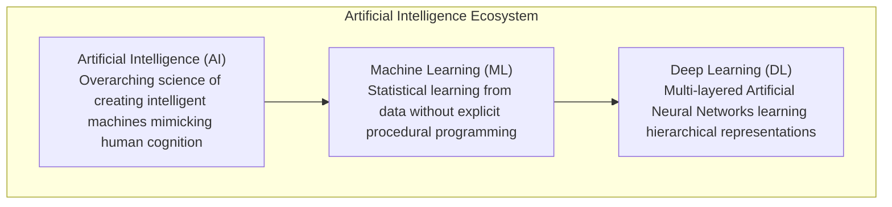
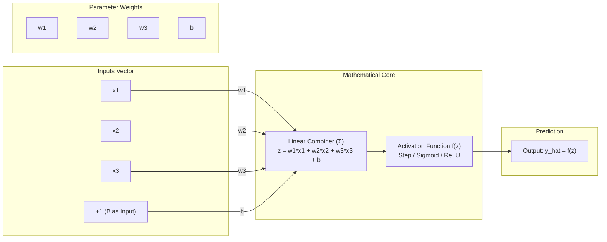

# Lecture 36: Deep Learning Foundations & Artificial Neurons

Welcome to the definitive master curriculum repository for **Lecture 36: Deep Learning Foundations (Part-1)**. This lecture marks the monumental transition from classical statistical Machine Learning into modern Deep Learning and Artificial Neural Networks.

Every groundbreaking frontier in modern artificial intelligence—from autonomous driving perception systems to Large Language Models (LLMs) like GPT-4 and Claude—is powered by multi-layered neural architectures. This course builds rigorous mathematical foundations in perceptron dynamics, activation functions, non-linear representation learning, hardware acceleration, and PyTorch implementations.

---

## Architectural Taxonomy: AI vs ML vs DL

---

## Core Concept: The Artificial Neuron (Perceptron)

The foundational building block of all neural networks is the artificial neuron, which computes a linear combination of input features weighted by synaptic parameters, offsets the sum with a bias, and evaluates an activation function:

### The Primary Mathematical Formulation:
$$z = \sum_{i=1}^n w_i x_i + b = \mathbf{w}^T \mathbf{x} + b$$
$$\hat{y} = f(z) = f(\mathbf{w}^T \mathbf{x} + b)$$

---

## Comprehensive Submodule Roadmap

This curriculum is organized into 10 structured topic submodules accompanied by an industrial practice suite. Every module features dual-language documentation (English `README.md` and Hinglish `README_HINGLISH.md`), visual whiteboard references, executable PyTorch notebooks, and compiled vector-grade PDFs:

| Submodule | Topic Title | Core Concepts & Formulas Covered | Asset Reference | Documentation Links |
| :--- | :--- | :--- | :--- | :--- |
| **36.01** | **What is Deep Learning?** | AI vs ML vs DL hierarchy, Big Data, GPU parallelization, real-world apps | `keyframe_01.png` | [English](file:///c:/Users/Shivam%20Keshari/OneDrive/Desktop/AI-ML/lecture_36/Notes_36.01/README.md) \| [Hinglish](file:///c:/Users/Shivam%20Keshari/OneDrive/Desktop/AI-ML/lecture_36/Notes_36.01/README_HINGLISH.md) |
| **36.02** | **ML vs Deep Learning** | Manual feature engineering vs automated learning, Andrew Ng scaling curve | `keyframe_01.png` | [English](file:///c:/Users/Shivam%20Keshari/OneDrive/Desktop/AI-ML/lecture_36/Notes_36.02/README.md) \| [Hinglish](file:///c:/Users/Shivam%20Keshari/OneDrive/Desktop/AI-ML/lecture_36/Notes_36.02/README_HINGLISH.md) |
| **36.03** | **What are Neural Networks?** | Biological neuron mapping, 3-layer ANN architecture (Input, Hidden, Output) | `keyframe_01.png` | [English](file:///c:/Users/Shivam%20Keshari/OneDrive/Desktop/AI-ML/lecture_36/Notes_36.03/README.md) \| [Hinglish](file:///c:/Users/Shivam%20Keshari/OneDrive/Desktop/AI-ML/lecture_36/Notes_36.03/README_HINGLISH.md) |
| **36.04** | **Perceptron (In Depth)** | Frank Rosenblatt model, weights, bias necessity, Step, Sigmoid, ReLU, training loop | `keyframe_01.png` | [English](file:///c:/Users/Shivam%20Keshari/OneDrive/Desktop/AI-ML/lecture_36/Notes_36.04/README.md) \| [Hinglish](file:///c:/Users/Shivam%20Keshari/OneDrive/Desktop/AI-ML/lecture_36/Notes_36.04/README_HINGLISH.md) |
| **36.05** | **Multi-Layered Networks** | XOR non-linearity limit, Multi-Layer Perceptron (MLP), Universal Approximation | `keyframe_01.png` | [English](file:///c:/Users/Shivam%20Keshari/OneDrive/Desktop/AI-ML/lecture_36/Notes_36.05/README.md) \| [Hinglish](file:///c:/Users/Shivam%20Keshari/OneDrive/Desktop/AI-ML/lecture_36/Notes_36.05/README_HINGLISH.md) |
| **36.06** | **PyTorch vs TF vs Keras** | Dynamic vs static computation graphs, research vs enterprise production | `keyframe_01.png` | [English](file:///c:/Users/Shivam%20Keshari/OneDrive/Desktop/AI-ML/lecture_36/Notes_36.06/README.md) \| [Hinglish](file:///c:/Users/Shivam%20Keshari/OneDrive/Desktop/AI-ML/lecture_36/Notes_36.06/README_HINGLISH.md) |
| **36.07** | **PyTorch Installation** | CPU vs CUDA GPU installation, hardware detection script | `pytorch_installation.png` | [English](file:///c:/Users/Shivam%20Keshari/OneDrive/Desktop/AI-ML/lecture_36/Notes_36.07/README.md) \| [Hinglish](file:///c:/Users/Shivam%20Keshari/OneDrive/Desktop/AI-ML/lecture_36/Notes_36.07/README_HINGLISH.md) |
| **36.08** | **Google Colab Setup** | Free NVIDIA T4 GPU cloud runtime, Drive integration, session limits | `keyframe_01.png` | [English](file:///c:/Users/Shivam%20Keshari/OneDrive/Desktop/AI-ML/lecture_36/Notes_36.08/README.md) \| [Hinglish](file:///c:/Users/Shivam%20Keshari/OneDrive/Desktop/AI-ML/lecture_36/Notes_36.08/README_HINGLISH.md) |
| **36.09** | **Building a Neuron (Code)**| `torch.tensor`, `nn.Linear(3, 1)`, forward pass, mathematical proof | [Notebook](file:///c:/Users/Shivam%20Keshari/OneDrive/Desktop/AI-ML/lecture_36/Notes_36.09/10_lecture_code_Neuron.ipynb) | [English](file:///c:/Users/Shivam%20Keshari/OneDrive/Desktop/AI-ML/lecture_36/Notes_36.09/README.md) \| [Hinglish](file:///c:/Users/Shivam%20Keshari/OneDrive/Desktop/AI-ML/lecture_36/Notes_36.09/README_HINGLISH.md) |
| **36.10** | **Neuron Code Walkthrough** | Cell-by-cell notebook execution, `@` matrix dot product verification | [Notebook](file:///c:/Users/Shivam%20Keshari/OneDrive/Desktop/AI-ML/lecture_36/Notes_36.10/10_lecture_code_Neuron.ipynb) | [English](file:///c:/Users/Shivam%20Keshari/OneDrive/Desktop/AI-ML/lecture_36/Notes_36.10/README.md) \| [Hinglish](file:///c:/Users/Shivam%20Keshari/OneDrive/Desktop/AI-ML/lecture_36/Notes_36.10/README_HINGLISH.md) |
| **Practice**| **Industrial Scenarios** | Cardiovascular diagnostic neuron, XOR mathematical proof, GPU VRAM sizing | Multiple | [English Questions](file:///c:/Users/Shivam%20Keshari/OneDrive/Desktop/AI-ML/lecture_36/Practice_Problems/README.md) \| [Hinglish Questions](file:///c:/Users/Shivam%20Keshari/OneDrive/Desktop/AI-ML/lecture_36/Practice_Problems/README_HINGLISH.md) \| [Solutions](file:///c:/Users/Shivam%20Keshari/OneDrive/Desktop/AI-ML/lecture_36/Practice_Problems/Solutions.md) |

---

## Comparison: Machine Learning vs Deep Learning

| Parameter | Traditional Machine Learning | Deep Learning |
| :--- | :--- | :--- |
| **Dataset Scale** | Effective on small to medium structured tabular data | Requires large datasets to avoid overfitting |
| **Feature Extraction** | Manual, handcrafted by domain experts | Automated hierarchical feature learning directly from raw data |
| **Hardware** | Optimized for standard CPUs | Requires GPU/TPU matrix acceleration |
| **Model Interpretability** | Glass Box (clear feature weights, decision trees) | Black Box (opaque parameter matrices) |
| **Data Modalities** | Tabular, numerical, categorical data | High-dimensional unstructured data (vision, audio, NLP) |
