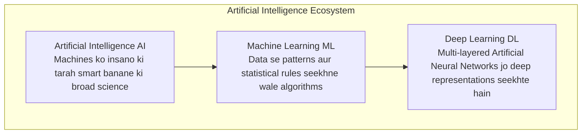
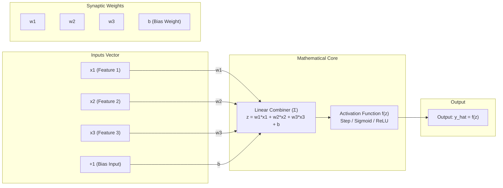

# Lecture 36: Deep Learning Foundations & Artificial Neurons (Hinglish)

Swagat hai **Lecture 36: Deep Learning Foundations (Part-1)** ke master curriculum repository mein! Yeh lecture classical Machine Learning se modern Deep Learning aur Artificial Neural Networks ki taraf ek aitihasik transition mark karta hai.

Duniya bhar ki modern AI technologies—jaise self-driving cars ka vision system, ChatGPT aur Claude jaise Large Language Models (LLMs)—multi-layered neural networks ke dum par hi chalti hain. Is module mein humne Perceptron ki mathematics, activation functions, non-linear representation learning, hardware acceleration, aur PyTorch code implementation ko zero se master kiya hai.

---

## AI, ML aur Deep Learning ka Hierarchy

---

## Core Concept: Artificial Neuron (Perceptron)

Neural Network ka sabse basic building block ek artificial neuron (Perceptron) hota hai. Yeh inputs ko weights se multiply karta hai, bias jodta hai, aur activation function se pass karke final output nikalta hai:

### Mukhya Mathematical Formula:
$$z = \sum_{i=1}^n w_i x_i + b = \mathbf{w}^T \mathbf{x} + b$$
$$\hat{y} = f(z) = f(\mathbf{w}^T \mathbf{x} + b)$$

---

## Comprehensive Submodule Roadmap

Is lecture ko 10 topic submodules aur 1 comprehensive industrial practice suite mein organize kiya gaya hai. Har module mein English aur Hinglish documentation, video whiteboard references, aur compiled PDFs shamil hain:

| Submodule | Topic Title | Key Concepts & Formulas | Asset Reference | Documentation Links |
| :--- | :--- | :--- | :--- | :--- |
| **36.01** | **What is Deep Learning?** | AI vs ML vs DL hierarchy, Big Data, GPU compute, real-world apps | `keyframe_01.png` | [English](file:///c:/Users/Shivam%20Keshari/OneDrive/Desktop/AI-ML/lecture_36/Notes_36.01/README.md) \| [Hinglish](file:///c:/Users/Shivam%20Keshari/OneDrive/Desktop/AI-ML/lecture_36/Notes_36.01/README_HINGLISH.md) |
| **36.02** | **ML vs Deep Learning** | Manual vs Automated feature engineering, Andrew Ng scaling curve | `keyframe_01.png` | [English](file:///c:/Users/Shivam%20Keshari/OneDrive/Desktop/AI-ML/lecture_36/Notes_36.02/README.md) \| [Hinglish](file:///c:/Users/Shivam%20Keshari/OneDrive/Desktop/AI-ML/lecture_36/Notes_36.02/README_HINGLISH.md) |
| **36.03** | **What are Neural Networks?** | Biological neuron mapping, 3-layer ANN architecture (Input, Hidden, Output) | `keyframe_01.png` | [English](file:///c:/Users/Shivam%20Keshari/OneDrive/Desktop/AI-ML/lecture_36/Notes_36.03/README.md) \| [Hinglish](file:///c:/Users/Shivam%20Keshari/OneDrive/Desktop/AI-ML/lecture_36/Notes_36.03/README_HINGLISH.md) |
| **36.04** | **Perceptron (In Depth)** | Frank Rosenblatt model, weights, bias necessity, Step, Sigmoid, ReLU, training loop | `keyframe_01.png` | [English](file:///c:/Users/Shivam%20Keshari/OneDrive/Desktop/AI-ML/lecture_36/Notes_36.04/README.md) \| [Hinglish](file:///c:/Users/Shivam%20Keshari/OneDrive/Desktop/AI-ML/lecture_36/Notes_36.04/README_HINGLISH.md) |
| **36.05** | **Multi-Layered Networks** | XOR non-linearity limit, Multi-Layer Perceptron (MLP), Universal Approximation | `keyframe_01.png` | [English](file:///c:/Users/Shivam%20Keshari/OneDrive/Desktop/AI-ML/lecture_36/Notes_36.05/README.md) \| [Hinglish](file:///c:/Users/Shivam%20Keshari/OneDrive/Desktop/AI-ML/lecture_36/Notes_36.05/README_HINGLISH.md) |
| **36.06** | **PyTorch vs TF vs Keras** | Dynamic vs static computation graphs, research vs enterprise production | `keyframe_01.png` | [English](file:///c:/Users/Shivam%20Keshari/OneDrive/Desktop/AI-ML/lecture_36/Notes_36.06/README.md) \| [Hinglish](file:///c:/Users/Shivam%20Keshari/OneDrive/Desktop/AI-ML/lecture_36/Notes_36.06/README_HINGLISH.md) |
| **36.07** | **PyTorch Installation** | CPU vs CUDA GPU installation, hardware detection script | `pytorch_installation.png` | [English](file:///c:/Users/Shivam%20Keshari/OneDrive/Desktop/AI-ML/lecture_36/Notes_36.07/README.md) \| [Hinglish](file:///c:/Users/Shivam%20Keshari/OneDrive/Desktop/AI-ML/lecture_36/Notes_36.07/README_HINGLISH.md) |
| **36.08** | **Google Colab Setup** | Free NVIDIA T4 GPU cloud runtime, Drive integration, session limits | `keyframe_01.png` | [English](file:///c:/Users/Shivam%20Keshari/OneDrive/Desktop/AI-ML/lecture_36/Notes_36.08/README.md) \| [Hinglish](file:///c:/Users/Shivam%20Keshari/OneDrive/Desktop/AI-ML/lecture_36/Notes_36.08/README_HINGLISH.md) |
| **36.09** | **Building a Neuron (Code)**| `torch.tensor`, `nn.Linear(3, 1)`, forward pass, mathematical proof | [Notebook](file:///c:/Users/Shivam%20Keshari/OneDrive/Desktop/AI-ML/lecture_36/Notes_36.09/10_lecture_code_Neuron.ipynb) | [English](file:///c:/Users/Shivam%20Keshari/OneDrive/Desktop/AI-ML/lecture_36/Notes_36.09/README.md) \| [Hinglish](file:///c:/Users/Shivam%20Keshari/OneDrive/Desktop/AI-ML/lecture_36/Notes_36.09/README_HINGLISH.md) |
| **36.10** | **Neuron Code Walkthrough** | Cell-by-cell notebook execution, `@` matrix dot product verification | [Notebook](file:///c:/Users/Shivam%20Keshari/OneDrive/Desktop/AI-ML/lecture_36/Notes_36.10/10_lecture_code_Neuron.ipynb) | [English](file:///c:/Users/Shivam%20Keshari/OneDrive/Desktop/AI-ML/lecture_36/Notes_36.10/README.md) \| [Hinglish](file:///c:/Users/Shivam%20Keshari/OneDrive/Desktop/AI-ML/lecture_36/Notes_36.10/README_HINGLISH.md) |
| **Practice**| **Industrial Scenarios** | Cardiovascular diagnostic neuron, XOR mathematical proof, GPU VRAM sizing | Multiple | [English Questions](file:///c:/Users/Shivam%20Keshari/OneDrive/Desktop/AI-ML/lecture_36/Practice_Problems/README.md) \| [Hinglish Questions](file:///c:/Users/Shivam%20Keshari/OneDrive/Desktop/AI-ML/lecture_36/Practice_Problems/README_HINGLISH.md) \| [Solutions](file:///c:/Users/Shivam%20Keshari/OneDrive/Desktop/AI-ML/lecture_36/Practice_Problems/Solutions.md) |
