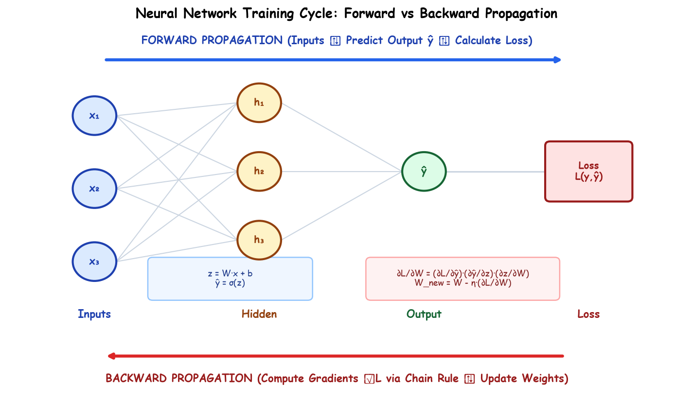

# Submodule 37.01: Forward & Backward Propagation

## 1. Introduction: The Dual Engine of Neural Network Training

Training an Artificial Neural Network (ANN) is fundamentally an iterative optimization process composed of two complementary mathematical phases executed in sequence:
1. **Forward Propagation (Inference Phase)**: Feature inputs flow from the input layer through successive hidden layers to compute an output prediction $\hat{y}$, culminating in loss evaluation against the true ground truth $y$.
2. **Backward Propagation (Credit Assignment & Optimization Phase)**: The calculated error signal is propagated backwards through the network via the calculus chain rule, calculating partial derivatives (gradients) of the loss function with respect to every learnable weight and bias parameter, which are subsequently updated by an optimization algorithm.



---

## 2. Mathematical Formalism of Forward Propagation

Consider a fully connected feedforward layer $l \in \{1, 2, \dots, L\}$:

### Step 1: Linear Combination (Affine Transformation)
$$z^{[l]} = W^{[l]} a^{[l-1]} + b^{[l]}$$
- $a^{[l-1]} \in \mathbb{R}^{n^{[l-1]}}$: Activation vector from the preceding layer (for $l=1$, $a^{[0]} = x$ is the raw feature input vector).
- $W^{[l]} \in \mathbb{R}^{n^{[l]} \times n^{[l-1]}}$: Synaptic weight matrix connecting layer $l-1$ to layer $l$.
- $b^{[l]} \in \mathbb{R}^{n^{[l]}}$: Learnable bias vector for layer $l$.
- $z^{[l]} \in \mathbb{R}^{n^{[l]}}$: Pre-activation linear combination vector.

### Step 2: Non-Linear Activation Mapping
$$a^{[l]} = g^{[l]}(z^{[l]})$$
- $g^{[l]}(\cdot)$: Activation function applied element-wise (e.g., ReLU for hidden layers, Sigmoid or Softmax for output layers).
- For the final layer $L$, the activation represents the model's hypothesis: $a^{[L]} = \hat{y}$.

### Step 3: Objective Loss Evaluation
Given ground truth target $y$ and model prediction $\hat{y}$:
$$\mathcal{L}(y, \hat{y})$$
- Evaluates the discrepancy or prediction penalty on a single training example.

---

## 3. Mathematical Formalism of Backward Propagation

Backpropagation computes the gradient of the scalar loss with respect to all parameter matrices using backward sensitivity vectors:

### Output Layer Error Signal
$$\delta^{[L]} = \frac{\partial \mathcal{L}}{\partial z^{[L]}} = \frac{\partial \mathcal{L}}{\partial a^{[L]}} \odot {g^{[L]}}'(z^{[L]})$$
where $\odot$ denotes the element-wise Hadamard product.

### Recursive Hidden Layer Error Propagation
For any preceding hidden layer $l = L-1, L-2, \dots, 1$:
$$\delta^{[l]} = \left( (W^{[l+1]})^T \delta^{[l+1]} \right) \odot {g^{[l]}}'(z^{[l]})$$

### Parameter Gradient Computation
$$\frac{\partial \mathcal{L}}{\partial W^{[l]}} = \delta^{[l]} (a^{[l-1]})^T$$
$$\frac{\partial \mathcal{L}}{\partial b^{[l]}} = \delta^{[l]}$$

---

## 4. Parameter Optimization (Gradient Descent Step)

Once gradients are computed across all layers, parameters are updated along the negative gradient direction scaled by the learning rate $\eta$:
$$W^{[l]} \leftarrow W^{[l]} - \eta \frac{\partial \mathcal{L}}{\partial W^{[l]}}$$
$$b^{[l]} \leftarrow b^{[l]} - \eta \frac{\partial \mathcal{L}}{\partial b^{[l]}}$$

---

## 5. Architectural Comparison: Forward vs Backward Pass

| Architectural Feature | Forward Propagation | Backward Propagation |
| :--- | :--- | :--- |
| **Direction of Flow** | Input Layer $\to$ Hidden Layers $\to$ Output Layer | Output Loss $\to$ Hidden Layers $\to$ Input Layer |
| **Primary Mathematical Operation** | Matrix-Vector Multiplications & Non-linearities | Transposed Matrix Multiplications & Derivatives (Chain Rule) |
| **Primary Objective** | Compute prediction $\hat{y}$ and scalar Loss $\mathcal{L}$ | Compute parameter gradients $\frac{\partial \mathcal{L}}{\partial W}, \frac{\partial \mathcal{L}}{\partial b}$ |
| **Memory Requirement** | Stores intermediate activations $z^{[l]}, a^{[l]}$ in cache | Consumes cached values to evaluate derivatives, then releases memory |
| **Execution Context** | Both Training and Inference / Production | Training Only |

---

## 6. Practical PyTorch Verification

```python
import torch
import torch.nn as nn

# 1. Reproducibility
torch.manual_seed(42)

# 2. Synthetic input feature vector x and ground truth y
x = torch.tensor([[1.5, -0.5, 2.0]], dtype=torch.float32)  # Shape: [1, 3]
y = torch.tensor([[1.0]], dtype=torch.float32)             # Shape: [1, 1]

# 3. Define 2-layer neural network
model = nn.Sequential(
    nn.Linear(in_features=3, out_features=4),
    nn.ReLU(),
    nn.Linear(in_features=4, out_features=1),
    nn.Sigmoid()
)

# 4. FORWARD PASS
y_hat = model(x)
criterion = nn.BCELoss()
loss = criterion(y_hat, y)
print(f"Forward Pass Output (y_hat): {y_hat.item():.4f}")
print(f"Computed Loss: {loss.item():.4f}")

# 5. BACKWARD PASS
model.zero_grad()
loss.backward()

# Inspect computed gradient for layer 1 weights
print("Layer 1 Weight Gradient Shape:", model[0].weight.grad.shape)
print("Layer 1 Weight Gradient Values:\n", model[0].weight.grad)
```\n