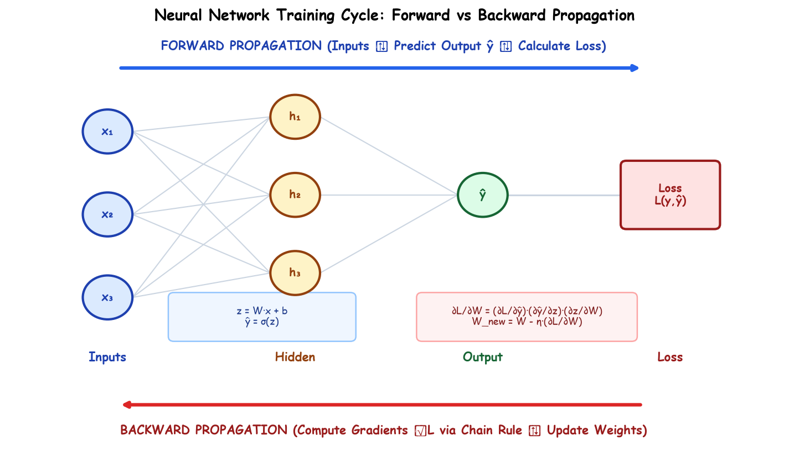

# Submodule 37.01: Forward & Backward Propagation (Hinglish)

## 1. Parichay: Neural Network Training ke Do Engine

Neural Network ko train karne ka process do sequential steps par adharit hota hai:
1. **Forward Propagation (Aage Badhne ka Phase)**: Input features pehle input layer me aate hain, fir hidden layers se guzar kar prediction $\hat{y}$ nikalte hain, aur aakhir me loss function se error evaluate hota hai.
2. **Backward Propagation (Peeche Lautne aur Seekhne ka Phase)**: Error nikalne ke baad, network peeche ki taraf chalta hai aur Calculus ke **Chain Rule** ki madad se har ek weight ($W$) aur bias ($b$) ka gradient nikal kar unhe update karta hai.

---

## 2. Forward Propagation ki Working

Forward pass me data hamesha left se right move karta hai:
1. **Linear Combination**:
   $$z = W \cdot x + b$$
   Yahan har input feature ko uske respective weight se multiply karke bias term joda jata hai.
2. **Activation Function**:
   $$a = g(z)$$
   Is linear sum par non-linear activation (jaise ReLU ya Sigmoid) apply kiya jata hai taaki model complex patterns seekh sake.
3. **Loss Calculation**:
   Model ke predicted output $\hat{y}$ aur actual ground truth $y$ ke beech ka loss calculate kiya jata hai.

---

## 3. Backward Propagation ki Working

Jab loss calculate ho jata hai, tab network **Gradient Descent** algorithm ki madad se seekhta hai:
- Network dekhta hai: *"Kis weight ki wajah se kitna error aaya?"*
- Is process ko calculate karne ke liye hum **Partial Derivatives** (Gradients) nikalte hain: $\frac{\partial \mathcal{L}}{\partial W}$ aur $\frac{\partial \mathcal{L}}{\partial b}$.
- Gradient nikalne ke baad naye weights update hote hain:
  $$W_{new} = W_{old} - \eta \cdot \frac{\partial \mathcal{L}}{\partial W}$$
  $$b_{new} = b_{old} - \eta \cdot \frac{\partial \mathcal{L}}{\partial b}$$

---

## 4. Forward vs Backward Pass ka Tulnatmak Chart

| Feature | Forward Propagation | Backward Propagation |
| :--- | :--- | :--- |
| **Direction** | Input $\to$ Hidden $\to$ Output | Output $\to$ Hidden $\to$ Input |
| **Main Kaam** | Output $\hat{y}$ aur Loss $\mathcal{L}$ nikalna | Gradients calculate karna aur Weights update karna |
| **Math Tool** | Matrix multiplication + Activation | Chain rule of derivatives |
| **Kab Chalta Hai?** | Training aur Testing (Deployment) dono me | Sirf aur sirf Training phase me |\n