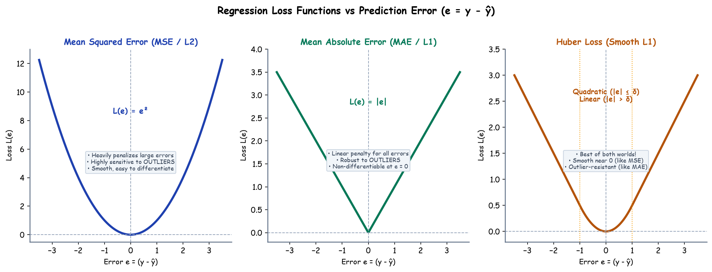

# Submodule 37.02: Loss Functions (Regression)

## 1. Loss vs Cost: The Precise Technical Distinction

In deep learning literature and engineering discussions, the terms *Loss* and *Cost* are frequently conflated, yet represent distinct concepts:
- **Loss Function $\mathcal{L}(y, \hat{y})$**: Measures the prediction error on a **single isolated sample** $(x_i, y_i)$.
- **Cost Function $J(\theta)$**: Measures the **aggregated average error** across the entire training dataset of $N$ samples:
  $$J(\theta) = \frac{1}{N} \sum_{i=1}^N \mathcal{L}(y^{(i)}, \hat{y}^{(i)})$$

---

## 2. Mean Squared Error (MSE / L2 Loss)

MSE is the classical standard loss function for continuous real-valued target estimation.

### Mathematical Formulation
$$\mathcal{L}_{MSE}(y, \hat{y}) = (y - \hat{y})^2$$
$$J_{MSE}(\theta) = \frac{1}{2N} \sum_{i=1}^N (y^{(i)} - \hat{y}^{(i)})^2$$
*(The scalar factor $\frac{1}{2}$ is intentionally introduced so that during derivative evaluation, the power of 2 cancels algebraically: $\frac{\partial}{\partial \hat{y}} [\frac{1}{2}(y - \hat{y})^2] = -(y - \hat{y})$).*

### Gradient Derivative
$$\frac{\partial J_{MSE}}{\partial \hat{y}} = -\frac{1}{N} \sum_{i=1}^N (y^{(i)} - \hat{y}^{(i)})$$

### Advantages & Disadvantages
- **Advantages**:
  1. Strictly convex and smooth everywhere with a continuous gradient.
  2. Penalizes small errors gently while forcing the model to prioritize correcting large discrepancies.
- **Critical Disadvantage**:
  1. **Extreme Outlier Sensitivity**: Because errors are squared, an outlier with error $e = 100$ produces a penalty of $10,000$, disproportionately dominating parameter updates and skewing the regression boundary away from the true underlying distribution.

---

## 3. Mean Absolute Error (MAE / L1 Loss)

MAE measures the linear distance between true and estimated targets without exponential amplification.

### Mathematical Formulation
$$\mathcal{L}_{MAE}(y, \hat{y}) = |y - \hat{y}|$$
$$J_{MAE}(\theta) = \frac{1}{N} \sum_{i=1}^N |y^{(i)} - \hat{y}^{(i)}|$$

### Gradient Derivative
$$\frac{\partial \mathcal{L}_{MAE}}{\partial \hat{y}} = \begin{cases} -1 & \text{if } y - \hat{y} > 0 \\ +1 & \text{if } y - \hat{y} < 0 \\ \text{undefined} & \text{if } y = \hat{y} \end{cases}$$

### Advantages & Disadvantages
- **Advantages**:
  1. **Outlier Robustness**: Large errors only contribute linearly ($e=100 \implies \text{penalty } 100$).
- **Disadvantages**:
  1. **Non-smooth Derivative at Zero**: At $e = 0$, the function is non-differentiable (requires subgradient calculus).
  2. Constant gradient magnitude $\pm 1$ causes updates to oscillate around the minimum rather than smoothly decelerating.

---

## 4. Huber Loss (Smooth L1 Loss)

Huber Loss unifies the optimal attributes of both MSE and MAE by transitioning smoothly between quadratic and linear regimes governed by threshold hyperparameter $\delta$:

### Mathematical Formulation
$$\mathcal{L}_{\delta}(y, \hat{y}) = \begin{cases} \frac{1}{2} (y - \hat{y})^2 & \text{if } |y - \hat{y}| \le \delta \\ \delta |y - \hat{y}| - \frac{1}{2}\delta^2 & \text{if } |y - \hat{y}| > \delta \end{cases}$$

### Architectural Behavior
- For small residual errors ($|e| \le \delta$): Becomes pure MSE $\implies$ smooth gradient deceleration to minimum.
- For large outlier errors ($|e| > \delta$): Becomes pure MAE $\implies$ linear scaling prevents outlier explosion.

---

## 5. Comparative Trade-off Matrix

| Metric Dimension | Mean Squared Error (MSE) | Mean Absolute Error (MAE) | Huber Loss (Smooth L1) |
| :--- | :--- | :--- | :--- |
| **Mathematical Formula** | $(y - \hat{y})^2$ | $|y - \hat{y}|$ | Piecewise Quadratic/Linear |
| **Gradient at $e = 0$** | Smoothly converges to $0$ | Discontinuous ($\pm 1$) | Smoothly converges to $0$ |
| **Outlier Sensitivity** | Severe (Quadratic explosion) | Low (Linear robustness) | Highly Robust (Linear beyond $\delta$) |
| **Computational Ease** | $O(1)$ analytic differentiation | Requires subgradient handling | Piecewise conditional logic |
| **PyTorch Equivalent** | `nn.MSELoss()` | `nn.L1Loss()` | `nn.HuberLoss(delta=1.0)` |\n