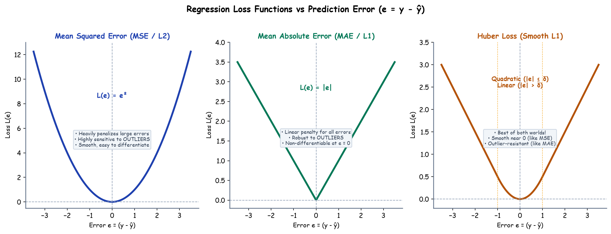

# Submodule 37.02: Loss Functions (Regression) (Hinglish)

## 1. Loss vs Cost: Sahi Technical Difference

Deep Learning me *Loss* aur *Cost* me ek mahatvapurna farak hota hai:
- **Loss Function**: Jab hum kisi **single sample** (ek record) ka error nikaalte hain, use Loss kehte hain.
- **Cost Function**: Jab hum poore dataset ke saare samples ka **average error** calculate karte hain, use Cost function kehte hain:
  $$J(\theta) = \frac{1}{N} \sum_{i=1}^N \mathcal{L}(y^{(i)}, \hat{y}^{(i)})$$

---

## 2. Regression ke Teen Mukhya Loss Functions

Regression problems (jahan target continuous number ho jaise house price ya temperature) ke liye teen popular loss functions hain:

### 1. Mean Squared Error (MSE / L2 Loss)
$$J_{MSE} = \frac{1}{2N} \sum (y - \hat{y})^2$$
- **Fayda**: Iska curve bilkul smooth parabola hota hai, isliye Gradient Descent aasani se minimum par pahunch jata hai. Formula me $\frac{1}{2}$ lagane se derivative lene par 2 se 2 cancel ho jata hai.
- **Nuksan**: Yeh **outliers ke prati bohot sensitive** hota hai. Agar kisi ek point par error 100 aa gaya, toh uska square 10,000 ban jata hai, jo poore model ko bhatka deta hai.

### 2. Mean Absolute Error (MAE / L1 Loss)
$$J_{MAE} = \frac{1}{N} \sum |y - \hat{y}|$$
- **Fayda**: Outliers ke aane par bhi model bhatakta nahi hai (kyunki error ka square nahi hota, sirf absolute value judti hai).
- **Nuksan**: Zero par iska slope sharp V-shape hota hai (differentiable nahi hota), jis wajah se minimum ke aas-paas steps bounce karte rehte hain.

### 3. Huber Loss (Dono ka Combination)
Huber loss MSE aur MAE ka hybrid model hai:
- Chhote errors ($|e| \le \delta$) ke liye MSE ki tarah quadratic behave karta hai.
- Bade errors ($|e| > \delta$) ke liye MAE ki tarah linear behave karta hai.
- Is wajah se yeh smooth bhi rehta hai aur outliers se immune bhi!\n