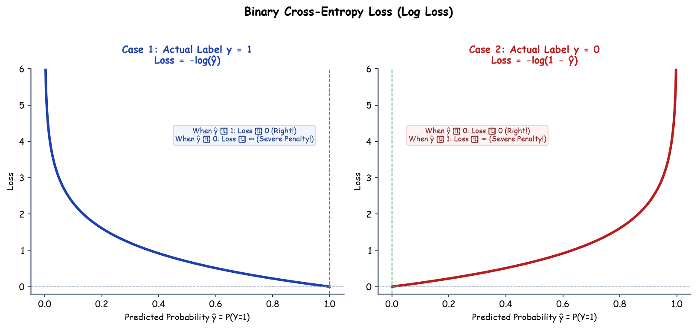

# Submodule 37.03: Loss Functions (Classification)

## 1. Introduction: Probability Penalty Dynamics

In classification problems, target outputs represent discrete category assignments rather than continuous magnitudes. Consequently, neural networks output estimated probabilities bounded in $[0, 1]$. Measuring discrepancy via Euclidean distance (MSE) on probabilities creates non-convex loss surfaces plagued with local minima. 

The industry standard loss framework is **Cross-Entropy Loss**, derived directly from the principle of **Maximum Likelihood Estimation (MLE)** in information theory.

---

## 2. Binary Cross-Entropy Loss (BCE / Log Loss)

For binary classification problems where target $y \in \{0, 1\}$ and model output $\hat{y} = P(Y=1|x) \in (0, 1)$:

### Single-Sample Formulation
$$\mathcal{L}_{BCE}(y, \hat{y}) = -\Big[ y \log(\hat{y}) + (1 - y) \log(1 - \hat{y}) \Big]$$

### Full Dataset Cost Formulation
$$J_{BCE}(\theta) = -\frac{1}{N} \sum_{i=1}^N \Big[ y^{(i)} \log(\hat{y}^{(i)}) + (1 - y^{(i)}) \log(1 - \hat{y}^{(i)}) \Big]$$

### Case-by-Case Mathematical Mechanics
1. **Case 1: Actual Ground Truth $y = 1$**:
   $$\mathcal{L} = -\log(\hat{y})$$
   - If $\hat{y} \to 1$: Loss $\to -\log(1) = 0$ (Virtually zero penalty).
   - If $\hat{y} \to 0$: Loss $\to -\log(0) \to +\infty$ (Asymptotic exponential penalty for confident incorrect prediction).
2. **Case 2: Actual Ground Truth $y = 0$**:
   $$\mathcal{L} = -\log(1 - \hat{y})$$
   - If $\hat{y} \to 0$: Loss $\to -\log(1) = 0$.
   - If $\hat{y} \to 1$: Loss $\to -\log(0) \to +\infty$.

### Output Layer Activation
- Hidden layers employ **ReLU**.
- The output layer utilizes a **Sigmoid Activation Function**:
  $$\hat{y} = \sigma(z) = \frac{1}{1 + e^{-z}}$$

---

## 3. Categorical Cross-Entropy Loss (Multi-Class Classification)

When classifying input samples into $C > 2$ mutually exclusive classes (e.g., Cat, Dog, Bird), target vectors are **One-Hot Encoded**:
$$y^{(i)} = \begin{bmatrix} y_1 & y_2 & \dots & y_C \end{bmatrix}^T, \quad y_c \in \{0, 1\}, \quad \sum_{c=1}^C y_c = 1$$

### Single-Sample Formulation
$$\mathcal{L}_{CCE}(y, \hat{y}) = -\sum_{c=1}^C y_c \log(\hat{y}_c)$$

### Output Layer: The Softmax Activation
To guarantee that output predictions across all $C$ neurons constitute a valid probability distribution (summing to exactly $1.0$):
$$\hat{y}_c = \text{Softmax}(z_c) = \frac{e^{z_c}}{\sum_{j=1}^C e^{z_j}}, \quad \forall c \in \{1, \dots, C\}$$

### Numerical Stability: Log-Sum-Exp Trick
Direct exponentiation in Softmax risks floating-point overflow for large $z_c$. Deep learning engines stabilize evaluation by subtracting the maximum component:
$$\text{Softmax}(z_c) = \frac{e^{z_c - \max(z)}}{\sum_{j=1}^C e^{z_j - \max(z)}}$$

---

## 4. Sparse Categorical Cross-Entropy

- **Standard Categorical Cross-Entropy**: Expects target $y$ formatted as dense one-hot vectors (`[0, 1, 0, 0]`). Memory-intensive for hundreds or thousands of classes.
- **Sparse Categorical Cross-Entropy**: Accepts integer scalar labels directly (e.g., `class_idx = 1`), performing internal indexing without allocating one-hot memory.

---

## 5. Architectural Summary Table

| Classification Task | Output Classes | Output Layer Neurons | Output Activation | Standard Loss Function | PyTorch Implementation |
| :--- | :--- | :--- | :--- | :--- | :--- |
| **Binary Classification** | 2 mutually exclusive | 1 | Sigmoid $\sigma(z)$ | Binary Cross-Entropy | `nn.BCELoss()` or `nn.BCEWithLogitsLoss()` |
| **Multi-Class Classification** | $C > 2$ mutually exclusive | $C$ | Softmax | Categorical Cross-Entropy | `nn.CrossEntropyLoss()` |
| **Multi-Label Classification** | Multiple concurrent labels | $C$ | Sigmoid per node | Binary Cross-Entropy per node | `nn.BCEWithLogitsLoss()` |\n