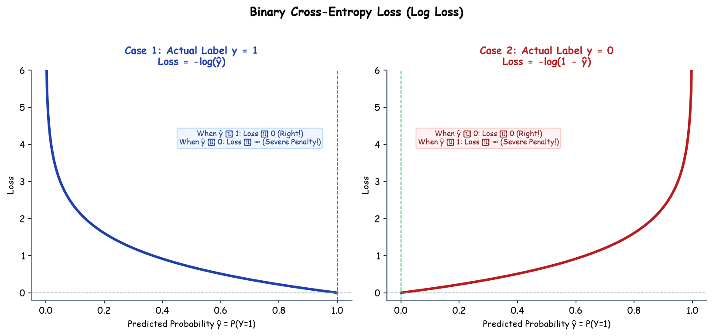

# Submodule 37.03: Loss Functions (Classification) (Hinglish)

## 1. Classification me Cross-Entropy kyun zaroori hai?

Classification problems me target ek category (jaise Dog vs Cat, ya Spam vs Ham) hoti hai. Yahan model probabilities predict karta hai (0 se 1 ke beech).
Agar hum probability par normal MSE loss lagayenge toh optimization surface bohot uneven aur plateau se bhari ban jati hai. Isiliye hum **Cross-Entropy Loss** use karte hain.

---

## 2. Binary Cross-Entropy (BCE / Log Loss)

Jab sirf 2 classes hon ($y = 0$ ya $y = 1$):
$$J_{BCE} = -\frac{1}{N} \sum [y \log(\hat{y}) + (1 - y) \log(1 - \hat{y})]$$

- **Agar actual label $y = 1$ hai**:
  Formula ban jata hai $-\log(\hat{y})$. Agar model ne $0.99$ predict kiya toh loss lagbhag $0$ hoga. Lekin agar model ne confidence ke saath galat prediction ($0.01$) de diya, toh $-\log(0.01)$ bohot bada penalty generate karega.
- **Architecture**:
  - Hidden layers me **ReLU** lagta hai.
  - Final output neuron me **Sigmoid** lagta hai: $\sigma(z) = \frac{1}{1 + e^{-z}}$.

---

## 3. Categorical Cross-Entropy (Multi-Class Classification)

Jab 2 se zyada classes hon (jaise Car, Bike, Truck):
1. **Target Encoding**: Labels ko **One-Hot Encoding** me convert kiya jata hai (jaise Class 2 $\to [0, 1, 0]$).
2. **Output Layer**: Output layer me utne hi neurons hote hain jitni classes hain ($C$).
3. **Softmax Activation**: Saare output neurons par **Softmax** lagta hai jo saare outputs ka sum $1.0$ (100% probability) bana deta hai:
   $$\hat{y}_c = \frac{e^{z_c}}{\sum_{j=1}^C e^{z_j}}$$
4. **Loss Formula**:
   $$\mathcal{L} = -\sum_{c=1}^C y_c \log(\hat{y}_c)$$\n