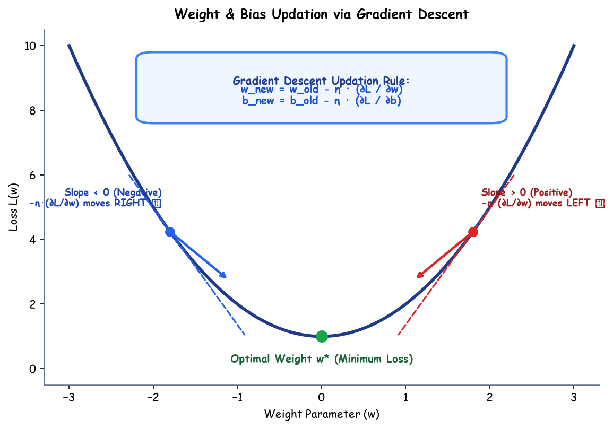

# Submodule 37.04: Weight & Bias Updation

## 1. Introduction to Parameter Optimization

Once the loss function evaluates the discrepancy between predictions and ground truth, the network updates its internal parameter tensors (weights $W$ and biases $b$) via **Gradient Descent**. Gradient Descent determines the magnitude and direction of adjustment necessary to move down the loss landscape towards the minimum.

---

## 2. The Core Parameter Update Equations

For any learnable weight parameter $w$ and bias parameter $b$:

$$w_{\text{new}} = w_{\text{old}} - \eta \cdot \frac{\partial \mathcal{L}}{\partial w}$$

$$b_{\text{new}} = b_{\text{old}} - \eta \cdot \frac{\partial \mathcal{L}}{\partial b}$$

### Parameter Deconstruction
- $w_{\text{old}}, b_{\text{old}}$: Current numerical parameter values before optimization step.
- $\eta$ (Eta): The **Learning Rate** hyperparameter (controls step size along the gradient vector).
- $\frac{\partial \mathcal{L}}{\partial w}, \frac{\partial \mathcal{L}}{\partial b}$: Partial derivatives representing the **Slope / Gradient** of the loss surface with respect to that parameter.
- The negative sign ($-$) ensures movement occurs in the direction of **steepest descent**.

---

## 3. Mathematical Mechanics: Why Does the Formula Always Converge?

### Case 1: Point is on the Right of the Minimum (Positive Slope)
- Slope $\frac{\partial \mathcal{L}}{\partial w} > 0$ (Tangent angles upward).
- Formula calculation:
  $$w_{\text{new}} = w_{\text{old}} - \eta \cdot (+ \text{value}) = w_{\text{old}} - \text{positive} < w_{\text{old}}$$
- **Result**: $w$ decreases, moving **LEFT** $\leftarrow$ directly towards the minimum!

### Case 2: Point is on the Left of the Minimum (Negative Slope)
- Slope $\frac{\partial \mathcal{L}}{\partial w} < 0$ (Tangent angles downward).
- Formula calculation:
  $$w_{\text{new}} = w_{\text{old}} - \eta \cdot (- \text{value}) = w_{\text{old}} + \text{positive} > w_{\text{old}}$$
- **Result**: $w$ increases, moving **RIGHT** $\rightarrow$ directly towards the minimum!

---

## 4. The Critical Role of the Learning Rate ($\eta$)

| Learning Rate Setting | Dynamic Behavior on Loss Curve | Training Outcome |
| :--- | :--- | :--- |
| **Too Large ($\eta \gg 0.1$)** | Steps overshoot the global minimum, oscillating wildly and potentially diverging ($L \to \infty$). | Divergence / Exploding weights |
| **Too Small ($\eta \ll 0.0001$)** | Steps are microscopic; requires millions of iterations to converge. | Training stalls / Trapped in saddle points |
| **Optimal (e.g., $0.001 - 0.01$)** | Smooth, steady progression decelerating naturally as slope approaches zero. | Rapid, stable convergence |\n