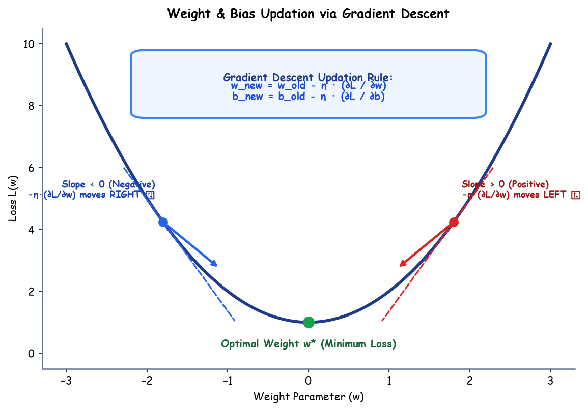

# Submodule 37.04: Weight & Bias Updation (Hinglish)

## 1. Weights aur Biases Update Kaise Hote Hain?

Jab model ka loss nikal jata hai, tab network ke andar ke **Weights ($W$)** aur **Biases ($b$)** ko Gradient Descent ke zariye update kiya jata hai taaki agle round me error kam ho sake.

---

## 2. Updation ka Golden Formula

$$w_{new} = w_{old} - \eta \cdot \frac{\partial \mathcal{L}}{\partial w}$$

$$b_{new} = b_{old} - \eta \cdot \frac{\partial \mathcal{L}}{\partial b}$$

- **$w_{old}$**: Purana weight.
- **$\eta$ (Learning Rate)**: Step ka size tay karta hai ki kitni tezi se aage badhna hai.
- **$\frac{\partial \mathcal{L}}{\partial w}$**: Curve ka slope (gradient).
- **Minus ($-$) sign**: Hamesha slope ke ulti direction me chalkar minima tak pahunchata hai.

---

## 3. Mathematical Intuition: Yeh Formula Hamesha Kaam Kyun Karta Hai?

1. **Agar hum minimum ke Right side khade hain (Positive Slope)**:
   - Slope positive hai ($>0$).
   - Formula: $w_{new} = w_{old} - (\text{positive})$.
   - Weight kam hoga aur **Left ki taraf** minimum ki ore shift hoga!
2. **Agar hum minimum ke Left side khade hain (Negative Slope)**:
   - Slope negative hai ($<0$).
   - Formula: $w_{new} = w_{old} - (-\text{value}) = w_{old} + \text{value}$.
   - Weight badhega aur **Right ki taraf** minimum ki ore shift hoga!

Dono hi suraton me yeh formula points ko kheench kar minimum tak le aata hai!\n