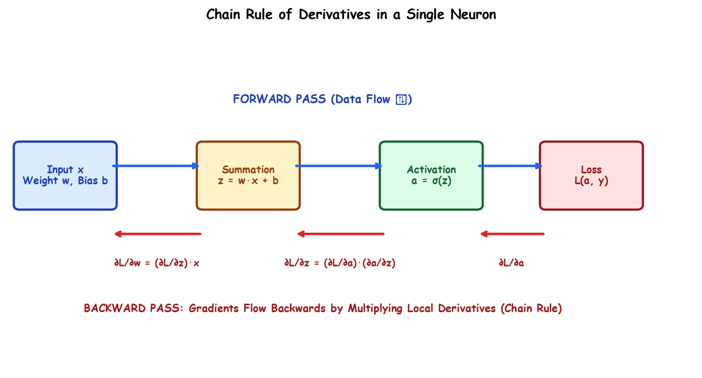

# Submodule 37.05: Chain Rule of Derivatives in Neural Networks

## 1. Calculus Foundation: The Multi-Variable Chain Rule

In elementary calculus, if variable $y$ is a function of intermediate variable $u$, which in turn is a function of independent variable $x$ ($y = f(u)$ where $u = g(x)$), the rate of change of $y$ with respect to $x$ cannot be evaluated directly. It is computed via the **Chain Rule**:
$$\frac{dy}{dx} = \frac{dy}{du} \cdot \frac{du}{dx}$$

---

## 2. Why is the Chain Rule Mandatory for Neural Networks?

In an Artificial Neural Network, the final scalar loss $\mathcal{L}$ is computed at the output layer, whereas the adjustable synaptic weights (e.g., $w_1$ in an early layer) reside deep inside preceding layers.

The loss function $\mathcal{L}$ **does not contain weight parameters explicitly in its definition**. For example, in MSE:
$$\mathcal{L} = \frac{1}{2} (y - \hat{y})^2$$
Here $\mathcal{L}$ directly depends on prediction $\hat{y}$. But $\hat{y}$ depends on activation $a$, which depends on linear combination $z$, which finally depends on weight $w$.

Because of this composite dependency chain:
$$w \longrightarrow z \longrightarrow a \longrightarrow \mathcal{L}$$
evaluating the sensitivity gradient $\frac{\partial \mathcal{L}}{\partial w}$ requires traversing this computational graph in reverse using the chain rule.

---

## 3. Step-by-Step Mathematical Derivation for a Single Neuron

Consider an artificial neuron:
1. **Linear Summation**: $z = w x + b$
2. **Activation Output**: $\hat{y} = a = \sigma(z)$
3. **Squared Error Loss**: $\mathcal{L} = \frac{1}{2} (y - a)^2$

To find $\frac{\partial \mathcal{L}}{\partial w}$:
$$\frac{\partial \mathcal{L}}{\partial w} = \frac{\partial \mathcal{L}}{\partial a} \cdot \frac{\partial a}{\partial z} \cdot \frac{\partial z}{\partial w}$$

### Evaluating Local Derivatives:
1. **Local Gradient 1**: $\frac{\partial \mathcal{L}}{\partial a} = \frac{\partial}{\partial a}\left[ \frac{1}{2}(y - a)^2 \right] = -(y - a)$
2. **Local Gradient 2**: $\frac{\partial a}{\partial z} = \sigma'(z) = \sigma(z)(1 - \sigma(z)) = a(1 - a)$
3. **Local Gradient 3**: $\frac{\partial z}{\partial w} = \frac{\partial}{\partial w}(wx + b) = x$

### Assembling the Composite Gradient:
$$\frac{\partial \mathcal{L}}{\partial w} = -(y - a) \cdot a(1 - a) \cdot x$$

Similarly, for the bias parameter $b$:
$$\frac{\partial \mathcal{L}}{\partial b} = \frac{\partial \mathcal{L}}{\partial a} \cdot \frac{\partial a}{\partial z} \cdot \frac{\partial z}{\partial b} = -(y - a) \cdot a(1 - a) \cdot 1$$

---

## 4. Multi-Layer Backpropagation Extension

In a multi-layer network with hidden layers:
$$\frac{\partial \mathcal{L}}{\partial W^{[1]}} = \frac{\partial \mathcal{L}}{\partial a^{[2]}} \cdot \frac{\partial a^{[2]}}{\partial z^{[2]}} \cdot \frac{\partial z^{[2]}}{\partial a^{[1]}} \cdot \frac{\partial a^{[1]}}{\partial z^{[1]}} \cdot \frac{\partial z^{[1]}}{\partial W^{[1]}}$$

Gradients flow seamlessly backwards layer-by-layer, where each node computes its local Jacobian and multiplies it with the upstream gradient signal.\n