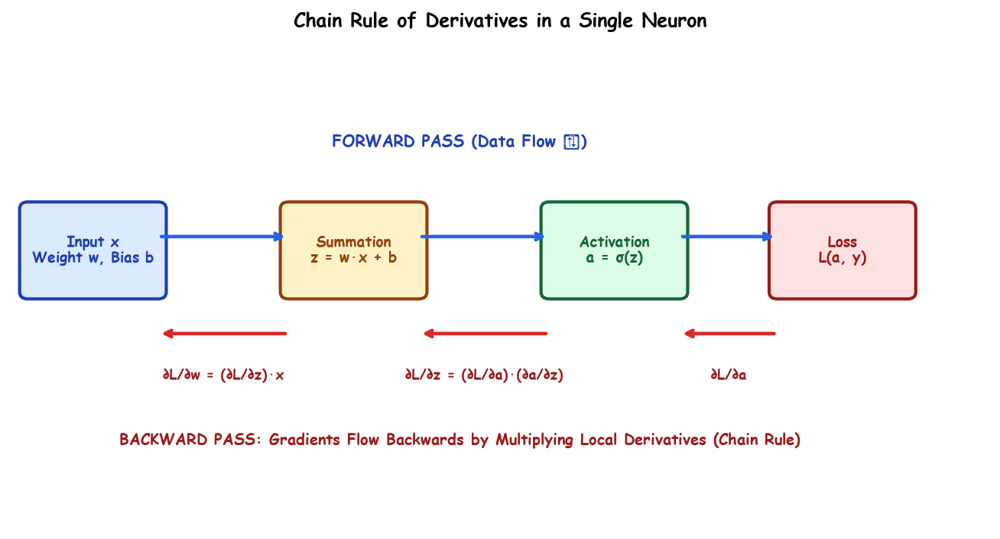

# Submodule 37.05: Chain Rule of Derivatives in Neural Networks (Hinglish)

## 1. Chain Rule kya hai aur iski zaroorat kyun hai?

Calculus me Chain Rule ka seedha matlab hota hai: agar $y$ depend karta hai $u$ par, aur $u$ depend karta hai $x$ par, toh $y$ ka derivative $x$ ke respect me nikalne ke liye hum dono intermediate derivatives ko aapas me multiply karte hain:
$$\frac{dy}{dx} = \frac{dy}{du} \cdot \frac{du}{dx}$$

---

## 2. Neural Networks me Chain Rule ki Zaroorat

Neural network me jab hum loss nikaalte hain, toh loss formula ke andar direct weight $w$ nahi hota!
- Loss $\mathcal{L}$ depend karta hai output prediction $a$ par.
- Output $a$ depend karta hai linear sum $z$ par.
- Linear sum $z = w x + b$ depend karta hai weight $w$ aur bias $b$ par.

Dependency chain aisi banti hai:
$$w \longrightarrow z \longrightarrow a \longrightarrow \mathcal{L}$$

Isiliye agar hume weight update karne ke liye $\frac{\partial \mathcal{L}}{\partial w}$ nikaalna hai, toh hume Chain Rule lagana padta hai:
$$\frac{\partial \mathcal{L}}{\partial w} = \frac{\partial \mathcal{L}}{\partial a} \cdot \frac{\partial a}{\partial z} \cdot \frac{\partial z}{\partial w}$$

Har layer ka local derivative peeche se aane wale error signal ke saath multiply hokar sabhi weights tak pahunch jata hai!\n