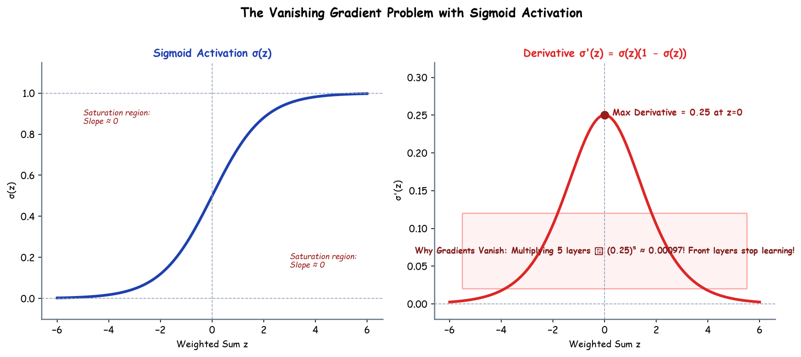

# Submodule 37.06: The Vanishing Gradient Problem

## 1. Introduction: The Barrier to Deep Architectures

Historically, stacking dozens of layers in deep neural networks consistently resulted in degraded performance rather than enhanced representation learning. This failure was primarily caused by the **Vanishing Gradient Problem**, first rigorously analyzed by Sepp Hochreiter in 1991 and Yoshua Bengio in 1994.

In deep networks trained with traditional saturating activation functions (like Sigmoid or Tanh), backpropagated error gradients shrink exponentially as they travel backward from the output layer to early layers, reducing updates in front layers to numerical insignificance.

---

## 2. Mathematical Root Cause Analysis

Consider a deep neural network of $L$ sequential linear layers activated by the Sigmoid function $\sigma(z)$:
$$a^{[l]} = \sigma(z^{[l]}), \quad z^{[l]} = W^{[l]} a^{[l-1]} + b^{[l]}$$

Applying the Chain Rule to compute the gradient of loss $\mathcal{L}$ with respect to the initial layer's weight $W^{[1]}$:
$$\frac{\partial \mathcal{L}}{\partial W^{[1]}} = \frac{\partial \mathcal{L}}{\partial a^{[L]}} \cdot \left[ \prod_{l=2}^L \frac{\partial a^{[l]}}{\partial a^{[l-1]}} \right] \cdot \frac{\partial a^{[1]}}{\partial z^{[1]}} \cdot \frac{\partial z^{[1]}}{\partial W^{[1]}}$$

Expanding each intermediate Jacobian factor:
$$\frac{\partial a^{[l]}}{\partial a^{[l-1]}} = \frac{\partial a^{[l]}}{\partial z^{[l]}} \cdot \frac{\partial z^{[l]}}{\partial a^{[l-1]}} = \sigma'(z^{[l]}) \cdot W^{[l]}$$

Therefore:
$$\frac{\partial \mathcal{L}}{\partial W^{[1]}} = \frac{\partial \mathcal{L}}{\partial a^{[L]}} \cdot \left[ \prod_{l=2}^L \sigma'(z^{[l]}) W^{[l]} \right] \cdot \sigma'(z^{[1]}) \cdot a^{[0]}$$

---

## 3. The Derivative Saturation Bottleneck

The derivative of the Sigmoid function is mathematically bounded:
$$\sigma'(z) = \sigma(z)(1 - \sigma(z))$$

- **Maximum Value**: The maximum possible value of $\sigma'(z)$ occurs strictly at $z = 0$:
  $$\sigma'(0) = 0.5 \times (1 - 0.5) = 0.25$$
- **Everywhere Else**: As $|z| > 0$, $\sigma'(z) < 0.25$.
- **Saturation Regions**: For $|z| \ge 4$, $\sigma'(z) \to 0$.

### Exponential Decay Dynamics
When backpropagating through $L = 6$ hidden layers:
$$\prod_{l=1}^6 \sigma'(z^{[l]}) \le (0.25)^6 = \frac{1}{4096} \approx 0.000244$$

Even if weights are of unit scale, the gradient shrinks by over four orders of magnitude before reaching $W^{[1]}$:
$$W_{\text{new}}^{[1]} = W_{\text{old}}^{[1]} - \eta \cdot (0.000244 \cdot \text{signal}) \approx W_{\text{old}}^{[1]}$$

**Consequence**: The early feature-extracting layers cannot learn, rendering depth useless!

---

## 4. Modern Solutions to Vanishing Gradients

1. **Non-Saturating Activation Functions**: Replacing Sigmoidal activations with **ReLU** or its variants (derivative is constant $1.0$ for $z > 0$).
2. **Proper Weight Initialization**: Using **He (Kaiming) Initialization** for ReLU or **Xavier (Glorot) Initialization** for Tanh to preserve activation variance across layers.
3. **Residual Skip Connections (ResNets)**: Adding identity bypass shortcuts ($a^{[l]} = g(z^{[l]}) + a^{[l-1]}$) so gradients can flow directly backward unimpeded ($+1$ term).
4. **Batch Normalization**: Constraining activations to stable zero-mean unit-variance ranges, avoiding saturation regions.\n