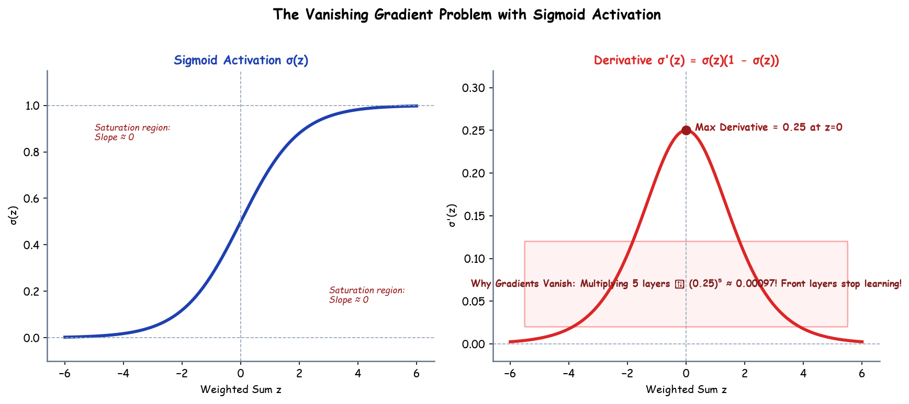

# Submodule 37.06: The Vanishing Gradient Problem (Hinglish)

## 1. Vanishing Gradient Problem kya hai?

Jab hum deep neural network banate hain (jisme bohot saari hidden layers hoti hain), tab training ke dauran ek bohot badi problem aati hai jise **Vanishing Gradient Problem** kehte hain.
Is problem me jaise-jaise error ka signal peeche ki layers (layer 1 aur 2) ki taraf jata hai, gradient ka size itna chhota ho jata hai ki wo lagbhag **0** ban jata hai!

Natija:
$$w_{new} = w_{old} - \eta \cdot (0.00001) \approx w_{old}$$
Pehli layers ke weights update hi nahi hote, aur network kuch seekh hi nahi pata!

---

## 2. Yeh Problem Kyun Aati Hai? (Root Cause)

Iska sabse bada kaaran hai purane activation functions (jaise **Sigmoid**):
1. **Sigmoid ka derivative bohot chhota hota hai**:
   $$\sigma'(z) = \sigma(z)(1 - \sigma(z))$$
   Iska **maximum derivative sirf 0.25** hota hai (jab $z = 0$ ho). Baki sab jagah yeh $0.25$ se bhi chhota hota hai.
2. **Chain Rule me Continuous Multiplication**:
   Agar network me 5 hidden layers hain, toh gradient me 5 baar derivative multiply hoga:
   $$(0.25)^5 = 0.00097$$
   Itna chhota number multiply hone se gradient gayab (vanish) ho jata hai!

---

## 3. Iska Solution kya hai?

1. **ReLU Activation Use Karna**: Hidden layers me Sigmoid hata kar **ReLU** lagana (kyunki positive values ke liye ReLU ka derivative hamesha $1.0$ rehta hai, kabhi vanish nahi hota).
2. **He / Kaiming Initialization**: Weights ko sahi variance ke saath shuru karna.
3. **Residual Connections (ResNet)**: Skip connections lagana taaki gradient seedhe bypass ho sake.\n