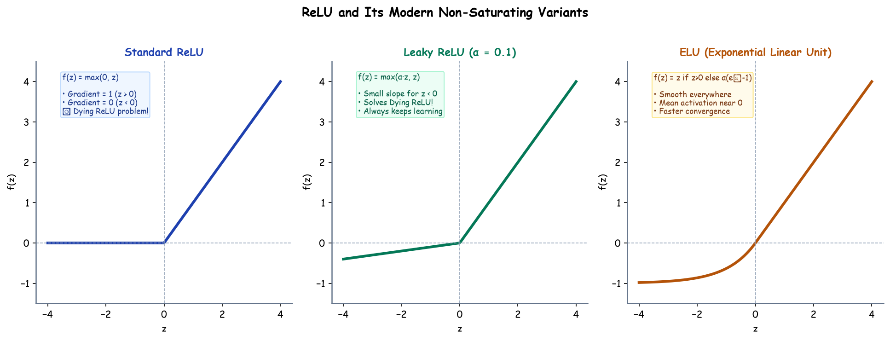

# Submodule 37.07: ReLU & its Variants

## 1. Introduction: The Universal Non-Saturating Standard

The **Rectified Linear Unit (ReLU)**, introduced to deep learning by Nair & Hinton (2010) and popularized by AlexNet (2012), is the most widely adopted activation function for hidden layers in modern deep architectures. It decisively resolved the vanishing gradient bottleneck of sigmoidal units while being computationally trivial.

---

## 2. Standard ReLU (Rectified Linear Unit)

### Mathematical Formulation
$$f(z) = \max(0, z) = \begin{cases} z & \text{if } z \ge 0 \\ 0 & \text{if } z < 0 \end{cases}$$

### First Derivative
$$f'(z) = \begin{cases} 1 & \text{if } z > 0 \\ 0 & \text{if } z < 0 \\ \text{subgradient } [0, 1] & \text{if } z = 0 \end{cases}$$

### Key Advantages:
1. **No Saturation for Positive Activations**: Derivative is strictly $1.0$ for any positive $z$, eliminating gradient decay.
2. **Extreme Computational Efficiency**: Involves a single comparison threshold ($z > 0$) rather than transcendental exponentiation ($e^z$).
3. **Sparse Representation**: Biologically plausible sparsity; neurons with negative pre-activations output true zeros.

### The "Dying ReLU" Failure Mode:
If a neuron receives large negative updates that cause $z = w^T x + b < 0$ for all training samples:
- Activation $a = 0$
- Gradient $f'(z) = 0$
- Weight update $\Delta w = -\eta \cdot 0 = 0$
The neuron permanently "dies", becoming an inactive zero-generator for the remainder of training.

---

## 3. Leaky ReLU

To eliminate the Dying ReLU pathology, Maas et al. (2013) introduced **Leaky ReLU**, providing a gentle slope for negative inputs:

### Mathematical Formulation
$$f(z) = \max(\alpha z, z) = \begin{cases} z & \text{if } z \ge 0 \\ \alpha z & \text{if } z < 0 \end{cases}$$
where $\alpha$ is a fixed small hyperparameter (typically $\alpha = 0.01$).

### Derivative
$$f'(z) = \begin{cases} 1 & \text{if } z > 0 \\ \alpha & \text{if } z < 0 \end{cases}$$
Since $f'(z) = 0.01 \ne 0$ for negative values, gradients never collapse to absolute zero, allowing dead neurons to recover.

---

## 4. Parametric ReLU (PReLU)

He et al. (2015) generalized Leaky ReLU by treating the slope parameter $\alpha$ as a **learnable parameter** optimized via backpropagation:
$$\frac{\partial \mathcal{L}}{\partial \alpha} = \sum_{i} \frac{\partial \mathcal{L}}{\partial a_i} \cdot \frac{\partial a_i}{\partial \alpha}, \quad \frac{\partial a_i}{\partial \alpha} = \begin{cases} 0 & \text{if } z_i \ge 0 \\ z_i & \text{if } z_i < 0 \end{cases}$$
- If $\alpha = 0$, behaves as standard ReLU.
- If $\alpha = 0.01$, behaves as Leaky ReLU.
- Allows each individual channel/layer to adaptively discover its optimal negative activation slope.

---

## 5. Exponential Linear Unit (ELU)

Clevert et al. (2015) proposed **ELU** to ensure smooth differentiability and push mean activations closer to zero:

### Mathematical Formulation
$$f(z) = \begin{cases} z & \text{if } z > 0 \\ \alpha(e^z - 1) & \text{if } z \le 0 \end{cases}$$

### Derivative
$$f'(z) = \begin{cases} 1 & \text{if } z > 0 \\ f(z) + \alpha & \text{if } z \le 0 \end{cases}$$

- Smooth everywhere, including at $z = 0$ when $\alpha = 1$.
- Negative saturation region ($	o -\alpha$) provides noise robustness.

---

## 6. Comprehensive Activation Comparison Matrix

| Function Name | Formula for $z < 0$ | Gradient for $z < 0$ | Solves Vanishing Gradient? | Solves Dying ReLU? | Computational Cost |
| :--- | :--- | :--- | :--- | :--- | :--- |
| **Standard ReLU** | $0$ | $0$ | Yes ($z > 0$) | No | Lowest ($O(1)$) |
| **Leaky ReLU** | $\alpha z$ (fixed $\alpha=0.01$) | $\alpha = 0.01$ | Yes | Yes | Lowest |
| **Parametric ReLU** | $\alpha z$ (learnable $\alpha$) | $\alpha$ (parameter) | Yes | Yes | Very Low |
| **ELU** | $\alpha(e^z - 1)$ | $\alpha e^z$ | Yes | Yes | Moderate (exponential) |\n