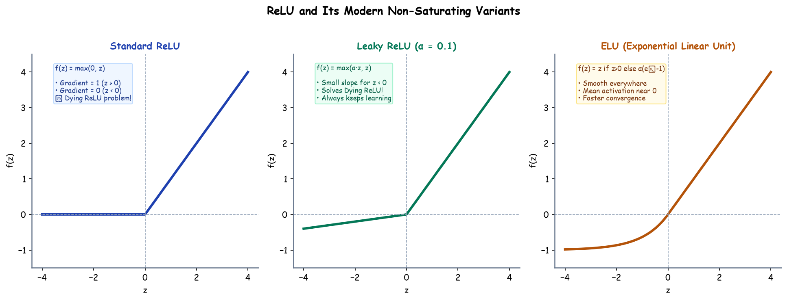

# Submodule 37.07: ReLU & its Variants (Hinglish)

## 1. ReLU itna popular kyun hai?

**ReLU (Rectified Linear Unit)** modern Deep Learning ka sabse popular activation function hai:
$$f(z) = \max(0, z)$$
- Positive values ($z > 0$) ke liye output seedhe $z$ rehta hai aur derivative hamesha **1.0** hota hai.
- Iska calculation bohot fast hota hai (koi complex exponential calculation nahi karni padti).
- Yeh Vanishing Gradient problem ko poori tarah khatam kar deta hai.

---

## 2. "Dying ReLU" Problem kya hai?

ReLU ki ek kamzori hoti hai: agar kisi neuron me negative input ($z < 0$) chala jaye, toh:
- Output ho jata hai: $0$
- Derivative ho jata hai: $0$
- Naya weight update: $w_{new} = w_{old} - \eta \cdot 0 = w_{old}$
Neuron hamesha ke liye "mar" (dead ho) jata hai aur future me kabhi koi naya feature learn nahi kar pata.

---

## 3. ReLU ke Modern Variants

1. **Leaky ReLU**:
   Negative side par zero karne ke bajaye hum ek chhota slope $\alpha = 0.01$ de dete hain:
   $$f(z) = \max(0.01z, z)$$
   Isse derivative kabhi zero nahi hota aur Dying ReLU problem solve ho jati hai.
2. **PReLU (Parametric ReLU)**:
   Yahan $\alpha$ ek fixed number nahi hota, balki ek learnable parameter hota hai jise model backpropagation se khud seekhta hai.
3. **ELU (Exponential Linear Unit)**:
   Negative side par exponential curve $\alpha(e^z - 1)$ lagata hai jo smooth hota hai aur zero-mean activations create karta hai.\n