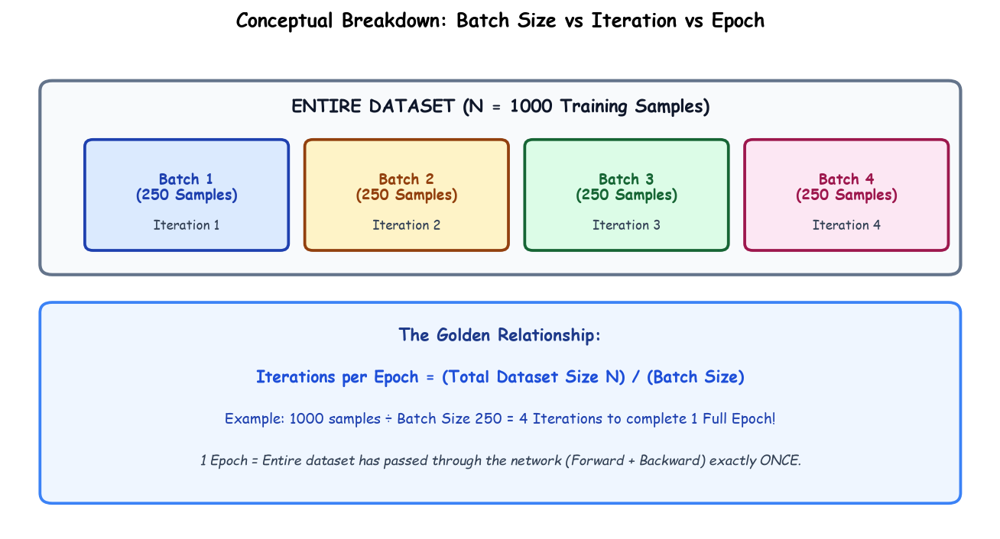

# Submodule 37.08: Batch vs Iteration vs Epoch

## 1. Introduction: Deconstructing Training Terminology

When configuring neural network training pipelines, three foundational hyperparameters govern data ingestion, memory utilization, and optimization cadence: **Batch**, **Iteration**, and **Epoch**. Confusing these metrics leads to incorrect learning rate scaling and suboptimal computational resource allocation.

---

## 2. Detailed Technical Definitions

### 1. Batch & Batch Size ($B$)
- **Batch**: A discrete subset of training examples passed simultaneously into the neural network for forward propagation, loss evaluation, and backward gradient computation.
- **Batch Size ($B$)**: The integer number of individual data samples contained within one batch.
  - Standard deep learning batch sizes are powers of two (e.g., $16, 32, 64, 128, 256$) to optimize parallel tensor alignment in GPU warp/thread block architectures.

### 2. Iteration (Step)
- An **Iteration** (often termed a training *Step*) represents **one complete cycle of Forward Pass + Backward Pass + Weight Update on exactly ONE batch**.
- If a dataset is partitioned into $K$ batches, completing all batches requires $K$ iterations.

### 3. Epoch
- An **Epoch** represents **one complete, exhaustive pass of the ENTIRE training dataset** through the neural network.
- During 1 epoch, every single training sample in the dataset has been seen by the model exactly once.

---

## 3. The Governing Mathematical Relationship

Given:
- Total number of training samples in dataset: $N$
- Configured Batch Size: $B$

The number of iterations (weight updates) required to complete **one single epoch** is:

$$\text{Iterations per Epoch} = \left\lceil \frac{N}{B} \right\rceil$$

### Concrete Numerical Walkthrough
Suppose an industrial computer vision dataset contains $N = 50,000$ images:
- **Scenario A: Batch Size $B = 100$**
  $$\text{Iterations per Epoch} = \frac{50,000}{100} = 500 \text{ weight updates per epoch}$$
  If trained for $E = 20$ epochs:
  $$\text{Total Training Iterations} = 500 \times 20 = 10,000 \text{ steps}$$

- **Scenario B: Batch Size $B = 64$**
  $$\text{Iterations per Epoch} = \left\lceil \frac{50,000}{64} \right\rceil = 782 \text{ weight updates per epoch}$$

---

## 4. Architectural Trade-offs of Batch Size Selection

| Batch Size Setting | GPU Memory Footprint | Gradient Estimation Quality | Training Wall-Clock Speed | Generalization Ability |
| :--- | :--- | :--- | :--- | :--- |
| **Small (e.g., $8 - 32$)** | Minimal VRAM | High stochastic noise | Slower (underutilizes GPU parallelism) | Superior (stochastic noise escapes sharp local minima) |
| **Moderate (e.g., $64 - 128$)** | Optimal balance | Balanced variance | Fast (efficient GPU tensor cores utilization) | Strong generalization |
| **Large (e.g., $1024 - 4096$)** | Massive VRAM | Low variance (approaches true gradient) | Extremely fast throughput | Risks converging to sharp minima (poorer test generalization) |\n