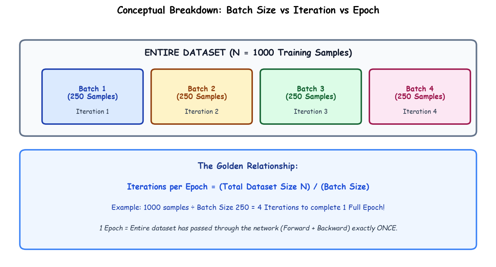

# Submodule 37.08: Batch vs Iteration vs Epoch (Hinglish)

## 1. Teeno Terms ka Asal Matlab kya hai?

Neural network training me teen sabse zaroori shabdon ka use hota hai:

---

## 2. Definitions aur Difference

1. **Batch aur Batch Size ($B$)**:
   - Poore dataset ko ek saath memory me daalna bohot mehenga hota hai. Isiliye dataset ko chhote-chhote hisson me todte hain, jise **Batch** kehte hain.
   - Ek batch me kitne samples hain, use **Batch Size** kehte hain (jaise 32, 64, ya 128).
2. **Iteration (Step)**:
   - **Ek single batch** par jab model ek baar Forward pass karta hai aur ek baar Backward pass karke weights update karta hai, use **1 Iteration** kehte hain.
3. **Epoch**:
   - Jab model poore ke poore dataset ko ek baar poora dekh leta hai (yaani saare batches khatam ho jate hain), use **1 Epoch** kehte hain.

---

## 3. Golden Formula

$$\text{Iterations per Epoch} = \frac{\text{Total Dataset Size } (N)}{\text{Batch Size } (B)}$$

### Real Example:
- Maan lo dataset me $N = 1000$ images hain.
- Humne Batch Size rakha $B = 100$.
- Toh ek epoch complete karne me kitne iterations lagenge?
  $$\frac{1000}{100} = 10 \text{ iterations}$$
- Iska matlab 10 baar weights update hone ke baad 1 Epoch poora hoga!\n