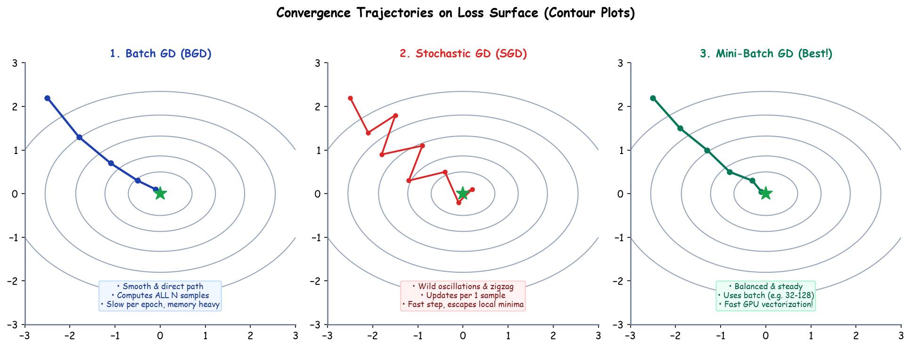

# Submodule 37.09: Classical Optimizers (BGD vs SGD vs Mini-Batch)

## 1. Introduction: The Optimization Landscape

An **Optimizer** is the mathematical algorithm responsible for updating parameter tensors (weights and biases) to minimize the scalar objective cost function $J(\theta)$. Classical first-order optimizers belong to the **Gradient Descent** family, differing fundamentally in **how many training samples are evaluated before computing gradients and executing a parameter update**.

---

## 2. Batch Gradient Descent (BGD / Vanilla GD)

In Batch Gradient Descent, the full training dataset of $N$ samples is evaluated to compute the true exact gradient vector before executing a single update step:
$$\theta \leftarrow \theta - \eta \cdot \nabla_\theta J(\theta) = \theta - \eta \cdot \left[ \frac{1}{N} \sum_{i=1}^N \nabla_\theta \mathcal{L}(y^{(i)}, \hat{y}^{(i)}) \right]$$

- **Convergence Trajectory**: Monotonic, smooth, direct progression along the gradient vector without oscillations.
- **Critical Drawback**: Computationally impractical for big data (e.g., $N = 10^7$). Computing millions of forward/backward passes for one weight update causes extreme memory overhead and intractable wall-clock times. Cannot perform online learning.

---

## 3. Stochastic Gradient Descent (SGD)

Stochastic Gradient Descent updates parameters after evaluating **each single individual training sample** $(x^{(i)}, y^{(i)})$:
$$\theta \leftarrow \theta - \eta \cdot \nabla_\theta \mathcal{L}(y^{(i)}, \hat{y}^{(i)})$$

- **Convergence Trajectory**: Highly erratic, jagged, noisy zigzag path across the loss landscape.
- **Key Advantage**: Immediate updates with minimal memory consumption ($O(1)$ batch memory). The persistent stochastic noise helps parameter states jump out of shallow local minima and flat saddle points.
- **Drawback**: Never settles perfectly at the exact minimum; constantly fluctuates around the optimum unless an aggressive learning rate decay schedule is applied. Cannot leverage GPU vectorized SIMD hardware parallelism.

---

## 4. Mini-Batch Gradient Descent (MBGD)

Mini-Batch Gradient Descent represents the optimal industrial consensus, partitioning dataset $N$ into small batches of size $B$ (typically $B \in \{32, 64, 128, 256\}$):
$$\theta \leftarrow \theta - \eta \cdot \left[ \frac{1}{B} \sum_{i=1}^B \nabla_\theta \mathcal{L}(y^{(i)}, \hat{y}^{(i)}) \right]$$

### Architectural Superiority
1. **Hardware Parallelization**: Matrix operations over $B$ samples perfectly align with GPU tensor core execution blocks, running nearly as fast as a single sample update.
2. **Reduced Variance**: Averaging over $B$ samples significantly reduces gradient variance compared to SGD, producing smoother convergence.
3. **Generalization Regularization**: Retains sufficient stochastic noise to prevent overfitting and escape saddle points.

---

## 5. Comparative Specification Matrix

| Metric Dimension | Batch Gradient Descent (BGD) | Stochastic Gradient Descent (SGD) | Mini-Batch Gradient Descent (MBGD) |
| :--- | :--- | :--- | :--- |
| **Sample Size per Update** | Entire Dataset ($N$) | Single Sample ($1$) | Mini-Batch ($B$, e.g., $32 - 128$) |
| **Updates per Epoch** | Exactly $1$ | Exactly $N$ | $\lceil N / B \rceil$ |
| **GPU Parallelism** | Poor memory scaling | Extremely Poor (Cannot vectorize) | Optimal (Full GPU core saturation) |
| **Loss Curve Behavior** | Monotonically decreases smoothly | Wild zigzagging fluctuations | Smooth progression with mild noise |
| **Memory Requirement** | High (petabytes crash system) | Minimal | Moderate (Configurable to VRAM) |
| **Production Standard** | Rare | Educational only | Universal Industry Standard |\n