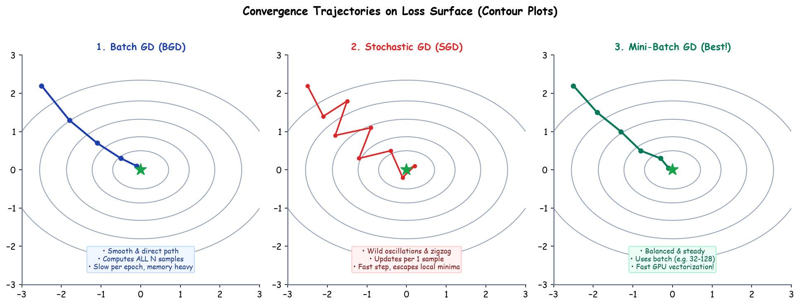

# Submodule 37.09: Classical Optimizers (BGD vs SGD vs Mini-Batch) (Hinglish)

## 1. Optimizers kya hote hain?

Optimizer wo algorithm hota hai jo model ke loss ko kam karne ke liye weights aur biases ko update karta hai. Gradient Descent ke teen classical roop hote hain:

---

## 2. Teen Mukhya Variants

### 1. Batch Gradient Descent (BGD)
- **Kaise kaam karta hai**: Poore $N$ samples ka data ek saath compute karta hai aur fir ek baar update karta hai.
- **Fayda**: Iska rasta bilkul seedha aur smooth hota hai.
- **Nuksan**: Bohot slow hota hai aur memory (RAM) bohot zyada leta hai. Agar 10 lakh data points hain, toh ek step lene me ghanto lag jayenge.

### 2. Stochastic Gradient Descent (SGD)
- **Kaise kaam karta hai**: Har **ek single sample** ke baad weight update kar deta hai.
- **Fayda**: Bohot fast hota hai aur memory kam lagti hai. Random jhatko (noise) ki wajah se local minima se bahar nikal jata hai.
- **Nuksan**: Rasta bohot zigzag (noisy) hota hai aur yeh minimum par tikta nahi, aas-paas hilte rehta hai. GPU ki parallel power ka use nahi kar pata.

### 3. Mini-Batch Gradient Descent (Sabse Best!)
- **Kaise kaam karta hai**: Data ko chhote batches (jaise 32 ya 64 samples) me divide karta hai.
- **Fayda**: BGD aur SGD ka best combination hai! Yeh GPU ki matrix power ka poora faayda uthata hai, smooth raste par chalta hai, aur modern deep learning me **100% yahi use hota hai**.\n