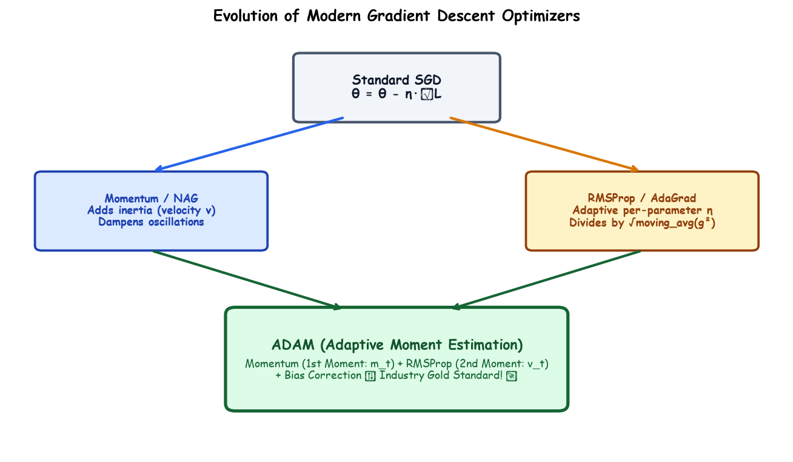

# Submodule 37.10: Modern Variants of Gradient Descent

## 1. Introduction: Overcoming Ravines, Plateaus & Sparse Gradients

While Mini-Batch Gradient Descent is effective, standard first-order optimization suffers from severe pathologies in deep high-dimensional non-convex loss surfaces:
1. **Ravine Oscillation**: In elongated valleys where surface curvature is much steeper in one dimension than another, gradient descent oscillates wildly across the slopes while making agonizingly slow progress along the valley floor.
2. **Uniform Learning Rate Dilemma**: Applying a global scalar learning rate $\eta$ across millions of parameters is suboptimal when frequent features require gentle updates and sparse, infrequent features require larger updates.

Modern adaptive optimizers resolve these challenges by incorporating **Momentum** (directional velocity) and **Adaptive Learning Rates** (per-parameter scaling).

---

## 2. Gradient Descent with Momentum

Inspired by physical mechanics, Momentum models the parameter state as a heavy ball rolling down the loss landscape, accumulating velocity in directions of persistent gradient and dampening oscillations in orthogonal directions.

### Mathematical Formulation
$$v_t = \beta v_{t-1} + (1 - \beta) g_t$$
$$\theta_t = \theta_{t-1} - \eta v_t$$

- $g_t = \nabla_\theta \mathcal{L}(\theta_t)$: Current gradient vector.
- $v_t$: Accumulated **velocity vector** (Exponential Moving Average of past gradients).
- $\beta \in [0, 1)$: Momentum coefficient (typically $\beta = 0.9$, representing $90\%$ retention of past momentum).

### Impact on Optimization:
- Along oscillating dimensions (where signs alternate $+/-$): Gradients cancel out algebraically $\implies$ oscillations are suppressed.
- Along consistent slope dimensions: Velocity accumulates $\implies$ convergence accelerates by a factor of $\frac{1}{1-\beta} = 10\times$.

---

## 3. RMSProp (Root Mean Square Propagation)

Developed independently by Geoffrey Hinton, RMSProp introduces **adaptive per-parameter learning rates** by dividing each gradient update by the running root-mean-square of its historical magnitudes:

### Mathematical Formulation
$$s_t = \beta s_{t-1} + (1 - \beta) g_t^2$$
$$\theta_t = \theta_{t-1} - \frac{\eta}{\sqrt{s_t} + \epsilon} \odot g_t$$

- $s_t$: Exponential Moving Average of **squared gradients** (tracks gradient variance per parameter).
- $\epsilon$: Infinitesimal numerical stabilizer (e.g., $10^{-8}$) preventing division by zero.
- **Dynamics**: Parameters with massive historical gradients receive proportionally smaller updates (damping exploding gradients), while parameters with tiny gradients receive amplified updates (accelerating plateau traversal).

---

## 4. Adam (Adaptive Moment Estimation)

Published by Kingma & Ba (2014), **Adam** is universally regarded as the gold-standard default optimizer across deep learning. It synthesizes the advantages of both **Momentum** (estimating the 1st raw moment / mean) and **RMSProp** (estimating the 2nd uncentered moment / variance), accompanied by rigorous **bias corrections**:

### Step 1: Exponential Moving Averages of Gradients
$$m_t = \beta_1 m_{t-1} + (1 - \beta_1) g_t \quad \text{(1st Moment: Directional Velocity)}$$
$$v_t = \beta_2 v_{t-1} + (1 - \beta_2) g_t^2 \quad \text{(2nd Moment: Scale Normalization)}$$

### Step 2: Bias Correction
Because $m_0 = 0$ and $v_0 = 0$ are initialized at zero, early estimates are heavily biased towards zero. Adam corrects for this initialization bias:
$$\hat{m}_t = \frac{m_t}{1 - \beta_1^t}, \quad \hat{v}_t = \frac{v_t}{1 - \beta_2^t}$$

### Step 3: Parameter Update
$$\theta_t = \theta_{t-1} - \frac{\eta}{\sqrt{\hat{v}_t} + \epsilon} \odot \hat{m}_t$$

### Default Hyperparameter Standards:
- $\eta = 0.001$ (Standard initial learning rate)
- $\beta_1 = 0.9$ (1st moment decay)
- $\beta_2 = 0.999$ (2nd moment decay)
- $\epsilon = 10^{-8}$

---

## 5. Architectural Optimizer Comparison

| Optimizer | Tracks 1st Moment (Momentum)? | Tracks 2nd Moment (Adaptive Scale)? | Bias Correction? | Primary Hyperparameters | Best Use Case |
| :--- | :--- | :--- | :--- | :--- | :--- |
| **SGD** | No | No | No | $\eta$ | Baseline / Overfitting prevention |
| **Momentum** | Yes (Velocity) | No | No | $\eta, \beta$ | Computer Vision / ResNets |
| **RMSProp** | No | Yes (Scale) | No | $\eta, \beta, \epsilon$ | Recurrent Neural Networks (RNNs) |
| **Adam** | Yes ($m_t$) | Yes ($v_t$) | Yes ($\hat{m}_t, \hat{v}_t$) | $\eta, \beta_1, \beta_2, \epsilon$ | **Default for 95% of Deep Learning** |\n