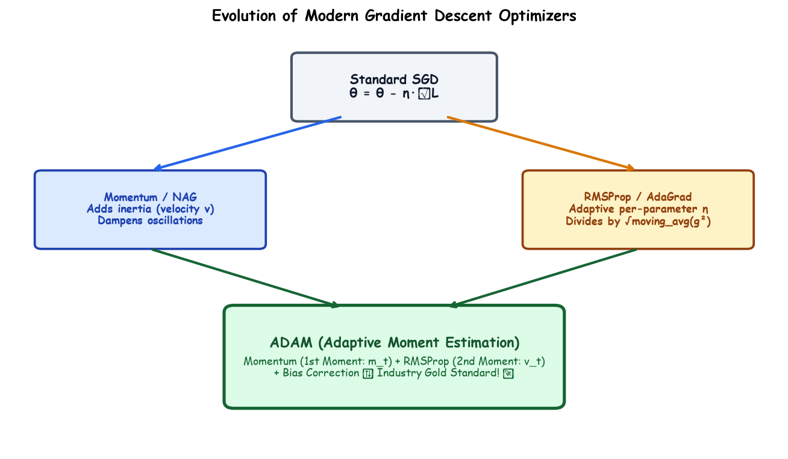

# Submodule 37.10: Modern Variants of Gradient Descent (Hinglish)

## 1. Modern Optimizers ki Zaroorat Kyun Padi?

Simple Gradient Descent me do badi problems hoti hain:
1. **Ghati me bhatakna (Ravine Oscillation)**: Agar loss surface ek taraf dhalandar aur doosri taraf flat ho, toh gradient upar-neeche uchhalta rehta hai aur aage bohot dheere badhta hai.
2. **Sabhi parameters ke liye ek hi learning rate**: Har parameter ka gradient alag hota hai, isiliye sabke liye alag learning rate hona chahiye.

Isliye research ne modern optimizers invent kiye:

---

## 2. Modern Optimizers ka Vikas (Evolution)

### 1. Momentum Optimizer
- **Concept**: Ek bhaari gend (heavy ball) ki tarah jo dhalan par ludhakte huye speed pakad leti hai.
- Yeh pichle gradients ka **velocity ($v_t$)** track karta hai.
- Faltu ke uchhal-kood ko shaant karta hai aur aage badhne ki speed ko $10\times$ tezi deta hai.

### 2. RMSProp Optimizer
- **Concept**: Har parameter ke liye alag learning rate.
- Yeh gradients ke square ka moving average nikaalta hai.
- Jis parameter ka gradient bohot bada ho, use chhota step deta hai; aur jiska gradient bohot chhota ho, use bada step deta hai!

### 3. ADAM Optimizer (Sabka Baap - Industry King! 👑)
- **Momentum + RMSProp ka jod**:
  - Momentum se liya: Direction aur Speed (1st Moment $m_t$).
  - RMSProp se liya: Adaptive Learning Rate (2nd Moment $v_t$).
  - Saath me lagaya: **Bias Correction** (shuruaati 0 bias hatane ke liye).
- **Default settings**: $\eta = 0.001$, $\beta_1 = 0.9$, $\beta_2 = 0.999$.
- Aaj ki date me 95% deep learning models me **Adam** hi use hota hai!\n