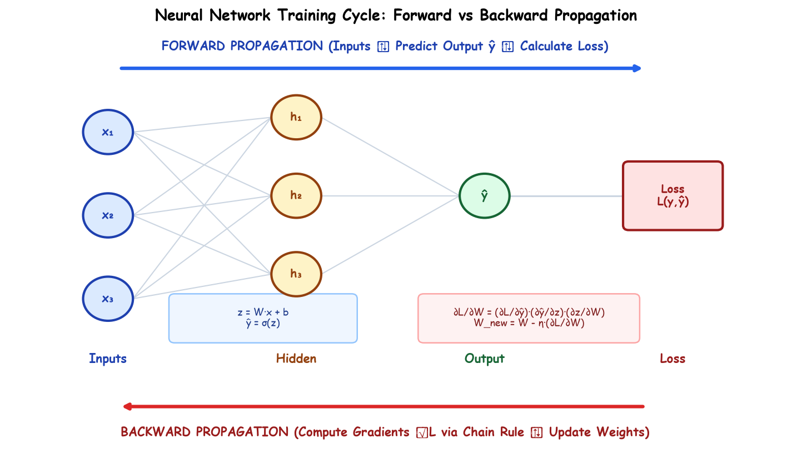

# Lecture 37: Deep Learning Foundations (Part-2) — Training Neural Networks

Welcome to the comprehensive master curriculum for **Lecture 37: Deep Learning Foundations (Part-2)**. While Lecture 36 established the architectural representation of artificial neurons and multi-layer perceptrons, Lecture 37 is dedicated entirely to **how neural networks learn**: loss function formulation, backpropagation calculus, gradient descent dynamics, activation selection, and modern adaptive optimizers.

---

## High-Level Training Dynamics: Forward vs Backward Pass

Neural network training is a continuous feedback loop between inference and optimization:

### The Governing Mathematical Equations
1. **Forward Pass (Affine + Activation)**:
   $$z^{[l]} = W^{[l]} a^{[l-1]} + b^{[l]}, \quad a^{[l]} = g^{[l]}(z^{[l]})$$
2. **Loss Evaluation**:
   $$\mathcal{L}(y, \hat{y})$$
3. **Backward Pass (Chain Rule Error Propagation)**:
   $$\delta^{[l]} = ((W^{[l+1]})^T \delta^{[l+1]}) \odot {g^{[l]}}'(z^{[l]})$$
4. **Parameter Updation (Gradient Descent Step)**:
   $$W^{[l]} \leftarrow W^{[l]} - \eta \frac{\partial \mathcal{L}}{\partial W^{[l]}}, \quad b^{[l]} \leftarrow b^{[l]} - \eta \frac{\partial \mathcal{L}}{\partial b^{[l]}}$$

---

## Comprehensive Submodule Roadmap

This curriculum comprises 10 exhaustive submodules accompanied by an industrial practice suite. Every module features dual-language documentation (English `README.md` and Hinglish `README_HINGLISH.md`), notebook-style hand-drawn educational diagrams, mathematical proofs, and compiled vector PDFs:

| Submodule | Topic Title | Core Concepts & Formulas Covered | Educational Diagram | Documentation Links |
| :--- | :--- | :--- | :--- | :--- |
| **37.01** | **Forward & Backward Propagation** | Dual-engine training loop, linear combiner, activation, loss, credit assignment | [Diagram](Notes_37.01/forward_backward_propagation.png) | [English](Notes_37.01/README.md) \| [Hinglish](Notes_37.01/README_HINGLISH.md) |
| **37.02** | **Loss Functions (Regression)** | Loss vs Cost, MSE ($L_2$), MAE ($L_1$), Huber Loss, outlier sensitivity analysis | [Diagram](Notes_37.02/regression_loss_functions.png) | [English](Notes_37.02/README.md) \| [Hinglish](Notes_37.02/README_HINGLISH.md) |
| **37.03** | **Loss Functions (Classification)** | Binary Cross-Entropy (Log Loss), Softmax layer, Multi-class Categorical Cross-Entropy | [Diagram](Notes_37.03/classification_loss_functions.png) | [English](Notes_37.03/README.md) \| [Hinglish](Notes_37.03/README_HINGLISH.md) |
| **37.04** | **Weight & Bias Updation** | Gradient descent update rules, learning rate $\eta$ dynamics, positive/negative slope mechanics | [Diagram](Notes_37.04/weight_bias_updation.png) | [English](Notes_37.04/README.md) \| [Hinglish](Notes_37.04/README_HINGLISH.md) |
| **37.05** | **Chain Rule of Derivatives in NN** | Computational graph, local Jacobian evaluation, reverse gradient accumulation | [Diagram](Notes_37.05/chain_rule_neural_network.png) | [English](Notes_37.05/README.md) \| [Hinglish](Notes_37.05/README_HINGLISH.md) |
| **37.06** | **Vanishing Gradient Problem** | Sigmoid derivative upper bound $\sigma' \le 0.25$, exponential gradient decay $(0.25)^L$ | [Diagram](Notes_37.06/vanishing_gradient_problem.png) | [English](Notes_37.06/README.md) \| [Hinglish](Notes_37.06/README_HINGLISH.md) |
| **37.07** | **ReLU & its Variants** | Standard ReLU, Dying ReLU pathology, Leaky ReLU, Parametric ReLU (PReLU), ELU | [Diagram](Notes_37.07/relu_and_variants.png) | [English](Notes_37.07/README.md) \| [Hinglish](Notes_37.07/README_HINGLISH.md) |
| **37.08** | **Batch vs Iteration vs Epoch** | Definitions, governing formula $\text{Steps} = N/B$, hardware throughput trade-offs | [Diagram](Notes_37.08/batch_iteration_epoch.png) | [English](Notes_37.08/README.md) \| [Hinglish](Notes_37.08/README_HINGLISH.md) |
| **37.09** | **Classical Optimizers** | Batch Gradient Descent (BGD), Stochastic GD (SGD), Mini-Batch GD, loss surface trajectories | [Diagram](Notes_37.09/optimizers_comparison.png) | [English](Notes_37.09/README.md) \| [Hinglish](Notes_37.09/README_HINGLISH.md) |
| **37.10** | **Modern Variants of GD** | Momentum, RMSProp, Adam (1st & 2nd moments + bias correction), industrial standards | [Diagram](Notes_37.10/modern_gd_variants.png) | [English](Notes_37.10/README.md) \| [Hinglish](Notes_37.10/README_HINGLISH.md) |
| **Practice** | **Industrial Practice Suite** | 15 advanced mathematical, analytical, and implementation problems with complete solutions | N/A | [Questions](Practice_Problems/README.md) \| [Solutions](Practice_Problems/Solutions.md) |\n