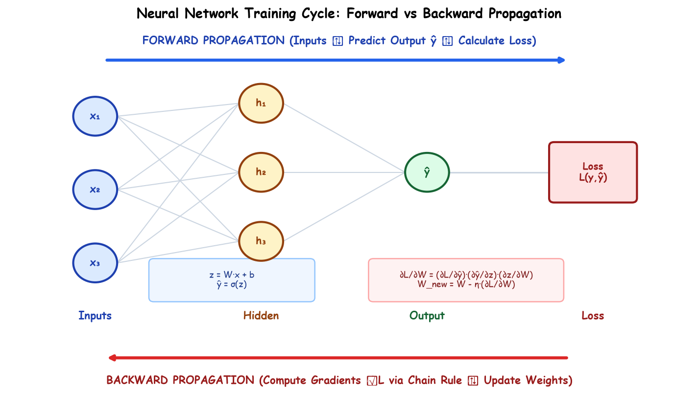

# Lecture 37: Deep Learning Foundations (Part-2) — Training Neural Networks (Hinglish)

Yeh **Lecture 37: Deep Learning Foundations (Part-2)** ka master guide hai. Is lecture me humne seekha hai ki ek Neural Network asal me train kaise hota hai: Loss functions, Backpropagation, Calculus ka Chain Rule, Vanishing Gradients, ReLU ke variants, aur Modern Optimizers (Adam, RMSProp, Momentum).

---

## Training Cycle: Forward vs Backward Pass

1. **Forward Propagation**: Inputs $\to$ Linear Sum ($z = Wx + b$) $\to$ Activation ($a = g(z)$) $\to$ Prediction $\hat{y}$ $\to$ Loss Calculation $\mathcal{L}(y, \hat{y})$.
2. **Backward Propagation**: Loss se shuru hokar Chain Rule ke zariye har layer ke weights aur biases ke gradients nikaalna.
3. **Weight Updation**:
   $$W_{new} = W_{old} - \eta \cdot \frac{\partial \mathcal{L}}{\partial W}$$
   $$b_{new} = b_{old} - \eta \cdot \frac{\partial \mathcal{L}}{\partial b}$$

---

## Submodules ki List

| Submodule | Topic | Mukhya Concept | Documentation |
| :--- | :--- | :--- | :--- |
| **37.01** | Forward & Backward Propagation | Do-engine training cycle aur mathematical flow | [English](Notes_37.01/README.md) \| [Hinglish](Notes_37.01/README_HINGLISH.md) |
| **37.02** | Loss Functions (Regression) | Loss vs Cost, MSE, MAE, Huber Loss | [English](Notes_37.02/README.md) \| [Hinglish](Notes_37.02/README_HINGLISH.md) |
| **37.03** | Loss Functions (Classification) | Binary Cross-Entropy, Softmax, Categorical Cross-Entropy | [English](Notes_37.03/README.md) \| [Hinglish](Notes_37.03/README_HINGLISH.md) |
| **37.04** | Weight & Bias Updation | Gradient descent formula aur slope direction analysis | [English](Notes_37.04/README.md) \| [Hinglish](Notes_37.04/README_HINGLISH.md) |
| **37.05** | Chain Rule of Derivatives | Multi-variable chain rule se backpropagation ka proof | [English](Notes_37.05/README.md) \| [Hinglish](Notes_37.05/README_HINGLISH.md) |
| **37.06** | Vanishing Gradient Problem | Sigmoid derivative $0.25$ limit aur gradient decay | [English](Notes_37.06/README.md) \| [Hinglish](Notes_37.06/README_HINGLISH.md) |
| **37.07** | ReLU & its Variants | Dying ReLU problem, Leaky ReLU, PReLU, ELU | [English](Notes_37.07/README.md) \| [Hinglish](Notes_37.07/README_HINGLISH.md) |
| **37.08** | Batch vs Iteration vs Epoch | Batch size, iterations per epoch aur memory balance | [English](Notes_37.08/README.md) \| [Hinglish](Notes_37.08/README_HINGLISH.md) |
| **37.09** | Classical Optimizers | Batch GD, Stochastic GD, Mini-batch GD comparison | [English](Notes_37.09/README.md) \| [Hinglish](Notes_37.09/README_HINGLISH.md) |
| **37.10** | Modern Variants of GD | Momentum, RMSProp, Adam optimizer | [English](Notes_37.10/README.md) \| [Hinglish](Notes_37.10/README_HINGLISH.md) |
| **Practice** | Industrial Practice Suite | 15 technical problems aur step-by-step solutions | [Questions](Practice_Problems/README.md) \| [Solutions](Practice_Problems/Solutions.md) |\n