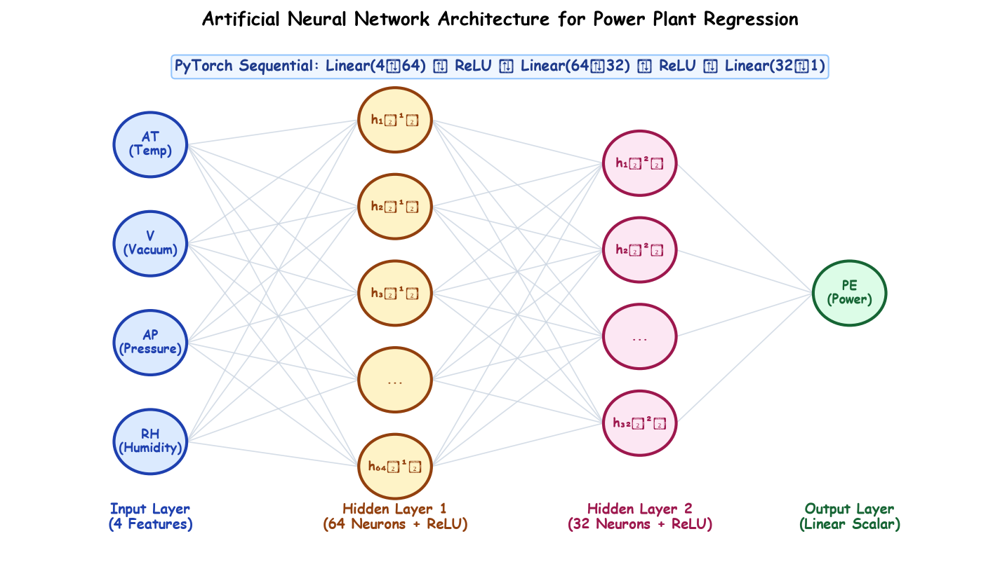

# Submodule 38.01: Artificial Neural Networks for Regression

## 1. Introduction & Engineering Problem Formulation

While classical Machine Learning provides robust baselines for regression (such as Linear Regression, Support Vector Regression, and Random Forests), deep **Artificial Neural Networks (ANNs)** serve as universal non-linear function approximators capable of modeling complex thermodynamic and multi-variable industrial processes without manual feature engineering.

In this module, we formulate an end-to-end industrial deep learning regression project: **Predicting the Net Hourly Electrical Energy Output ($PE$) of a Combined Cycle Power Plant (CCPP)** based on ambient environmental thermodynamic measurements.

---

## 2. Dataset Anatomy: Combined Cycle Power Plant

A Combined Cycle Power Plant operates gas turbines, steam turbines, and heat recovery steam generators simultaneously. Thermodynamic vacuum and ambient atmospheric conditions directly influence turbine efficiency and electrical generation:

| Feature Variable | Technical Name | Physical Unit | Description & Thermodynamic Role |
| :--- | :--- | :--- | :--- |
| **`AT`** | Ambient Temperature | $^{\circ}\text{C}$ | Atmospheric temperature; higher ambient temperatures decrease air density, reducing gas turbine mass flow. |
| **`V`** | Exhaust Vacuum | $\text{cm Hg}$ | Condenser vacuum pressure affecting steam turbine exhaust efficiency. |
| **`AP`** | Ambient Pressure | $\text{mbar}$ | Atmospheric barometric pressure; higher pressure increases air mass intake. |
| **`RH`** | Relative Humidity | $\%$ | Atmospheric moisture percentage; alters combustion dynamics. |
| **`PE` (Target)** | **Net Electrical Energy Output** | **$\text{MW}$** | **The continuous scalar target variable representing total electrical output produced.** |

---

## 3. End-to-End Deep Learning Regression Architecture

The regression neural network takes $d = 4$ continuous features and outputs a single unbounded scalar prediction $\hat{y} \in \mathbb{R}$:

1. **Input Layer**: 4 neurons accepting standardized feature vector $\mathbf{x} = [\text{AT}, \text{V}, \text{AP}, \text{RH}]^T$.
2. **Hidden Layer 1**: Dense linear layer with 64 neurons activated by **ReLU** non-linearity:
   $$z^{[1]} = W^{[1]} \mathbf{x} + b^{[1]}, \quad a^{[1]} = \max(0, z^{[1]}), \quad W^{[1]} \in \mathbb{R}^{64 \times 4}, \, b^{[1]} \in \mathbb{R}^{64}$$
3. **Hidden Layer 2**: Dense linear layer with 32 neurons activated by **ReLU**:
   $$z^{[2]} = W^{[2]} a^{[1]} + b^{[2]}, \quad a^{[2]} = \max(0, z^{[2]}), \quad W^{[2]} \in \mathbb{R}^{32 \times 64}, \, b^{[2]} \in \mathbb{R}^{32}$$
4. **Output Layer (Linear Scalar)**:
   $$\hat{y} = z^{[3]} = W^{[3]} a^{[2]} + b^{[3]}, \quad W^{[3]} \in \mathbb{R}^{1 \times 32}, \, b^{[3]} \in \mathbb{R}$$
   *(Crucial Note: The output layer has **NO non-linear activation function** (Identity / Linear mapping) because continuous regression predictions must span arbitrary numerical ranges).*

---

## 4. The 6-Stage PyTorch Implementation Lifecycle

Unlike scikit-learn's two-step `model.fit()` interface, professional PyTorch pipelines enforce transparent, low-level control over the execution lifecycle:

1. **Data Ingestion & Cleaning**: Loading CSV data into Pandas DataFrames, checking nulls, and separating features ($X$) from target ($y$).
2. **Normalization & Tensor Conversion**: Applying `StandardScaler` to prevent feature dominance and converting arrays into PyTorch `float32` tensors.
3. **Batch Pipeline Packaging**: Encapsulating tensors inside `TensorDataset` and feeding into mini-batch `DataLoader` with parallel shuffle.
4. **Model Class Definition**: Inheriting from `nn.Module`, defining parameterized layers in `__init__`, and building the computation graph in `forward()`.
5. **Training & Validation Optimization**: Executing mini-batch gradient descent with `zero_grad()`, `MSELoss()`, `backward()`, and `Adam` updates, while tracking validation loss.
6. **Model Checkpointing & Evaluation**: Saving optimal weights (`state_dict()`) and computing test metrics ($R^2$ score and residual analysis).

---

## 5. Submodule Companion Assets

The complete executable Jupyter Notebook and dataset are available locally in this submodule directory:
- [ANN_Regression.ipynb](file:///c:/Users/Shivam%20Keshari/OneDrive/Desktop/AI-ML/lecture_38/Notes_38.01/ANN_Regression.ipynb)
- [powerplant_data.csv](file:///c:/Users/Shivam%20Keshari/OneDrive/Desktop/AI-ML/lecture_38/Notes_38.01/powerplant_data.csv)\n