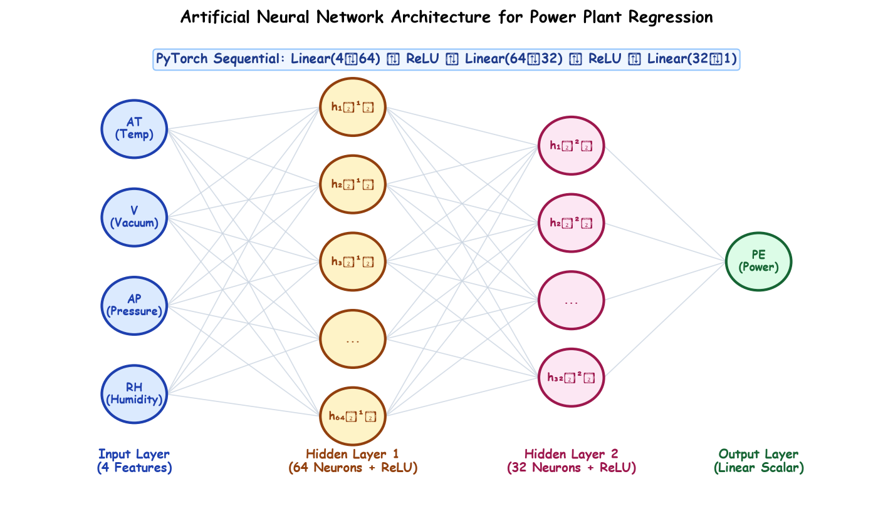

# Submodule 38.01: Artificial Neural Networks for Regression (Hinglish)

## 1. Parichay aur Real-World Problem Formulation

Classical Machine Learning algorithms (jaise Linear Regression ya Support Vector Regression) ke baad, ab hum Deep Learning aur **Artificial Neural Networks (ANN)** ko ek real-world industrial project par implement karenge:
**Combined Cycle Power Plant ka Energy Output ($PE$) Predict Karna**.

Ek Power Plant me gas aur steam turbines chalti hain jo ambient environment (taapmaan, pressure, humidity, vacuum) ke hisab se electricity generate karti hain. Hum 4 inputs se continuous electrical power ($PE$) predict karenge.

---

## 2. Dataset ke Columns (Features)

| Column | Naam | Physical Unit | Description |
| :--- | :--- | :--- | :--- |
| **`AT`** | Ambient Temperature | $^{\circ}\text{C}$ | Power plant ke aas-paas ka taapmaan. |
| **`V`** | Exhaust Vacuum | $\text{cm Hg}$ | Steam turbine ka vacuum pressure. |
| **`AP`** | Ambient Pressure | $\text{mbar}$ | Hawa ka atmospheric barometric pressure. |
| **`RH`** | Relative Humidity | $\%$ | Hawa me nami ka percentage. |
| **`PE` (Target)** | **Net Electrical Output** | **$\text{MW}$** | **Total generated power (MegaWatts me) jo predict karni hai.** |

---

## 3. Neural Network ka Architecture

1. **Input Layer**: 4 neurons ($AT, V, AP, RH$).
2. **Hidden Layer 1**: 64 neurons + **ReLU** activation.
3. **Hidden Layer 2**: 32 neurons + **ReLU** activation.
4. **Output Layer**: 1 neuron (**Koi activation function nahi**, bilkul linear). Regression me output par Sigmoid ya ReLU nahi lagate taaki continuous number predict ho sake.

---

## 4. PyTorch Lifecycle ke 6 Steps

1. **Data Load karna**: Pandas se CSV read karna aur null values check karna.
2. **Scaling aur Tensors**: `StandardScaler` lagana aur PyTorch `Float32` tensors me convert karna.
3. **TensorDataset aur DataLoader**: 32-32 samples ke mini-batches banana.
4. **`nn.Module` Model Class**: PyTorch me custom ANN class likhna.
5. **Training Loop**: Forward pass $\to$ MSE Loss $\to$ Backpropagation $\to$ Adam Optimizer step.
6. **Model Save aur Evaluation**: Best model save karna aur $R^2$ score calculate karna.

---

## 5. Companion Code Files

Is submodule ke sath original Jupyter Notebook aur CSV dataset attach kiye gaye hain:
- [ANN_Regression.ipynb](file:///c:/Users/Shivam%20Keshari/OneDrive/Desktop/AI-ML/lecture_38/Notes_38.01/ANN_Regression.ipynb)
- [powerplant_data.csv](file:///c:/Users/Shivam%20Keshari/OneDrive/Desktop/AI-ML/lecture_38/Notes_38.01/powerplant_data.csv)\n