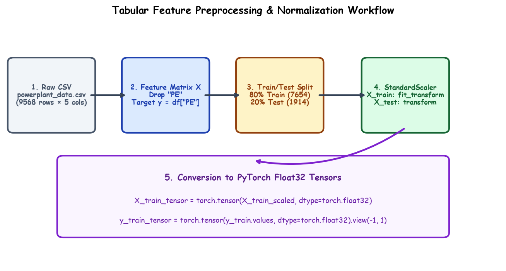

# Submodule 38.02: Data Loading & Feature Preprocessing

## 1. Introduction: The Preprocessing Imperative

Raw tabular data cannot be directly fed into neural networks. Differences in physical scales (e.g., Pressure $\approx 1013 \text{ mbar}$ vs Temperature $\approx 15^\circ\text{C}$) distort the loss surface into highly eccentric ellipsoidal valleys, inducing severe gradient oscillations and slowing convergence. 

Proper preprocessing guarantees numerical stability, isotropic gradient flow, and data leakage prevention.



---

## 2. Step 1: Ingestion & Feature-Target Separation

```python
import pandas as pd
import numpy as np

# Load tabular power plant records
df = pd.read_csv("powerplant_data.csv")

# Verify schema and data cleanliness
print("Dataset Shape:", df.shape)       # (9568, 5)
print("Missing Values:\n", df.isnull().sum())

# Separate feature matrix X and continuous target vector y
X = df.drop("PE", axis=1)
y = df["PE"]
```

---

## 3. Step 2: Rigorous Train/Test Partitioning

To evaluate true out-of-sample generalization performance, the dataset is split before computing any statistical transformations:

```python
from sklearn.model_selection import train_test_split

X_train, X_test, y_train, y_test = train_test_split(
    X, y, test_size=0.2, random_state=42
)
print("Training Samples:", X_train.shape[0])  # 7654 samples
print("Testing Samples:", X_test.shape[0])    # 1914 samples
```

---

## 4. Step 3: Feature Standardization (Z-Score Normalization)

Features are normalized to zero mean ($\mu = 0$) and unit standard deviation ($\sigma = 1$):
$$x_{\text{scaled}} = \frac{x - \mu}{\sigma}$$

> [!IMPORTANT]
> **Data Leakage Prohibition**: The `StandardScaler` must strictly fit its mean and variance parameters **only on the training partition** (`fit_transform`). The test partition is transformed using the training parameters (`transform`) to prevent future information leakage.

```python
from sklearn.preprocessing import StandardScaler

scaler = StandardScaler()
X_train_scaled = scaler.fit_transform(X_train)
X_test_scaled = scaler.transform(X_test)
```

---

## 5. Step 4: Conversion to PyTorch Float32 Tensors

PyTorch requires explicit tensor typing. Unlike NumPy which defaults to 64-bit double precision, deep learning hardware operates predominantly on **32-bit single precision (`torch.float32`)**:

```python
import torch

# Feature tensors
X_train_tensor = torch.tensor(X_train_scaled, dtype=torch.float32)
X_test_tensor = torch.tensor(X_test_scaled, dtype=torch.float32)

# Target tensors (reshaped to 2D column vectors [N, 1])
y_train_tensor = torch.tensor(y_train.values, dtype=torch.float32).view(-1, 1)
y_test_tensor = torch.tensor(y_test.values, dtype=torch.float32).view(-1, 1)

print("X_train_tensor shape:", X_train_tensor.shape)  # torch.Size([7654, 4])
print("y_train_tensor shape:", y_train_tensor.shape)  # torch.Size([7654, 1])
```\n