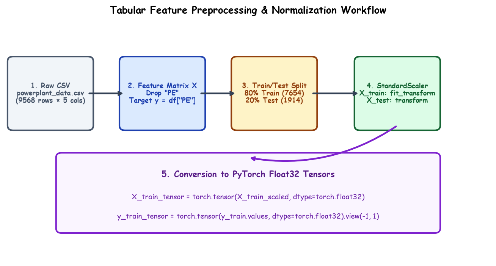

# Submodule 38.02: Data Loading & Feature Preprocessing (Hinglish)

## 1. Feature Preprocessing Kyun Zaroori Hai?

Power plant dataset me features alag-alag units me hain:
- Pressure: lagbhag $1013 \text{ mbar}$
- Temperature: lagbhag $15^\circ\text{C}$
Agar bina scale kiye direct neural network me bhejenge, toh bade numbers gradient descent ko bhatka denge aur training bohot slow aur unstable ho jayegi.



---

## 2. Step-by-Step Code Workflow

### 1. Data Ingestion aur Null Check
```python
import pandas as pd
df = pd.read_csv("powerplant_data.csv")
X = df.drop("PE", axis=1)
y = df["PE"]
```

### 2. Train / Test Split
```python
from sklearn.model_selection import train_test_split
X_train, X_test, y_train, y_test = train_test_split(X, y, test_size=0.2, random_state=42)
```

### 3. StandardScaler lagana (Z-Score Normalization)
Data leakage se bachne ke liye `fit_transform` sirf training data par lagaya jata hai aur test data par sirf `transform` kiya jata hai:
```python
from sklearn.preprocessing import StandardScaler
scaler = StandardScaler()
X_train_scaled = scaler.fit_transform(X_train)
X_test_scaled = scaler.transform(X_test)
```

### 4. PyTorch Tensors me Conversion
PyTorch me default precision `float32` hoti hai. Target vector ko `.view(-1, 1)` karke 2D column vector banaya jata hai:
```python
import torch
X_train_tensor = torch.tensor(X_train_scaled, dtype=torch.float32)
y_train_tensor = torch.tensor(y_train.values, dtype=torch.float32).view(-1, 1)
```\n