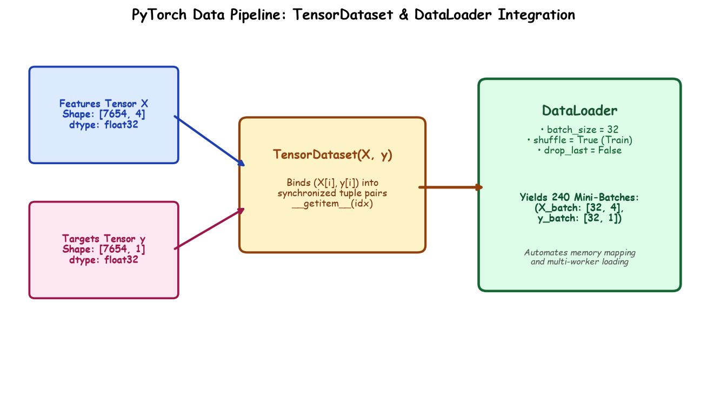

# Submodule 38.03: PyTorch TensorDataset & DataLoader Pipelines

## 1. Introduction: Efficient Mini-Batch Data Ingestion

In production deep learning, passing the entire dataset into memory simultaneously degrades performance and fails for large datasets. PyTorch abstracts high-performance mini-batch ingestion through two cooperative primitives:
1. **`TensorDataset`**: An indexable data wrapper that pairs feature tensors and target label tensors into synchronized coordinate tuples $(x_i, y_i)$.
2. **`DataLoader`**: An asynchronous multi-process iterator that manages mini-batch slicing, random shuffling, memory pinning, and thread allocation.



---

## 2. Encapsulating Tensors via `TensorDataset`

`TensorDataset` ensures that indexing sample $i$ retrieves both features and target simultaneously:
$$(X_{\text{train}}[i], y_{\text{train}}[i])$$

```python
from torch.utils.data import TensorDataset

train_dataset = TensorDataset(X_train_tensor, y_train_tensor)
test_dataset = TensorDataset(X_test_tensor, y_test_tensor)

print("Total Training Pairs:", len(train_dataset))  # 7654
print("Sample 0 Features:", train_dataset[0][0])
print("Sample 0 Target:", train_dataset[0][1])
```

---

## 3. Constructing the Asynchronous `DataLoader`

```python
from torch.utils.data import DataLoader

# Training DataLoader: Mini-batch size 32 with active shuffling
train_loader = DataLoader(
    dataset=train_dataset,
    batch_size=32,
    shuffle=True,       # Essential for stochastic gradient descent
    drop_last=False
)

# Testing DataLoader: Shuffling is unnecessary during evaluation
test_loader = DataLoader(
    dataset=test_dataset,
    batch_size=32,
    shuffle=False
)

print(f"Total Batches per Epoch: {len(train_loader)}")  # ceil(7654 / 32) = 240 batches
```

---

## 4. Why `shuffle=True` is Mandatory for Training

If training data is ordered chronologically or grouped by operating regimes, consecutive batches exhibit strong auto-correlation. Gradients oscillate violently between clusters.
Setting `shuffle=True` uniformly samples across the empirical distribution on every epoch, ensuring unbiased gradient expectations:
$$\mathbb{E}_{B \sim \mathcal{D}}[\nabla_\theta \mathcal{L}_B] = \nabla_\theta J(\theta)$$

---

## 5. Iterating Through a Batch: The Inner Loop

```python
# Inspecting the first yielded mini-batch
for X_batch, y_batch in train_loader:
    print("X_batch shape:", X_batch.shape)  # [32, 4]
    print("y_batch shape:", y_batch.shape)  # [32, 1]
    break
```\n