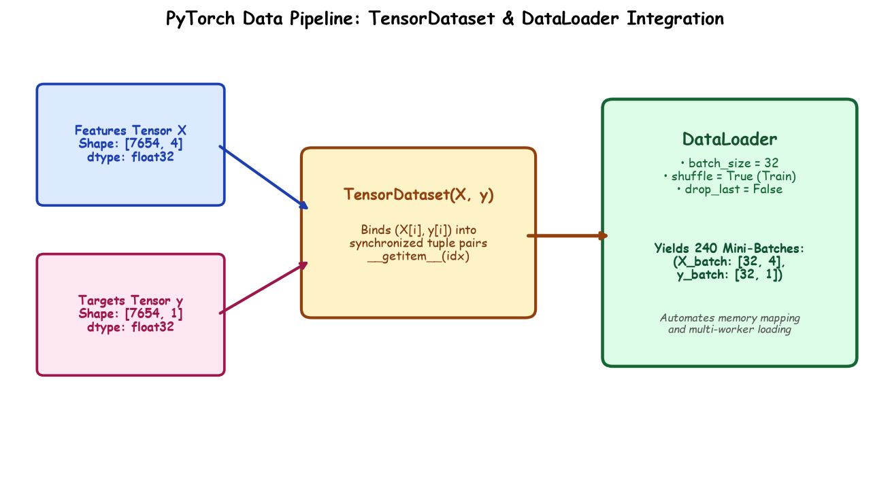

# Submodule 38.03: PyTorch TensorDataset & DataLoader (Hinglish)

## 1. TensorDataset aur DataLoader kya hain?

Deep learning me saara data ek saath memory me nahi daalte. Data ko batches me todne ke liye PyTorch ke do tools use hote hain:
1. **`TensorDataset`**: Yeh features ($X$) aur labels ($y$) ko ek sath jod kar pairs $(x_i, y_i)$ bana deta hai.
2. **`DataLoader`**: Yeh ek intelligent generator hai jo data ke 32-32 samples ke tukde (mini-batches) banata hai aur unhe shuffle karta hai.



---

## 2. Implementation Code

```python
from torch.utils.data import TensorDataset, DataLoader

# 1. Dataset create karna
train_dataset = TensorDataset(X_train_tensor, y_train_tensor)
test_dataset = TensorDataset(X_test_tensor, y_test_tensor)

# 2. DataLoader create karna (Batch size = 32)
train_loader = DataLoader(train_dataset, batch_size=32, shuffle=True)
test_loader = DataLoader(test_dataset, batch_size=32, shuffle=False)

print("Total Batches in 1 Epoch:", len(train_loader))  # 240 batches
```

- **`shuffle=True` kyun lagaya?**: Training ke time par data ko har epoch me mix (shuffle) karna zaroori hota hai taaki model kisi specific sequence ko yaad na kar le (overfitting se bache).
- Testing me `shuffle=False` rakha jata hai kyunki evaluation me order se koi farak nahi padta.\n