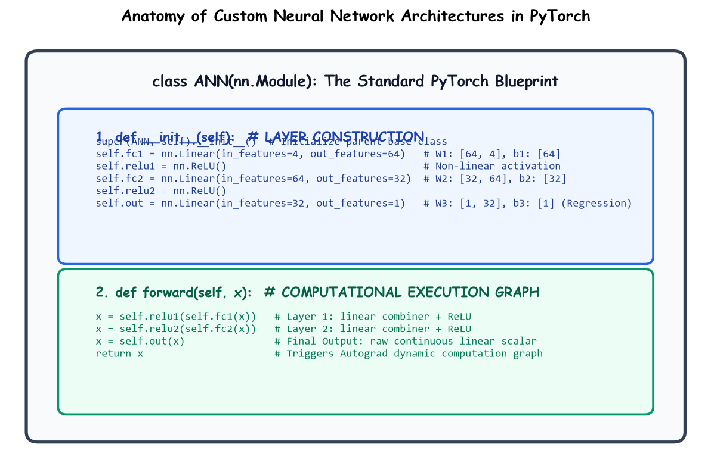

# Submodule 38.04: Building Custom PyTorch Models (`nn.Module`)

## 1. Introduction: Object-Oriented Deep Learning

PyTorch defines neural network architectures by subclassing `torch.nn.Module`. This object-oriented abstraction automates parameter registration, recursive device transfer (`.to('cuda')`), autograd backward hook attachments, and execution mode switching (`model.train()` vs `model.eval()`).



---

## 2. The Architectural Blueprint: `__init__` vs `forward`

Every custom PyTorch model requires two foundational methods:
1. **`__init__(self)`**: Instantiates and registers the parameterized structural layers (e.g., `nn.Linear`, `nn.ReLU`). Must always invoke `super().__init__()`.
2. **`forward(self, x)`**: Defines the runtime computational graph that maps incoming tensor `x` to output predictions.

---

## 3. Implementation of the Regression ANN

```python
import torch
import torch.nn as nn

class ANN(nn.Module):
    def __init__(self):
        super(ANN, self).__init__()
        # Layer 1: 4 input features -> 64 hidden neurons
        self.fc1 = nn.Linear(in_features=4, out_features=64)
        self.relu1 = nn.ReLU()
        
        # Layer 2: 64 hidden neurons -> 32 hidden neurons
        self.fc2 = nn.Linear(in_features=64, out_features=32)
        self.relu2 = nn.ReLU()
        
        # Output Layer: 32 hidden neurons -> 1 continuous regression scalar
        self.out = nn.Linear(in_features=32, out_features=1)
        
    def forward(self, x):
        x = self.relu1(self.fc1(x))
        x = self.relu2(self.fc2(x))
        x = self.out(x)  # No activation on regression output
        return x

# Instantiate model
model = ANN()
print(model)
```

---

## 4. Parameter Tensor Inspection & Verification

```python
total_params = 0
for name, param in model.named_parameters():
    print(f"Layer: {name:15} | Shape: {str(list(param.shape)):15} | Parameters: {param.numel()}")
    total_params += param.numel()

print("-" * 50)
print(f"Total Trainable Parameters: {total_params}")
```

### Parameter Calculation Verification:
1. Layer 1 (`fc1`): Weights $(64 \times 4 = 256) +$ Biases $(64) = 320$
2. Layer 2 (`fc2`): Weights $(32 \times 64 = 2048) +$ Biases $(32) = 2080$
3. Output Layer (`out`): Weights $(1 \times 32 = 32) +$ Biases $(1) = 33$
$$\text{Total Parameters} = 320 + 2080 + 33 = 2433 \text{ learnable parameters}$$\n