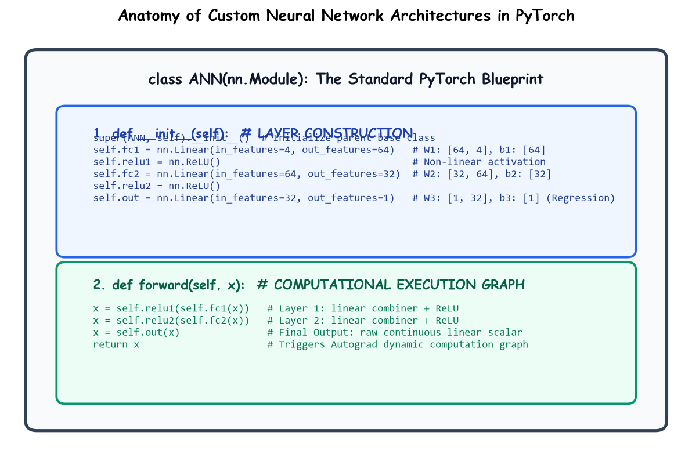

# Submodule 38.04: Building Custom PyTorch Models (`nn.Module`) (Hinglish)

## 1. PyTorch me Model Kaise Banate Hain?

PyTorch me model banane ke liye hum `nn.Module` class ko inherit karte hain. Isme do sabse zaroori functions hote hain:
1. **`__init__(self)`**: Yahan hum saari layers (jaise `nn.Linear`) aur activation functions define karte hain.
2. **`forward(self, x)`**: Yahan hum batate hain ki data pehle kis layer me jayega aur fir kahan niklega.



---

## 2. Complete Model Code

```python
import torch.nn as nn

class ANN(nn.Module):
    def __init__(self):
        super(ANN, self).__init__()
        # Input layer: 4 -> 64
        self.fc1 = nn.Linear(4, 64)
        self.relu1 = nn.ReLU()
        
        # Hidden layer: 64 -> 32
        self.fc2 = nn.Linear(64, 32)
        self.relu2 = nn.ReLU()
        
        # Output layer: 32 -> 1
        self.out = nn.Linear(32, 1)
        
    def forward(self, x):
        x = self.relu1(self.fc1(x))
        x = self.relu2(self.fc2(x))
        x = self.out(x)
        return x

model = ANN()
```

- **Output par ReLU kyun nahi lagaya?**: Kyunki Power Plant output ($PE$) continuous scalar number hai (jaise 450 MW). Agar ReLU lagayenge toh output galat zero ho sakta hai. Isiliye regression output hamesha linear rehta hai.\n