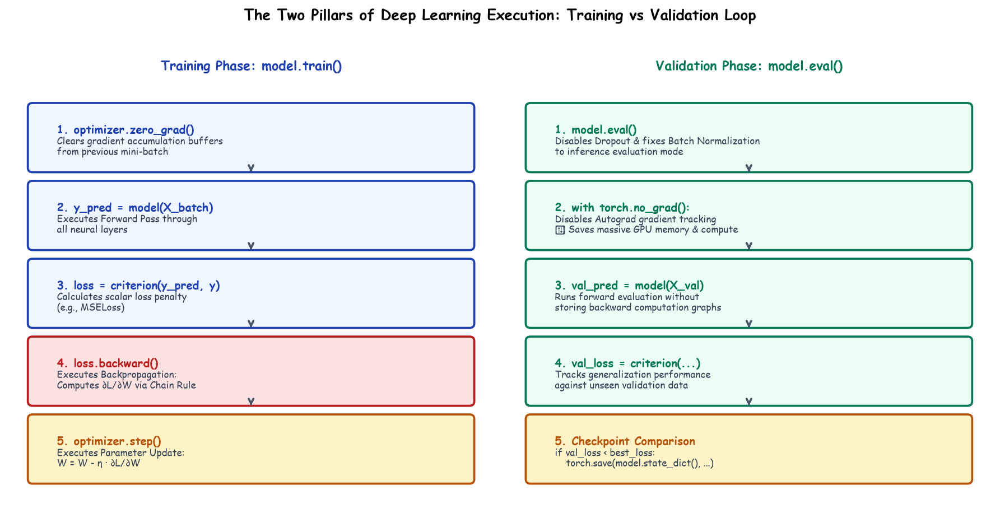

# Submodule 38.05: The PyTorch Training & Validation Loop

## 1. Introduction: Deconstructing the Optimization Engine

Unlike high-level frameworks where training is encapsulated behind a black box, PyTorch requires explicit management of the training loop. This architectural transparency enables exact debugging of gradient descent, validation monitoring, and custom learning rate schedules.



---

## 2. Setting Up Loss Function & Optimizer

```python
import torch.optim as optim

# Loss function: Mean Squared Error
criteria = nn.MSELoss()

# Adaptive Optimizer: Adam with learning rate 0.001
optimizer = optim.Adam(model.parameters(), lr=0.001)
```

---

## 3. The 5 Cardinal Steps of PyTorch Training

Inside every training batch iteration, the following sequence is executed strictly:
1. **`optimizer.zero_grad()`**: Clears gradient buffers from the previous step. Without this, PyTorch accumulates gradients additively: $g_{\text{new}} = g_{\text{old}} + g_{\text{current}}$.
2. **`output = model(X_batch)`**: Executes the forward pass through all layers.
3. **`loss = criteria(output, y_batch)`**: Evaluates scalar MSE loss.
4. **`loss.backward()`**: Triggers backpropagation, computing $\frac{\partial \mathcal{L}}{\partial W}$ and $\frac{\partial \mathcal{L}}{\partial b}$.
5. **`optimizer.step()`**: Updates parameters along the Adam descent vector:
   $$W \leftarrow W - \frac{\eta}{\sqrt{\hat{v}} + \epsilon} \hat{m}$$

---

## 4. Complete Training Loop Implementation with Validation

```python
epochs = 100
train_losses = []
val_losses = []
best_loss = float("inf")

for epoch in range(epochs):
    # ------------------ TRAINING PHASE ------------------
    model.train()
    running_train_loss = 0.0
    for X_batch, y_batch in train_loader:
        optimizer.zero_grad()
        output = model(X_batch)
        loss = criteria(output, y_batch)
        loss.backward()
        optimizer.step()
        running_train_loss += loss.item()
        
    avg_train_loss = running_train_loss / len(train_loader)
    train_losses.append(avg_train_loss)
    
    # ------------------ VALIDATION PHASE ------------------
    model.eval()
    running_val_loss = 0.0
    with torch.no_grad():
        for X_batch, y_batch in test_loader:
            output = model(X_batch)
            loss = criteria(output, y_batch)
            running_val_loss += loss.item()
            
    avg_val_loss = running_val_loss / len(test_loader)
    val_losses.append(avg_val_loss)
    
    # Model Checkpoint
    if avg_val_loss < best_loss:
        best_loss = avg_val_loss
        torch.save(model.state_dict(), "best_model.pt")
        
    if (epoch + 1) % 10 == 0:
        print(f"Epoch [{epoch+1:3d}/{epochs}] | Train Loss: {avg_train_loss:.4f} | Val Loss: {avg_val_loss:.4f}")
```\n