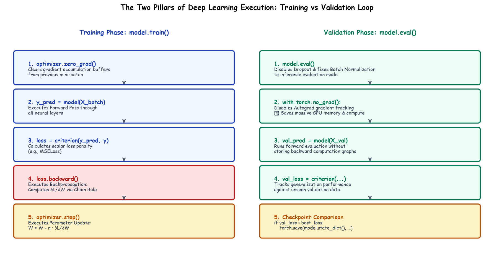

# Submodule 38.05: The PyTorch Training & Validation Loop (Hinglish)

## 1. PyTorch Training Loop ke 5 Golden Steps

Har batch me PyTorch training loop in 5 steps par chalta hai:



1. **`optimizer.zero_grad()`**: Purane gradients ko zero karna taaki naye batch ka gradient add na ho jaye.
2. **`output = model(X_batch)`**: Forward pass karke prediction $\hat{y}$ nikalna.
3. **`loss = criteria(output, y_batch)`**: MSE error calculate karna.
4. **`loss.backward()`**: Backpropagation chalana aur Chain Rule se gradients nikalna.
5. **`optimizer.step()`**: Weights aur biases ko update karna.

---

## 2. Validation Loop me `model.eval()` aur `torch.no_grad()` kyun lagate hain?

Validation karte waqt hum model ki performance check karte hain:
- **`model.eval()`**: Dropout aur Batch Normalization ko test mode me daal deta hai.
- **`with torch.no_grad():`**: Yeh Autograd ko band kar deta hai taaki computation graph memory me save na ho. Isse GPU ki memory bachti hai aur testing $3\times$ tezi se hoti hai!

---

## 3. Code Example

```python
for epoch in range(100):
    model.train()
    for X_batch, y_batch in train_loader:
        optimizer.zero_grad()
        output = model(X_batch)
        loss = criteria(output, y_batch)
        loss.backward()
        optimizer.step()
```\n