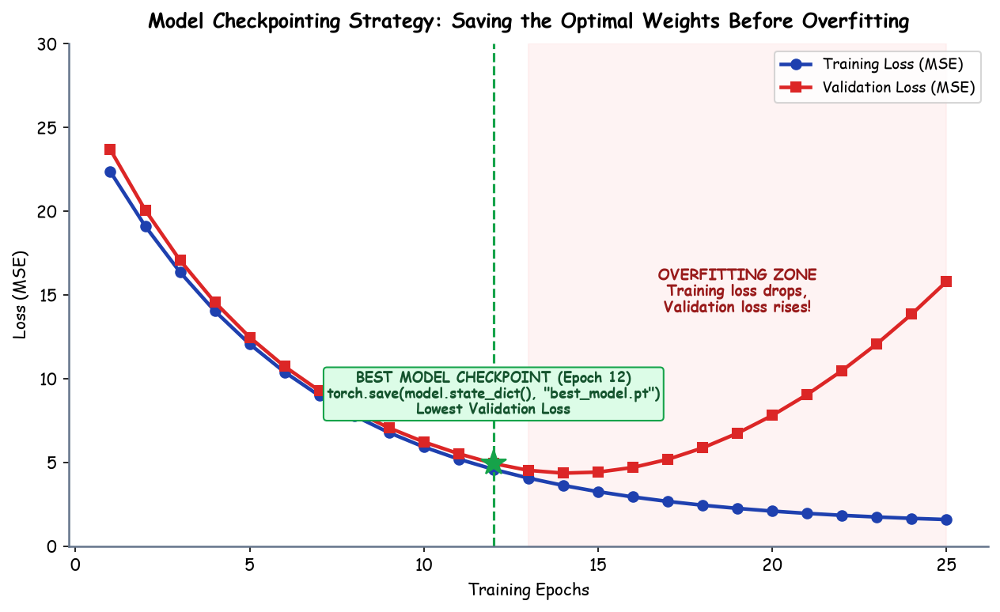

# Submodule 38.06: Model Checkpointing, `state_dict`, and Best Model Selection in PyTorch

## 1. Conceptual Foundation: The Need for Checkpointing

During neural network training across many iterations (epochs), weights are continuously updated via gradient descent. As training progresses:
- **Training Loss** almost always continues to decrease because the model fits the training samples deeper and deeper.
- **Validation Loss**, however, typically reaches an optimal minimum (representing maximum generalization power) and then begins to rise. This inflection point marks the onset of **overfitting** — where the model memorizes idiosyncratic training noise rather than generalized underlying distributions.

```
Loss
 ^
 |    \
 |     \  Validation Loss (Starts rising -> Overfitting!)
 |      \      /------------
 |       \____/  <- BEST MODEL CHECKPOINT (Minimum Val Loss)
 |        \
 |         \______ Training Loss (Continues decreasing)
 +--------------------------------------------------------> Epochs
```

If we simply save the model weights at the final epoch $E_{\text{final}}$, we inevitably save an **overfitted model**. To capture peak generalization performance, we must implement **Model Checkpointing** — saving parameter states to disk whenever the model achieves a new all-time low validation loss.

---

## 2. What is `model.state_dict()`?

In PyTorch, a model's learnable parameters (weights and biases) are encapsulated in an `OrderedDict` called the **`state_dict`**:
- Each layer with learnable parameters has entries for its weight matrix (`layer.weight`) and bias vector (`layer.bias`).
- Layers without parameters (such as `nn.ReLU`, `nn.Flatten`, or `nn.Dropout`) do not produce entries in the `state_dict`.

```python
for param_tensor in model.state_dict():
    print(param_tensor, "\t", model.state_dict()[param_tensor].size())
```
Sample Output:
```
model.0.weight   torch.Size([64, 4])
model.0.bias     torch.Size([64])
model.2.weight   torch.Size([32, 64])
model.2.bias     torch.Size([32])
model.4.weight   torch.Size([1, 32])
model.4.bias     torch.Size([1])
```

### Why Save `state_dict` Instead of the Entire Model?
1. **Lightweight & Clean**: Only numerical tensors and layer names are saved, resulting in minimal file size (~KB to few MBs vs large serialized python pickles).
2. **Portability & Decoupling**: Saving the entire model (`torch.save(model, path)`) serializes the Python class definition via `pickle`. If class definitions, module hierarchies, or directory structures change later, unpickling fails. Saving `state_dict` allows weights to be cleanly injected into any compatible architecture anywhere.

---

## 3. Hand-Drawn Educational Diagram: Model Checkpointing Workflow

The following notebook-style diagram illustrates the step-by-step logic of checking validation loss against the historical best, saving to disk, and restoring parameters for deployment.



---

## 4. PyTorch Implementation: Tracking Best Validation Loss

```python
import torch
import torch.nn as nn
import torch.optim as optim

# Initialize best loss tracker to infinity
best_val_loss = float('inf')
best_model_path = "best_model.pt"

epochs = 100
for epoch in range(epochs):
    # ---------------- TRAINING ----------------
    model.train()
    running_train_loss = 0.0
    for xb, yb in train_loader:
        optimizer.zero_grad()
        predictions = model(xb)
        loss = criteria(predictions, yb)
        loss.backward()
        optimizer.step()
        running_train_loss += loss.item()
    
    epoch_train_loss = running_train_loss / len(train_loader)

    # ---------------- VALIDATION ----------------
    model.eval()
    running_val_loss = 0.0
    with torch.no_grad():
        for xb, yb in val_loader:
            predictions = model(xb)
            loss = criteria(predictions, yb)
            running_val_loss += loss.item()
            
    epoch_val_loss = running_val_loss / len(val_loader)

    # ---------------- CHECKPOINTING ----------------
    if epoch_val_loss < best_val_loss:
        best_val_loss = epoch_val_loss
        torch.save(model.state_dict(), best_model_path)
        print(f"Epoch {epoch+1:03d}: [NEW BEST] Val Loss reduced to {best_val_loss:.4f} -> Saved checkpoint to '{best_model_path}'")
    else:
        print(f"Epoch {epoch+1:03d}: Train Loss: {epoch_train_loss:.4f} | Val Loss: {epoch_val_loss:.4f}")
```

---

## 5. Restoring and Loading the Best Model

When training terminates or when preparing the model for inference/production:
```python
# 1. Instantiate the pristine architecture class
restored_model = ANN()

# 2. Load the state dictionary from disk
state_dict = torch.load("best_model.pt", weights_only=True)

# 3. Inject parameter weights into the architecture
restored_model.load_state_dict(state_dict)

# 4. Set to evaluation mode for inference
restored_model.eval()

print("Best model checkpoint loaded successfully! Ready for inference.")
```

> [!TIP]
> Notice the return value when calling `load_state_dict`: `<All keys matched successfully>`. This confirms that every tensor key in the serialized dictionary matched the target architecture exactly with no missing or unexpected parameters.
