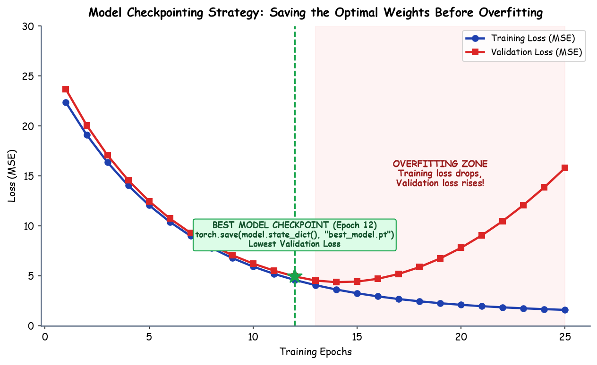

# Submodule 38.06: Model Checkpointing, `state_dict`, aur Best Model Selection (Hinglish Guide)

## 1. Checkpointing Ki Zaroorat Kyun Hoti Hai?

Deep learning model ko jab hum multiple epochs ke liye train karte hain, toh har epoch mein weights update hote rehte hain:
- **Training Loss** lagataar decrease hota rehta hai kyunki model training data ke patterns ko memorize karne lagta hai.
- Lekin **Validation Loss** ek certain point tak decrease hota hai (jahan generalization maximum hota hai) aur uske baad **increase** hone lagta hai. Is point par **Overfitting** shuru ho jati hai.

```
Loss
 ^
 |    \
 |     \  Validation Loss (Badhne laga -> Overfitting!)
 |      \      /------------
 |       \____/  <- BEST MODEL CHECKPOINT (Minimum Validation Loss)
 |        \
 |         \______ Training Loss (Hamesha ghata rehta hai)
 +--------------------------------------------------------> Epochs
```

Agar hum aakhri epoch par model ko save karenge, toh hum ek **overfitted model** save kar rahe honge. Isiliye hume chahiye ki jaise hi validation loss apne all-time minimum par aaye, hum us instant par model ke parameters ko disk par save kar lein — is process ko **Model Checkpointing** kehte hain.

---

## 2. `model.state_dict()` Kya Hai?

PyTorch ke andar model ke saare learnable parameters (weights aur biases) ek Python `OrderedDict` mein store hote hain jise **`state_dict`** bola jata hai:
- Jin layers mein weights hote hain (jaise `nn.Linear`), unke weights aur bias tensors is dictionary mein hote hain.
- Activation functions (jaise `nn.ReLU`) ya non-parametric layers is dictionary mein koi entry nahi banate.

```python
for param_tensor in model.state_dict():
    print(param_tensor, "\t", model.state_dict()[param_tensor].size())
```

### Pure Model ke bajaye `state_dict` save karna kyun best practice hai?
1. **Lightweight & Fast**: Isme sirf numerical weight values save hoti hain, koi unnecessary Python serialization overhead nahi hota.
2. **Architecture Decoupling**: Agar hum `torch.save(model, path)` karte hain, toh Python ka `pickle` module use hota hai jo class structure par depend karta hai. Code refactor hone par file corrupt ya unreadable ho sakti hai. Jabki `state_dict` ek standard dictionary hai jisko kisi bhi system par load kiya ja sakta hai.

---

## 3. Hand-Drawn Educational Diagram: Model Checkpointing Workflow

Neeche diya gaya student-style handwritten diagram checkpointing logic ko step-by-step explain karta hai:



---

## 4. PyTorch Code: Best Validation Loss Tracking Loop

```python
import torch

# Minimum loss track karne ke liye variable ko infinity se initialise karte hain
best_val_loss = float('inf')
best_model_path = "best_model.pt"

epochs = 100
for epoch in range(epochs):
    model.train()
    running_train_loss = 0.0
    for xb, yb in train_loader:
        optimizer.zero_grad()
        preds = model(xb)
        loss = criteria(preds, yb)
        loss.backward()
        optimizer.step()
        running_train_loss += loss.item()

    # Validation Phase
    model.eval()
    running_val_loss = 0.0
    with torch.no_grad():
        for xb, yb in val_loader:
            preds = model(xb)
            loss = criteria(preds, yb)
            running_val_loss += loss.item()

    val_loss = running_val_loss / len(val_loader)

    # Checkpoint Condition: Agar current loss pichle best se chhota hai
    if val_loss < best_val_loss:
        best_val_loss = val_loss
        torch.save(model.state_dict(), best_model_path)
        print(f"Epoch {epoch+1}: Validation Loss improve ho gaya -> {best_val_loss:.4f} (Saved to {best_model_path})")
```

---

## 5. Model Ko Disk Se Reload Karna (Inference Mode)

Deployment ya testing ke time model ko load karne ke steps:
```python
# 1. Model class ka blank instance banayein
model = ANN()

# 2. Disk se weights load karke architecture mein inject karein
model.load_state_dict(torch.load("best_model.pt", weights_only=True))

# 3. Model ko evaluation mode mein daalein
model.eval()

print("Best model safaltapoorvak load ho gaya!")
```
