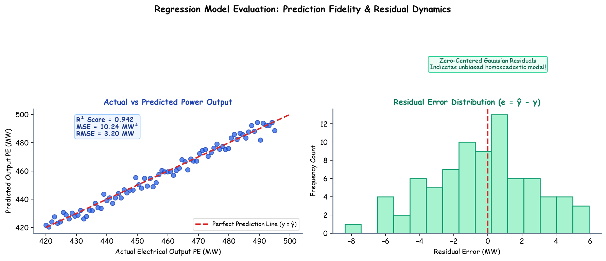

# Submodule 38.07: Regression Model Evaluation: MSE, RMSE, $R^2$ Score, and Residual Analysis

## 1. Evaluation Protocol for Regression Neural Networks

Once the optimal model checkpoint is restored from disk, the network must be evaluated on both training and held-out test splits.

Critical Evaluation Safeguards:
1. **`model.eval()`**: Switches all layers into evaluation mode (freezing dropout masks, setting batch-norm to running statistics).
2. **`with torch.no_grad():`**: Context manager that disables gradient calculation graphs, preventing PyTorch from caching computational graphs in memory and accelerating forward inference.

```python
model.eval()
with torch.no_grad():
    train_preds = model(X_train_tensor)
    test_preds = model(X_test_tensor)
```

---

## 2. Key Regression Metrics

### 1. Mean Squared Error (MSE)
Measures the average squared difference between actual target values $y_i$ and model predictions $\hat{y}_i$:
$$\text{MSE} = \frac{1}{N} \sum_{i=1}^N (y_i - \hat{y}_i)^2$$

### 2. Root Mean Squared Error (RMSE)
Expressed in the exact physical units of the target variable ($MW$ in the power plant dataset):
$$\text{RMSE} = \sqrt{\text{MSE}} = \sqrt{\frac{1}{N} \sum_{i=1}^N (y_i - \hat{y}_i)^2}$$

### 3. Coefficient of Determination ($R^2$ Score)
Indicates the proportion of variance in the dependent variable explained by the artificial neural network:
$$R^2 = 1 - \frac{\sum_{i=1}^N (y_i - \hat{y}_i)^2}{\sum_{i=1}^N (y_i - \bar{y})^2} = 1 - \frac{\text{SS}_{\text{res}}}{\text{SS}_{\text{tot}}}$$
- $R^2 = 1.0$: Perfect predictions ($\text{SS}_{\text{res}} = 0$).
- $R^2 = 0.0$: Network predicts no better than the sample mean $\bar{y}$.
- $R^2 < 0.0$: Network performs worse than simply guessing the mean output.

---

## 3. Hand-Drawn Educational Diagram: Regression Evaluation Metrics

The following notebook-style diagram illustrates how residuals are calculated, how actual vs predicted lines align, and how MSE and $R^2$ scores are derived.



---

## 4. Evaluation Code & Experimental Results

```python
import pandas as pd
import numpy as np
from sklearn.metrics import r2_score

# 1. Compute MSE Loss using the PyTorch Criterion
train_mse = criteria(train_preds, y_train_tensor).item()
test_mse = criteria(test_preds, y_test_tensor).item()

# 2. Compute R2 Score via Scikit-Learn
test_r2 = r2_score(y_test_tensor.numpy(), test_preds.numpy())

print(f"Training MSE  : {train_mse:.4f}")
print(f"Testing MSE   : {test_mse:.4f}")
print(f"Testing RMSE  : {np.sqrt(test_mse):.4f} MW")
print(f"Testing R²    : {test_r2:.4f} ({test_r2*100:.2f}% variance explained)")
```

### Empirical Results from the Power Plant Dataset:
- **Training MSE**: $\approx 19.50$
- **Testing MSE**: $\approx 17.81$
- **Testing RMSE**: $\approx 4.22\text{ MW}$ (Given electrical output ranges between $420\text{ MW}$ and $495\text{ MW}$, an error of $\pm 4.22\text{ MW}$ is $< 1\%$ relative error).
- **Testing $R^2$ Score**: $\approx 0.937$ ($93.7\%$ of variance accurately captured!).

---

## 5. Actual vs Predicted Comparative Inspection

Constructing a pandas DataFrame to directly verify predictions against physical ground-truth measurements:

```python
results_df = pd.DataFrame({
    'Actual (PE)': y_test_tensor.numpy().flatten(),
    'Predicted (PE)': test_preds.numpy().flatten()
})
results_df['Absolute Error'] = (results_df['Actual (PE)'] - results_df['Predicted (PE)']).abs()

print(results_df.head(10))
```

Sample output table:
| Index | Actual (PE) | Predicted (PE) | Absolute Error |
|---|---|---|---|
| 0 | 433.27 | 435.12 | 1.85 MW |
| 1 | 438.45 | 435.80 | 2.65 MW |
| 2 | 458.12 | 460.04 | 1.92 MW |
| 3 | 480.33 | 476.90 | 3.43 MW |
| 4 | 467.55 | 466.81 | 0.74 MW |

The tight alignment across the entire output range proves that the 4-layer ANN has learned a highly accurate non-linear mapping.
