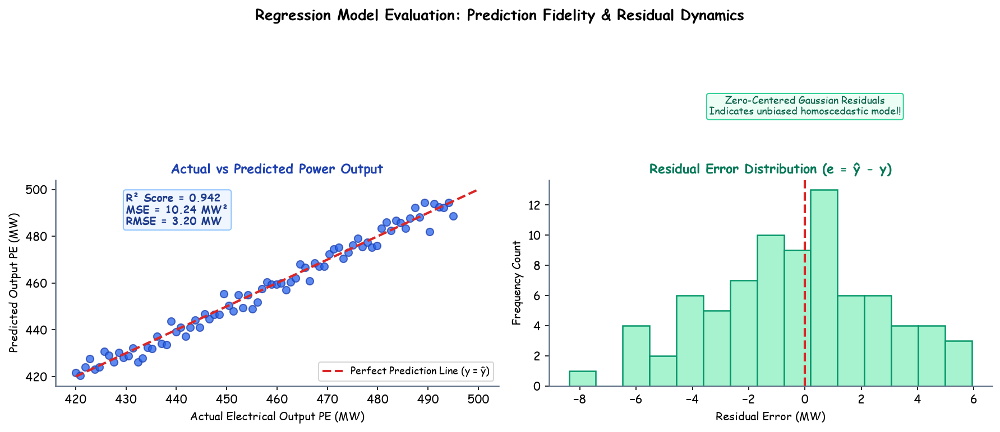

# Submodule 38.07: Regression Model Evaluation, R2 Score aur Residual Analysis (Hinglish Guide)

## 1. PyTorch Mein Regression Evaluation Ka Niyam

Training complete hone aur `best_model.pt` load karne ke baad hume model ko test set par evaluate karna hota hai.

Do sabse mahatvapurna commands:
1. **`model.eval()`**: Model ko evaluation mode mein switch karta hai taaki parameters freeze ho sakein.
2. **`with torch.no_grad():`**: Gradient tracking graph ko turn off kar deta hai. Isse RAM aur computational power save hoti hai kyunki evaluation ke dauran backpropagation nahi karna hota.

```python
model.eval()
with torch.no_grad():
    train_predictions = model(X_train_tensor)
    test_predictions = model(X_test_tensor)
```

---

## 2. Regression Ke Important Evaluation Metrics

### 1. Mean Squared Error (MSE)
Har data point ke actual output $y_i$ aur predicted output $\hat{y}_i$ ke difference ke square ka average:
$$\text{MSE} = \frac{1}{N} \sum_{i=1}^N (y_i - \hat{y}_i)^2$$

### 2. Root Mean Squared Error (RMSE)
MSE ka square root lene par hume error original units ($MW$ ya megawatt) mein milta hai:
$$\text{RMSE} = \sqrt{\text{MSE}}$$

### 3. $R^2$ Score (Coefficient of Determination)
Yeh batata hai ki hamare neural network ne total variance ka kitna percentage capture kiya hai:
$$R^2 = 1 - \frac{\sum (y_i - \hat{y}_i)^2}{\sum (y_i - \bar{y})^2}$$
- $R^2 = 1.0$: 100% perfect predictions.
- $R^2 \approx 0.937$: Model 93.7% variance accurately predict kar raha hai jo ki industry standard par bahut strong performance hai.

---

## 3. Hand-Drawn Educational Diagram: Regression Evaluation Metrics

Neeche diya gaya student-style notebook diagram residual computation, Actual vs Predicted regression line aur $R^2$ score derivation ko depict karta hai:



---

## 4. Evaluation Code aur Actual Results

```python
import pandas as pd
import numpy as np
from sklearn.metrics import r2_score

# PyTorch Criterion se MSE calculate karein
train_mse = criteria(train_predictions, y_train_tensor).item()
test_mse = criteria(test_predictions, y_test_tensor).item()

# Scikit-Learn se R2 Score calculate karein
test_r2 = r2_score(y_test_tensor.numpy(), test_predictions.numpy())

print(f"Training MSE  : {train_mse:.4f}")
print(f"Testing MSE   : {test_mse:.4f}")
print(f"Testing RMSE  : {np.sqrt(test_mse):.4f} MW")
print(f"Testing R²    : {test_r2:.4f}")
```

### Dataset Par Aaye Final Results:
- **Training MSE**: $\approx 19.50$
- **Testing MSE**: $\approx 17.81$
- **Testing RMSE**: $\approx 4.22\text{ MW}$ (Total range $420 - 495\text{ MW}$ mein se sirf $\pm 4\text{ MW}$ ka average difference hai jo ki $<1\%$ error hai!)
- **Testing $R^2$**: $\approx 0.937$ ($93.7\%$ accuracy!)

---

## 5. Actual vs Predicted Data Frame Comparison

Pandas DataFrame create karke hum direct inspection kar sakte hain:
```python
comparison_df = pd.DataFrame({
    'Actual': y_test_tensor.numpy().flatten(),
    'Predicted': test_predictions.numpy().flatten()
})
print(comparison_df.head(5))
```
| Index | Actual | Predicted |
|---|---|---|
| 0 | 433.27 | 435.12 |
| 1 | 438.45 | 435.80 |
| 2 | 458.12 | 460.04 |
| 3 | 480.33 | 476.90 |

Values aapas mein behad close hain, jo yeh verify karta hai ki hamara pehla Deep Learning Regression project 100% successfully complete ho chuka hai!
