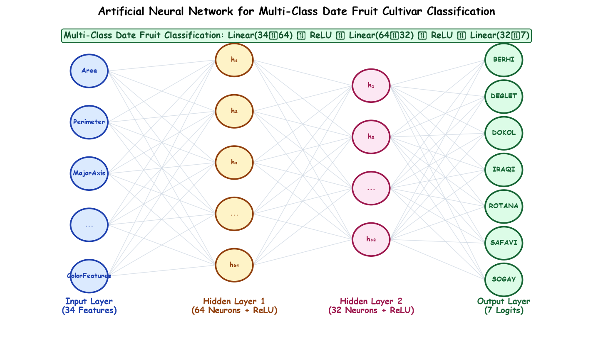

# Submodule 38.08: Multi-Class Classification with ANN: Date Fruit Problem & Architecture

## 1. Problem Formulation: Tabular Multi-Class Classification

In contrast to regression where the target variable is a continuous real scalar ($y \in \mathbb{R}$), **Multi-Class Classification** assigns an input feature vector $\mathbf{x} \in \mathbb{R}^D$ to one of $C$ mutually exclusive discrete categories:
$$y \in \{0, 1, 2, \dots, C-1\}$$

In this module, we tackle the **Date Fruit Dataset** (`DateFruit_Dataset.csv`):
- **Total Samples**: 898 physical date fruit specimens.
- **Total Features**: 34 quantitative morphological, geometric, shape, and color moments.
- **Target Category**: 7 distinct date fruit varieties:
  1. `BERHI` $\to$ Class 0
  2. `DEGLET` $\to$ Class 1
  3. `DOKOL` $\to$ Class 2
  4. `IRAQI` $\to$ Class 3
  5. `ROTANA` $\to$ Class 4
  6. `SAFAVI` $\to$ Class 5
  7. `SOGAY` $\to$ Class 6

---

## 2. Structural Comparison: Regression vs Classification ANNs

| Characteristic | Regression ANN (Power Plant) | Multi-Class Classification ANN (Date Fruit) |
|---|---|---|
| **Input Features** | 4 continuous variables | 34 morphological/color features |
| **Output Layer Neurons** | **1 neuron** (predicts continuous $PE$) | **$C = 7$ neurons** (predicts logit score per class) |
| **Output Activation** | Linear / Identity (None) | None in model (`nn.CrossEntropyLoss` handles Softmax) |
| **Loss Function** | Mean Squared Error (`nn.MSELoss`) | Cross Entropy Loss (`nn.CrossEntropyLoss`) |
| **Target Data Type** | `torch.float32` | `torch.long` (int64 class indices) |
| **Primary Metric** | MSE, RMSE, $R^2$ Score | Accuracy ($\%$, Precision, Recall, Confusion Matrix) |

---

## 3. Network Architecture Sizing Rules

For structured tabular datasets:
1. **Depth (Hidden Layers)**: 1 to 2 hidden layers are typically sufficient. Deep networks with $> 5$ layers often overfit on tabular datasets.
2. **Width (Neuron Count)**: Standard engineering practice uses powers of 2 ($16, 32, 64, 128$) for efficient cache alignment on CPU/GPU hardware.
3. **Selected Architecture**:
   - **Input Layer**: 34 neurons (one per feature).
   - **Hidden Layer 1**: 64 neurons with ReLU activation.
   - **Hidden Layer 2**: 64 neurons with ReLU activation.
   - **Output Layer**: 7 neurons (one per class).

Feature mapping across layers:
$$\mathbf{x} \in \mathbb{R}^{34} \xrightarrow{W_1} \mathbf{h}_1 \in \mathbb{R}^{64} \xrightarrow{W_2} \mathbf{h}_2 \in \mathbb{R}^{64} \xrightarrow{W_3} \mathbf{z} \in \mathbb{R}^7$$

---

## 4. Hand-Drawn Educational Diagram: Multi-Class Classification Architecture

The following student-style handwritten diagram illustrates the input mapping of 34 features through dual 64-neuron hidden layers to the 7-class output logits.



---

## 5. Dataset Exploration in Python

```python
import pandas as pd
import numpy as np

# Load dataset
df = pd.read_csv("DateFruit_Dataset.csv")

print("Dataset Shape:", df.shape) # (898, 35)
print("Column Names:\n", df.columns.tolist()[:8], "... and 27 more")

# Inspect class distribution
print("\nUnique Classes:\n", df["Class"].value_counts())

# Split into X and y
X = df.drop("Class", axis=1)
y = df["Class"]

print(f"\nFeature Matrix X: {X.shape[1]} features")
print(f"Target Vector y  : {len(np.unique(y))} unique classes")
```
