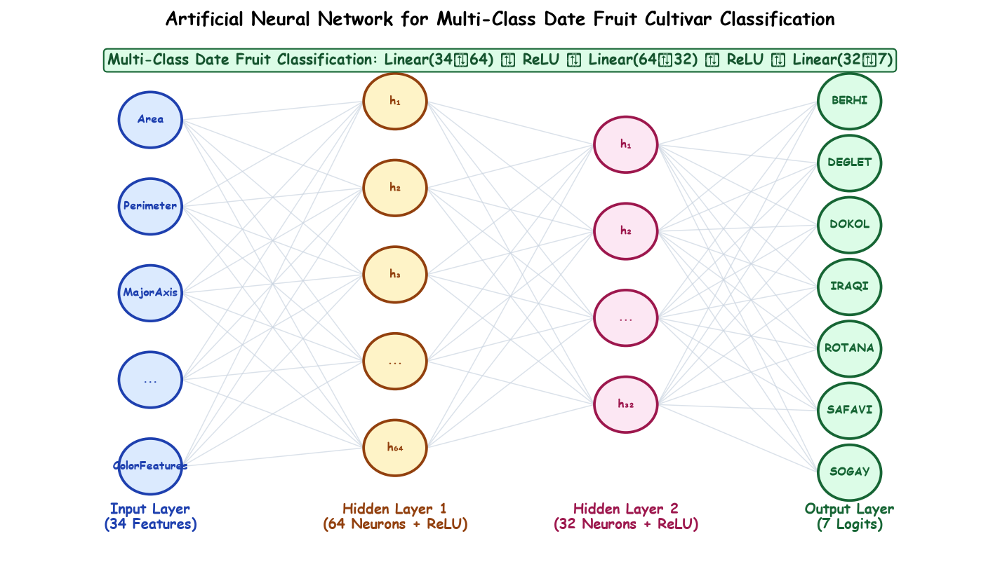

# Submodule 38.08: Multi-Class Classification ANN: Problem Formulation aur Architecture (Hinglish Guide)

## 1. Problem Samajhna: Multi-Class Classification

Pichle submodules mein humne **Regression** seekha jahan model continuous numeric value (jaise Power Output $MW$) predict kar raha tha.
Is submodule mein hum **Multi-Class Classification** implement karenge jahan target variable discrete category hota hai:
$$y \in \{0, 1, 2, \dots, C-1\}$$

Hamara project dataset hai **Date Fruit Dataset** (`DateFruit_Dataset.csv`):
- **Total Samples**: 898 khajur (date fruit specimens)
- **Features**: 34 physical features (Area, Perimeter, Major Axis, Minor Axis, Solidity, RGB Color moments, etc.)
- **Output Classes**: 7 alag-alag khajur ki varieties:
  1. `BERHI`
  2. `DEGLET`
  3. `DOKOL`
  4. `IRAQI`
  5. `ROTANA`
  6. `SAFAVI`
  7. `SOGAY`

---

## 2. Regression vs Multi-Class Classification ANN Mein Antar

| Feature | Regression Model | Classification Model |
|---|---|---|
| **Input Shape** | 4 features | 34 features |
| **Output Layer Neurons** | **1 neuron** (continuous scalar) | **7 neurons** (har class ke liye ek score/logit) |
| **Output Activation** | None (Linear) | Model ke andar None (`CrossEntropyLoss` Softmax khud lagata hai) |
| **Loss Function** | `nn.MSELoss()` | `nn.CrossEntropyLoss()` |
| **Target Tensor Type** | `torch.float32` | `torch.long` (Integer 0 to 6) |
| **Evaluation Metric** | MSE, RMSE, $R^2$ Score | Accuracy Percentage ($\%$) |

---

## 3. Architecture Design Rules (Neurons aur Layers Chunne Ka Formula)

Tabular structured data ke liye Deep Learning best practices:
1. **Hidden Layers Ki Sankhya**: Tabular data ke liye 1 se 2 hidden layers kaafi hoti hain. Jyada deep network banane se overfitting hone lagti hai.
2. **Neurons Ki Sankhya**: General convention ke mutabiq powers of 2 ($16, 32, 64, 128$) use karte hain taaki GPU aur CPU memory optimization best rahe.
3. **Selected Architecture**:
   - Input Layer: 34 input neurons
   - Hidden Layer 1: 64 neurons + ReLU
   - Hidden Layer 2: 64 neurons + ReLU
   - Output Layer: 7 neurons (7 classes ke raw logits)

---

## 4. Hand-Drawn Educational Diagram: Classification Architecture

Neeche diya gaya clean, student notebook style diagram 34 inputs se lekar 7 class logits tak ke mapping ko visualize karta hai:



---

## 5. Python Exploration Code

```python
import pandas as pd
import numpy as np

# Dataset load karein
df = pd.read_csv("DateFruit_Dataset.csv")
print("Dataframe shape:", df.shape) # 898 rows, 35 columns

# Classes count karein
print(df["Class"].value_counts())

X = df.drop("Class", axis=1)
y = df["Class"]

print("Number of Features:", X.shape[1]) # 34 features
print("Number of Classes :", len(y.unique())) # 7 classes
```
