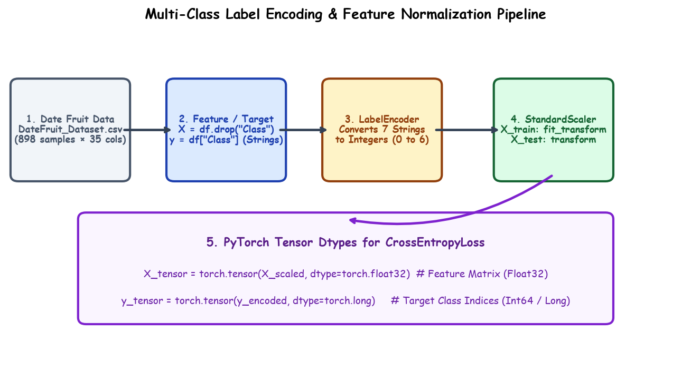

# Submodule 38.09: Multi-Class Preprocessing: Label Encoding, Feature Scaling, and PyTorch Pipelines

## 1. Target Encoding: `LabelEncoder`

In multi-class machine learning, target labels often appear as strings (e.g. `'BERHI'`, `'SAFAVI'`). PyTorch loss functions require integer labels $0, 1, \dots, C-1$.
Scikit-Learn's `LabelEncoder` encodes textual labels into integer indices:

```python
from sklearn.preprocessing import LabelEncoder

le = LabelEncoder()
y_encoded = le.fit_transform(y)
```

Mapping created:
```
BERHI   -> 0
DEGLET  -> 1
DOKOL   -> 2
IRAQI   -> 3
ROTANA  -> 4
SAFAVI  -> 5
SOGAY   -> 6
```

---

## 2. Feature Standardization: `StandardScaler`

The 34 features span vastly different scales:
- `Area`: $200,000$ to $600,000$ pixels
- `ConvexArea`: $> 3,000,000$
- `Solidity`: $0.85$ to $0.99$
- `Eccentricity`: $0.5$ to $0.9$

Features with larger variance dominate gradient descent updates unless normalized. `StandardScaler` centers each feature at zero mean and unit variance:
$$z = \frac{x - \mu}{\sigma}$$

### Critical Leakage Rule:
- `scaler.fit_transform(X_train)`: Calculates $\mu_{\text{train}}$ and $\sigma_{\text{train}}$ and normalizes training data.
- `scaler.transform(X_test)`: Reuses training $\mu_{\text{train}}$ and $\sigma_{\text{train}}$ to transform test data without data leakage!

---

## 3. Hand-Drawn Educational Diagram: Classification Preprocessing Pipeline

The following diagram illustrates the transformation flow from raw CSV columns, through label encoding and train-test splitting, to scaled tensors and mini-batch DataLoaders.



---

## 4. PyTorch Tensor Preparation: Float32 vs LongTensor

A common beginner pitfall in PyTorch multi-class classification is using the incorrect data type for target vectors.

| Tensor | Data Type | Reason |
|---|---|---|
| **Input Features ($X$)** | `torch.float32` | Neural network weights and activations require continuous 32-bit floating point precision. |
| **Target Labels ($y$)** | `torch.long` (`int64`) | `nn.CrossEntropyLoss` expects discrete class category indices from $0$ to $C-1$. Floats will trigger a runtime error! |

```python
import torch

X_train_tensor = torch.tensor(X_train_scaled, dtype=torch.float32)
y_train_tensor = torch.tensor(y_train, dtype=torch.long) # CRITICAL: dtype=torch.long!

X_test_tensor = torch.tensor(X_test_scaled, dtype=torch.float32)
y_test_tensor = torch.tensor(y_test, dtype=torch.long)
```

---

## 5. TensorDataset & DataLoader with Shuffling

```python
from torch.utils.data import TensorDataset, DataLoader

# Pair features with targets
train_dataset = TensorDataset(X_train_tensor, y_train_tensor)
test_dataset = TensorDataset(X_test_tensor, y_test_tensor)

# Build DataLoaders
train_loader = DataLoader(train_dataset, batch_size=32, shuffle=True)
test_loader = DataLoader(test_dataset, batch_size=32, shuffle=False)
```

### Why `shuffle=True` is Mandatory in Classification
In many datasets (including date fruits), rows are sorted or grouped by category. If `shuffle=False`, each mini-batch would contain only one class, causing gradient descent to wildly oscillate and fail to generalize across classes.
