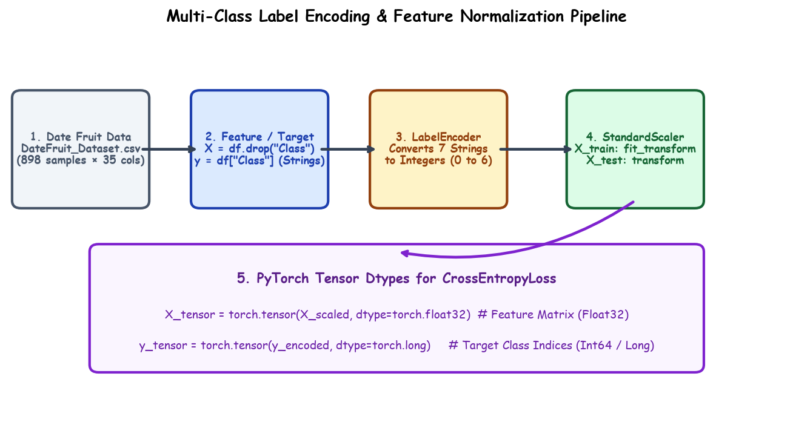

# Submodule 38.09: Multi-Class Preprocessing: Label Encoding, Scaling, aur Tensor Pipeline (Hinglish Guide)

## 1. Target Encoding: `LabelEncoder` Ka Upyog

Hamare dataset mein output column (`Class`) string names ke roop mein hai (`'BERHI'`, `'DEGLET'`, etc.). Neural network text ko directly process nahi kar sakta, usko integer indices $0$ to $C-1$ chahiye hote hain:

```python
from sklearn.preprocessing import LabelEncoder

le = LabelEncoder()
y = le.fit_transform(y)
```
Isse saari classes integer values $0, 1, 2, 3, 4, 5, 6$ mein map ho jati hain.

---

## 2. Feature Standardization: `StandardScaler`

Date fruit ke 34 features ke scale mein zameen-aasmaan ka farq hai:
- `Area`: Lakhon mein ($200,000$ to $500,000$)
- `Solidity` aur `Eccentricity`: $0$ se $1$ ke beech

Agar bina scale kiye network mein bhejenge, toh bade magnitude wale features gradients par dominate kar lenge aur network theek se learn nahi kar payega:
$$z = \frac{x - \mu}{\sigma}$$

```python
from sklearn.preprocessing import StandardScaler

scaler = StandardScaler()
X_train_scaled = scaler.fit_transform(X_train)
X_test_scaled = scaler.transform(X_test) # Data leakage se bachne ke liye sirf transform!
```

---

## 3. Hand-Drawn Educational Diagram: Preprocessing Pipeline

Neeche diya gaya student-style handwritten diagram raw CSV se lekar PyTorch mini-batches tak ke data pipeline ko step-by-step darshata hai:



---

## 4. PyTorch Tensors: `torch.float32` vs `torch.long` Ka Bada Niyam

Deep learning beginners aksar classification targets ke data type mein galti karte hain:

| Variable | Dtype | Kyun? |
|---|---|---|
| **Features ($X$)** | `torch.float32` | Sabhi weights aur floating point operations ke liye float zaroori hai. |
| **Target Labels ($y$)** | `torch.long` | `nn.CrossEntropyLoss` ko class index integer chahiye hota hai ($0$ se $6$). Agar yahan float bhejenge toh PyTorch runtime error de dega! |

```python
import torch

X_train_tensor = torch.tensor(X_train_scaled, dtype=torch.float32)
y_train_tensor = torch.tensor(y_train, dtype=torch.long) # IMPORTANT: torch.long

X_test_tensor = torch.tensor(X_test_scaled, dtype=torch.float32)
y_test_tensor = torch.tensor(y_test, dtype=torch.long)
```

---

## 5. TensorDataset aur DataLoader (Shuffle=True Kyun Zaroori Hai?)

```python
from torch.utils.data import TensorDataset, DataLoader

train_dataset = TensorDataset(X_train_tensor, y_train_tensor)
test_dataset = TensorDataset(X_test_tensor, y_test_tensor)

train_loader = DataLoader(train_dataset, batch_size=32, shuffle=True)
test_loader = DataLoader(test_dataset, batch_size=32, shuffle=False)
```

> [!IMPORTANT]
> **Classification mein `shuffle=True` kyun lazmi hai?**
> Dataset mein date fruits class-wise sorted ho sakte hain (pehle saare BERHI, fir DEGLET...). Agar shuffle nahi kiya, toh ek poore batch mein sirf ek hi class aayegi. Model har batch par confuse hoga aur gradient descent diverge ho jayega!
