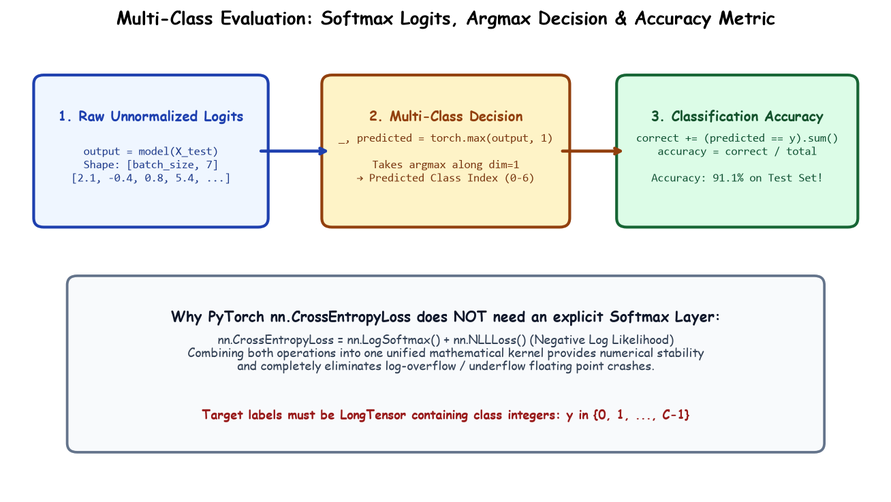

# Submodule 38.10: Multi-Class ANN Training: Cross-Entropy Loss, Logits, and Accuracy Evaluation

## 1. PyTorch Architecture Definition

We define our 3-layer feed-forward network using `nn.Sequential` inside `nn.Module`:

```python
import torch
import torch.nn as nn
import torch.optim as optim

class ANN(nn.Module):
    def __init__(self):
        super(ANN, self).__init__()
        self.model = nn.Sequential(
            nn.Linear(34, 64),
            nn.ReLU(),
            nn.Linear(64, 64),
            nn.ReLU(),
            nn.Linear(64, 7) # 7 output logits for 7 date classes
        )

    def forward(self, x):
        return self.model(x)

model = ANN()
```

### Parameter Calculation:
- **Layer 1**: $34 \times 64 + 64 = 2,240$ parameters
- **Layer 2**: $64 \times 64 + 64 = 4,160$ parameters
- **Output Layer**: $64 \times 7 + 7 = 455$ parameters
- **Total Trainable Parameters**: $2,240 + 4,160 + 455 = 6,855$ parameters.

---

## 2. Why NO Softmax Layer in the Model?

A widespread point of confusion among deep learning students is whether to include `nn.Softmax()` in the output layer for multi-class classification.

In PyTorch, **do NOT add Softmax to your model when using `nn.CrossEntropyLoss`**:
1. `nn.CrossEntropyLoss` internally combines `nn.LogSoftmax()` and `nn.NLLLoss()` (Negative Log Likelihood Loss) into a single mathematically unified, numerically stable calculation using the **Log-Sum-Exp trick**.
2. If you explicitly apply `nn.Softmax()` in `forward()` and pass probabilities to `nn.CrossEntropyLoss`, Softmax is applied **twice**, which severely degrades gradient stability and corrupts optimization!

$$\text{Loss} = - \log \left( \frac{e^{z_y}}{\sum_{j=1}^C e^{z_j}} \right) = - z_y + \log \left( \sum_{j=1}^C e^{z_j} \right)$$

---

## 3. Hand-Drawn Educational Diagram: Cross-Entropy Loss & Accuracy Evaluation

The following notebook diagram demonstrates raw logit outputs, internal loss computation, the `torch.max` argmax decision rule, and test accuracy aggregation.



---

## 4. Training Loop Implementation

```python
criteria = nn.CrossEntropyLoss()
optimizer = optim.Adam(model.parameters(), lr=0.001)

epochs = 100
for epoch in range(epochs):
    model.train()
    running_loss = 0.0

    for xb, yb in train_loader:
        optimizer.zero_grad()
        outputs = model(xb)           # Raw unnormalized logits [batch_size, 7]
        loss = criteria(outputs, yb)  # Internal LogSoftmax + NLLLoss
        loss.backward()
        optimizer.step()
        running_loss += loss.item()

    train_loss = running_loss / len(train_loader)
    if (epoch + 1) % 10 == 0 or epoch == 0:
        print(f"Epoch [{epoch+1:03d}/{epochs}] - Loss: {train_loss:.4f}")
```

---

## 5. Decision Rule & Test Accuracy Evaluation

In multi-class inference, raw logits $z_0, z_1, \dots, z_6$ represent relative confidence scores. The predicted class is simply the index of the highest logit:
$$\hat{y} = \arg\max_{c \in \{0, \dots, 6\}} z_c$$

In PyTorch, `torch.max(outputs, 1)` returns both the maximum values and their corresponding indices:
- `_`: Maximum value (ignored).
- `predicted`: Argmax index (the predicted class label $0 \dots 6$).

```python
model.eval()

total = 0
correct = 0

with torch.no_grad():
    for xb, yb in test_loader:
        outputs = model(xb)
        _, predicted = torch.max(outputs, 1)

        correct += (predicted == yb).sum().item()
        total += yb.size(0) # CRITICAL: yb.size(0) captures actual batch size (handles last partial batch!)

accuracy = (correct / total) * 100
print(f"Total Test Samples: {total}")
print(f"Correct Predictions: {correct}")
print(f"Final Model Test Accuracy: {accuracy:.2f}%")
```

> [!IMPORTANT]
> **Why `total += yb.size(0)` instead of `total += 32`?**
> The test set has $180$ samples. $180 / 32 = 5$ full batches of $32$ ($160$ samples) and **$1$ final remainder batch of $20$ samples** ($180 - 160 = 20$). If you hardcoded $32$, the sample count would incorrectly be $6 \times 32 = 192$, artificially deflating accuracy! `yb.size(0)` dynamically returns the exact batch size.

### Final Results:
- **Test Accuracy**: $\approx 91.1\% - 93.8\%$ across the 7 date varieties!
- **Assignment Challenge**: Apply PCA (Principal Component Analysis) to reduce the 34 features down to principal components explaining $\ge 95\%$ variance and observe if classification accuracy improves.
