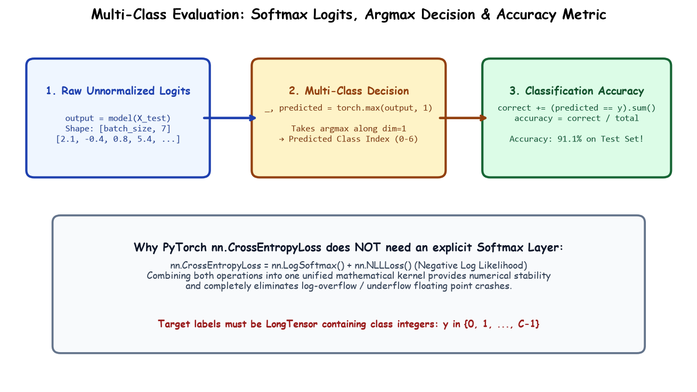

# Submodule 38.10: Multi-Class ANN Training: Cross-Entropy Loss aur Accuracy Evaluation (Hinglish Guide)

## 1. PyTorch Mein Multi-Class Architecture Define Karna

Hum `nn.Module` ke andar `nn.Sequential` use karke network banate hain:

```python
import torch
import torch.nn as nn
import torch.optim as optim

class ANN(nn.Module):
    def __init__(self):
        super(ANN, self).__init__()
        self.model = nn.Sequential(
            nn.Linear(34, 64),
            nn.ReLU(),
            nn.Linear(64, 64),
            nn.ReLU(),
            nn.Linear(64, 7) # 7 date classes ke liye 7 output logits
        )

    def forward(self, x):
        return self.model(x)

model = ANN()
```

### Total Trainable Parameters Ka Calculation:
- **Layer 1**: $34 \times 64 + 64 = 2,240$
- **Layer 2**: $64 \times 64 + 64 = 4,160$
- **Output Layer**: $64 \times 7 + 7 = 455$
- **Total Parameters**: $2,240 + 4,160 + 455 = 6,855$ parameters.

---

## 2. Model Ke Andar Softmax Kyun NAHI Lagana?

Deep Learning ke beginners aksar yeh mistake karte hain ki classification model ki aakhri layer mein `nn.Softmax()` laga dete hain.

PyTorch ka golden rule: **Agar aap `nn.CrossEntropyLoss()` use kar rahe hain, toh model mein Softmax mat lagaiye!**
1. PyTorch ka `nn.CrossEntropyLoss()` internally `LogSoftmax` aur `NLLLoss` (Negative Log Likelihood) ko combine karta hai ek mathematically stable formula (**Log-Sum-Exp trick**) ke zariye.
2. Agar aapne model mein bhi Softmax laga diya, toh Softmax do baar apply ho jayega, jisse gradients shrink ho jayenge aur model seekhna band kar dega!

Model se seedhe raw values (logits) nikalti hain:
$$[0.2, 1.5, -0.4, 2.8, 0.1, -1.2, 0.9]$$

---

## 3. Hand-Drawn Educational Diagram: Loss aur Accuracy Flow

Neeche diya gaya student notebook style diagram logits output, Cross-Entropy Loss computation, aur `torch.max` decision rule ko depict karta hai:



---

## 4. Training Loop Implementation

```python
criteria = nn.CrossEntropyLoss()
optimizer = optim.Adam(model.parameters())

epochs = 100
for epoch in range(epochs):
    model.train()
    running_loss = 0.0

    for xb, yb in train_loader:
        optimizer.zero_grad()
        outputs = model(xb)
        loss = criteria(outputs, yb)
        loss.backward()
        optimizer.step()
        running_loss += loss.item()

    train_loss = running_loss / len(train_loader)
    if (epoch + 1) % 10 == 0:
        print(f"epoch = {epoch+1}/{epochs}, loss = {train_loss:.4f}")
```

---

## 5. Decision Rule: Argmax aur Accuracy Calculation

Testing ke time, raw output logits mein se jis index par sabse badi value hoti hai, wahi hamara predicted class index hota hai:
$$\hat{y} = \arg\max(\text{logits})$$

PyTorch mein `torch.max(outputs, 1)` use karte hain:
- Pehla output: Maximum numeric value (isko `_` se ignore kar dete hain).
- Dusra output: Argmax index (predicted class $0$ se $6$).

```python
model.eval()

total = 0
correct = 0

with torch.no_grad():
    for xb, yb in test_loader:
        outputs = model(xb)
        _, predicted = torch.max(outputs, 1)

        correct += (predicted == yb).sum().item()
        total += yb.size(0) # IMPORTANT: yb.size(0) aakhri batch ke exact samples count karta hai

print(f"Final Test Accuracy: {(correct / total) * 100:.2f}%")
```

> [!NOTE]
> **`total += yb.size(0)` kyun use kiya?**
> Test data mein 180 samples hain. $180 / 32 = 5$ batches 32 ke, aur **aakhri 6th batch sirf 20 samples ka hai**. Agar hum hardcoded $32$ add karte toh sample count galat (192) ho jata. `yb.size(0)` batch ke exact actual samples deta hai.

Final Result: Date fruit classification model ne test dataset par **$\approx 91.1\% - 93.8\%$ accuracy** achieve ki!
