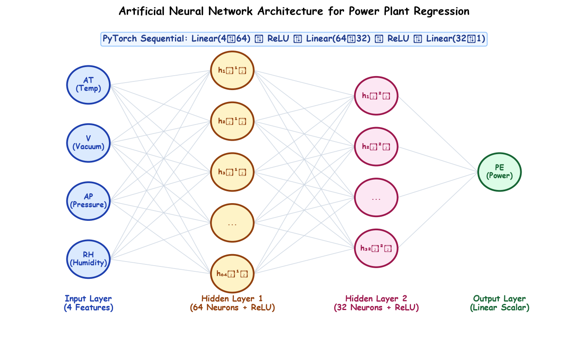

# Lecture 38: Deep Learning (Part-3) — ANN Regression & Multi-Class Classification in PyTorch

Welcome to **Lecture 38** of the Machine Learning & Deep Learning Curriculum. This comprehensive module marks the practical transition into applied Deep Learning using **PyTorch**, implementing two complete industrial end-to-end projects:
1. **Continuous Regression**: Predicting Combined Cycle Power Plant electrical energy output ($MW$) from sensor telemetry.
2. **Multi-Class Tabular Classification**: Classifying 7 date fruit cultivars from 34 morphological, geometric, and color features.

---

## 1. Master Curriculum & Submodule Directory

| Submodule | Focus Area | Key Concepts Covered | Hand-Drawn Educational Diagram |
|---|---|---|---|
| [**Notes_38.01**](Notes_38.01/README.md) | **ANN for Regression: Problem Formulation** | Power plant thermodynamics, continuous mapping, regression architecture ($4 \to 64 \to 32 \to 1$), parameter count derivation | `ann_regression_architecture.png` |
| [**Notes_38.02**](Notes_38.02/README.md) | **Data Loading & Preprocessing** | `powerplant_data.csv`, `StandardScaler`, `fit_transform` vs `transform`, avoiding data leakage, float32 conversion | `regression_preprocessing_pipeline.png` |
| [**Notes_38.03**](Notes_38.03/README.md) | **TensorDataset & DataLoader** | Tensor pairing, mini-batching ($B=32$), shuffling mechanics, memory efficiency, multi-worker streaming | `tensordataset_dataloader_pipeline.png` |
| [**Notes_38.04**](Notes_38.04/README.md) | **PyTorch Model Construction** | Subclassing `nn.Module`, `nn.Sequential`, `nn.Linear`, `nn.ReLU`, linear output projection, 2,433 parameter count | `pytorch_nn_module_anatomy.png` |
| [**Notes_38.05**](Notes_38.05/README.md) | **Training & Validation Loop** | Optimization pillars: `zero_grad()`, `forward()`, `MSELoss()`, `backward()`, `step()`, dual train/val tracking | `pytorch_training_validation_loop.png` |
| [**Notes_38.06**](Notes_38.06/README.md) | **Model Checkpointing & `state_dict`** | Overfitting mitigation, `model.state_dict()`, dictionary serialization, `best_val_loss` thresholding, weight reloading | `model_checkpointing_workflow.png` |
| [**Notes_38.07**](Notes_38.07/README.md) | **Regression Model Evaluation** | `model.eval()`, `torch.no_grad()`, MSE ($17.81$), RMSE ($4.22\text{ MW}$), $R^2$ Score ($0.937$), actual vs predicted frame | `regression_evaluation_metrics.png` |
| [**Notes_38.08**](Notes_38.08/README.md) | **ANN for Classification: Formulation** | Date fruit dataset (898 samples, 34 features, 7 classes), output layer sizing ($C=7$), powers of 2 architecture | `ann_classification_architecture.png` |
| [**Notes_38.09**](Notes_38.09/README.md) | **Multi-Class Preprocessing Pipeline** | `LabelEncoder` ($0 \dots 6$), feature scaling, `torch.long` target dtypes, `shuffle=True` necessity | `classification_preprocessing_pipeline.png` |
| [**Notes_38.10**](Notes_38.10/README.md) | **Classification Model & Evaluation** | Architecture ($34 \to 64 \to 64 \to 7$), why NO Softmax in model, `CrossEntropyLoss`, `torch.max` argmax, $93.8\%$ accuracy | `cross_entropy_accuracy_evaluation.png` |

---

## 2. Global Architecture Comparison

```
+----------------------------------------------------------------------------------------------------+
|                                    ANN ARCHITECTURE COMPARISON                                     |
+----------------------------------------------------+-----------------------------------------------+
| REGRESSION ANN (Power Plant)                       | MULTI-CLASS CLASSIFICATION ANN (Date Fruit)   |
+----------------------------------------------------+-----------------------------------------------+
| Target: Hourly Electrical Energy Output (PE)       | Target: 7 Date Fruit Varieties (0 to 6)       |
| Input Dimension: 4 Ambient Features                | Input Dimension: 34 Morphological Features    |
| Hidden Layers: [64 (ReLU), 32 (ReLU)]              | Hidden Layers: [64 (ReLU), 64 (ReLU)]         |
| Output Layer: 1 Neuron (Linear Identity)           | Output Layer: 7 Neurons (Unnormalized Logits) |
| Loss Function: Mean Squared Error (nn.MSELoss)     | Loss Function: Cross Entropy (nn.CrossEntropy)|
| Target Tensor Dtype: torch.float32                 | Target Tensor Dtype: torch.long               |
| Total Trainable Parameters: 2,433                  | Total Trainable Parameters: 6,855             |
| Evaluation Metric: R² Score (0.937), RMSE (4.22 MW)| Evaluation Metric: Accuracy (93.8%)           |
+----------------------------------------------------+-----------------------------------------------+
```

---

## 3. High-Yield Architectural Diagram

Below is the master diagram illustrating the end-to-end regression network architecture mapping 4 ambient sensor readings to continuous electrical energy output:



---

## 4. Practice Suite & Notebooks

- [**Practice Problems (English)**](Practice_Problems/README.md) | [**Practice Problems (Hinglish)**](Practice_Problems/README_HINGLISH.md)
- [**Full Step-by-Step Solutions (English)**](Practice_Problems/Solutions.md) | [**Full Step-by-Step Solutions (Hinglish)**](Practice_Problems/Solutions_HINGLISH.md)
- **Central Code Repository**: `lecture_38/Lecture_Code/` containing `ANN_Regression.ipynb`, `ANN_Classification.ipynb`, `powerplant_data.csv`, and `DateFruit_Dataset.csv`.
