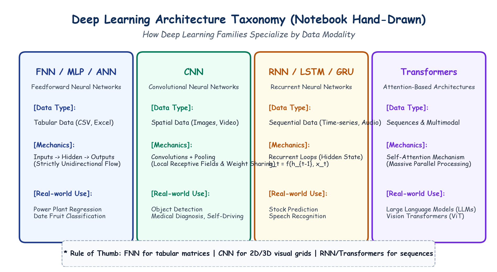

# Submodule 39.01: Deep Learning Architecture Taxonomy & The Feedforward Paradigm

## 1. Introduction: The Deep Learning Family of Architectures

Deep Learning is a specialized subfield of Machine Learning based on multi-layered artificial neural networks. While all neural networks utilize interconnected nodes (artificial neurons) that learn representations via gradient descent and backpropagation, **different data modalities require specialized architectural inductive biases**.

```
                           +---------------------------+
                           |   ARTIFICIAL INTELLIGENCE |
                           +-------------+-------------+
                                         |
                           +-------------v-------------+
                           |      MACHINE LEARNING     |
                           +-------------+-------------+
                                         |
                           +-------------v-------------+
                           |       DEEP LEARNING       |
                           +-------------+-------------+
                                         |
          +-------------------+----------+---------+--------------------+
          |                   |                    |                    |
+---------v--------+ +--------v-------+ +----------v---------+ +--------v--------+
| FNN / MLP / ANN  | |      CNN       | |     RNN / LSTM     | |   Transformers  |
| (Tabular / CSV)  | | (Images/Video) | | (Text / Audio Seq) | | (Self-Attention)|
+------------------+ +----------------+ +--------------------+ +-----------------+
```

---

## 2. Feedforward Neural Networks (FNN / MLP / ANN)

A **Feedforward Neural Network (FNN)**, also referred to as a **Multilayer Perceptron (MLP)** or standard **Artificial Neural Network (ANN)**, is the simplest and foundational deep learning architecture:

### Key Architectural Characteristics:
1. **Unidirectional Information Flow**: Information moves strictly forward through the network—from the input layer, through one or more hidden layers, to the output layer:
   $$\mathbf{x} \to \mathbf{h}_1 \to \mathbf{h}_2 \to \dots \to \mathbf{h}_L \to \mathbf{\hat{y}}$$
2. **No Recurrent Loops**: Neurons in layer $l$ receive connections only from layer $l-1$ and project only to layer $l+1$. There are no cycles, internal state feedback loops, or temporal memory.
3. **Clarifying Backpropagation in FNNs**:
   - A widespread student misconception is that backpropagation contradicts the "feedforward" definition.
   - **Forward Propagation** passes input data forward to compute predictions and loss.
   - **Backpropagation** merely passes mathematical error gradients ($\frac{\partial L}{\partial \mathbf{W}}$) backward using the chain rule to update learnable parameters. The underlying network data flow remains strictly feedforward.

### Primary Domain:
FNNs are optimized for **structured tabular data** (e.g. database rows, CSV files, Excel spreadsheets) where input features are scalar quantities without spatial or temporal adjacency.

---

## 3. Hand-Drawn Educational Diagram: Architecture Taxonomy

The following student-style notebook diagram illustrates how deep learning architectures specialize by data modality, showing their distinct wiring patterns.



---

## 4. Architectural Comparison Table

| Architecture Family | Primary Data Modality | Core Computational Mechanism | Primary Industry Applications |
|---|---|---|---|
| **FNN / MLP** | Tabular / Structured Data | Dense Matrix Multiplication ($\mathbf{W}\mathbf{x} + \mathbf{b}$) | Credit scoring, churn prediction, tabular regression |
| **CNN** | Spatial 2D/3D Grids (Images, Video) | Sliding Convolutions & Spatial Pooling | Object detection, facial recognition, autonomous driving |
| **RNN / LSTM / GRU**| Sequential / Temporal Data | Recurrent State Transition ($\mathbf{h}_t = f(\mathbf{h}_{t-1}, \mathbf{x}_t)$) | Time-series forecasting, speech recognition, ECG monitoring |
| **Transformers** | Sequences, Multimodal, Vision | Scaled Dot-Product Self-Attention | Large Language Models (LLMs), Vision Transformers (ViT) |

---

## 5. Limitations of Feedforward Networks

While highly effective on tabular data where each column represents an independent feature (e.g., age, salary, ambient temperature), FNNs become catastrophically inefficient when applied to high-dimensional grid structures like digital images. In the following submodules, we explore why this occurs and how **Convolutional Neural Networks (CNNs)** solve it.
