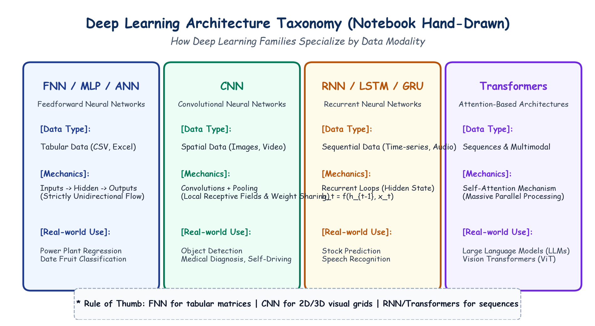

# Submodule 39.01: Deep Learning Architectures aur Feedforward Paradigm (Hinglish Guide)

## 1. Deep Learning Architectures Ka Introduction

Deep Learning, Machine Learning ka ek specialized subfield hai jisme multi-layered neural networks ka use hota hai. Saare neural networks gradient descent aur backpropagation se learn karte hain, lekin **alag-alag data formats ke liye alag-alag neural network architectures banaye gaye hain**:

```
                           +---------------------------+
                           |   ARTIFICIAL INTELLIGENCE |
                           +-------------+-------------+
                                         |
                           +-------------v-------------+
                           |      MACHINE LEARNING     |
                           +-------------+-------------+
                                         |
                           +-------------v-------------+
                           |       DEEP LEARNING       |
                           +-------------+-------------+
                                         |
          +-------------------+----------+---------+--------------------+
          |                   |                    |                    |
+---------v--------+ +--------v-------+ +----------v---------+ +--------v--------+
| FNN / MLP / ANN  | |      CNN       | |     RNN / LSTM     | |   Transformers  |
| (Tabular / CSV)  | | (Images/Video) | | (Text / Audio Seq) | | (Self-Attention)|
+------------------+ +----------------+ +--------------------+ +-----------------+
```

---

## 2. Feedforward Neural Network (FNN / MLP / ANN) Kya Hai?

**Feedforward Neural Network (FNN)**, jise hum **Multilayer Perceptron (MLP)** ya standard **ANN** bhi kehte hain, deep learning ka sabse basic aur foundational architecture hai:

### FNN Ke Mukhya Niyam:
1. **Ek Hi Direction Mein Information Ka Flow**: Data hamesha aage ki taraf move karta hai—input layer se hidden layers mein, aur hidden layers se output layer mein:
   $$\mathbf{x} \to \mathbf{h}_1 \to \mathbf{h}_2 \to \dots \to \mathbf{\hat{y}}$$
2. **Koi Feedback Loop Nahi**: Layer $l$ ke neurons sirf pichli layer se data lete hain aur agli layer ko bhejte hain. Isme koi backward connection ya memory nahi hoti.
3. **FNN Mein Backpropagation Ka Confusion**:
   - Beginners aksar sochte hain ki agar isme data sirf aage jata hai toh Backpropagation kaise hota hai?
   - **Forward Propagation** mein data aage jaakar prediction aur loss nikalta hai.
   - **Backpropagation** mein data peeche nahi aata, sirf mathematical error gradients ($\frac{\partial L}{\partial \mathbf{W}}$) aate hain taaki weights update ho sakein. Information flow hamesha feedforward hi rehta hai.

### FNN Kahan Use Hota Hai?
FNN tabular structured data (CSV files, Excel sheets) ke liye best hota hai jahan har column ek independent feature hota hai (jaise temperature, pressure, salary).

---

## 3. Hand-Drawn Educational Diagram: Deep Learning Architecture Taxonomy

Neeche diya gaya student-style handwritten diagram alag-alag data modalities ke liye deep learning architectures ke specialization ko depict karta hai:



---

## 4. Architectures Ka Comparison Table

| Architecture | Data Modality | Kaam Karne Ka Tareeqa | Industry Applications |
|---|---|---|---|
| **FNN / MLP** | Tabular / CSV Data | Dense Matrix Multiplication ($\mathbf{W}\mathbf{x} + \mathbf{b}$) | Churn prediction, Power plant regression |
| **CNN** | 2D/3D Images & Video | Sliding Convolutions + Max Pooling | Face unlock, Autonomous driving, Medical X-rays |
| **RNN / LSTM** | Time-Series & Audio | Recurrent Hidden State ($\mathbf{h}_t = f(\mathbf{h}_{t-1}, \mathbf{x}_t)$) | Stock prediction, Speech-to-text |
| **Transformers** | Sequences & Multimodal | Self-Attention Mechanism | LLMs (ChatGPT, Gemini), Vision Transformers |

---

## 5. FNN Ki Seemayein (Limitations)

FNNs tabular data ke liye shandar hain, lekin jab inko digital images par lagaya jata hai, toh yeh fail ho jate hain. Agle submodules mein hum dekhenge ki images par FNN kyun fail hota hai aur **CNNs** unhe kaise solve karte hain!
