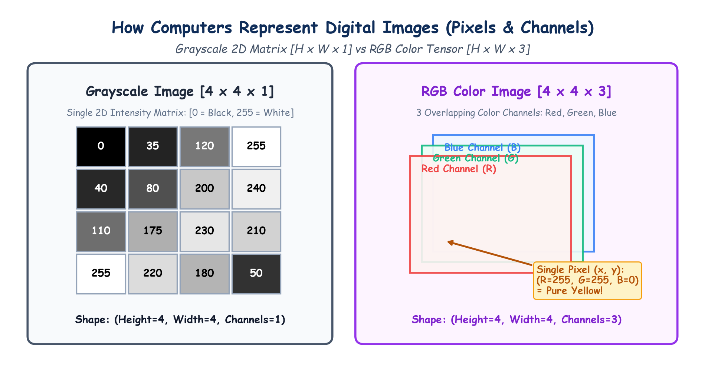

# Submodule 39.02: Computer Vision Foundations: Pixels, Grayscale Matrices & RGB Color Tensors

## 1. What is Computer Vision?

**Computer Vision (CV)** is the field of Artificial Intelligence and Deep Learning dedicated to enabling computational systems to interpret, process, and understand visual data (images and videos) in the same manner human biological vision does.

While a human perceives scenes in terms of entities, depth, color harmony, and semantic context, **a computer perceives every image purely as a structured matrix or tensor of numbers**.

---

## 2. Digital Image Representation: The Pixel Grid

A digital image is physically discretized into a 2D grid of microscopic squares called **pixels** (picture elements):
- For an image of resolution $H \times W$, there are $H$ rows and $W$ columns of pixels.
- Total pixel count $= H \times W$.
- Each pixel stores one or more numerical intensity values.

```
       Column 0    Column 1    Column 2  ...  Column W-1
Row 0  [ P(0,0)  |  P(0,1)   |  P(0,2)   ...   P(0,W-1) ]
Row 1  [ P(1,0)  |  P(1,1)   |  P(1,2)   ...   P(1,W-1) ]
...    [  ...    |   ...     |   ...     ...     ...    ]
Row H-1[ P(H-1,0)|  P(H-1,1) |  P(H-1,2) ...   P(H-1,W-1)]
```

---

## 3. Grayscale vs RGB Color Representations

### 1. Binary Black-and-White (1-bit)
- Values are strictly binary: $0$ (Black) or $1$ (White).
- Highly restrictive, unable to represent shading, textures, or gradients.

### 2. Grayscale Images (8-bit)
- Represented as a 2-dimensional matrix of shape **$(H, W, 1)$**.
- Each pixel intensity is an unsigned 8-bit integer ($uint8$) spanning $2^8 = 256$ discrete levels:
  $$\text{Pixel Value} \in [0, 255]$$
  - $\mathbf{0}$: Pure black (no light).
  - $\mathbf{128}$: Medium gray.
  - $\mathbf{255}$: Pure white (maximum luminous intensity).

### 3. RGB Color Images (24-bit TrueColor)
- Represented as a 3-dimensional tensor of shape **$(H, W, 3)$** or in PyTorch channel-first format **$(3, H, W)$**.
- An RGB image consists of three overlapping 2D matrices called **Color Channels**:
  1. **Red Channel (R)**: Intensity $\in [0, 255]$
  2. **Green Channel (G)**: Intensity $\in [0, 255]$
  3. **Blue Channel (B)**: Intensity $\in [0, 255]$
- Every color in the visible spectrum is produced by additive light synthesis:
  - Pure Red: $(255, 0, 0)$
  - Pure Green: $(0, 255, 0)$
  - Pure Blue: $(0, 0, 255)$
  - Yellow: $(255, 255, 0)$ (Red + Green)
  - Cyan: $(0, 255, 255)$ (Green + Blue)
  - Pure White: $(255, 255, 255)$
  - Pitch Black: $(0, 0, 0)$

---

## 4. Hand-Drawn Educational Diagram: Digital Image Matrix Representation

The following notebook-style diagram illustrates how pixel matrices represent grayscale intensities versus 3-channel RGB color tensors.



---

## 5. Pixel Normalization (Min-Max Scaling)

In raw image files, pixel values range from $0$ to $255$. Feeding integers up to $255$ directly into neural networks causes gradient explosion and unstable updates. 
Therefore, images are universally normalized into floating-point numbers in the range $[0.0, 1.0]$ via **Min-Max Scaling**:

$$x_{\text{norm}} = \frac{x}{255.0}$$

In PyTorch, this is automatically performed using `torchvision.transforms.ToTensor()`, which converts a PIL Image or NumPy array with range $[0, 255]$ into a FloatTensor with range $[0.0, 1.0]$.
