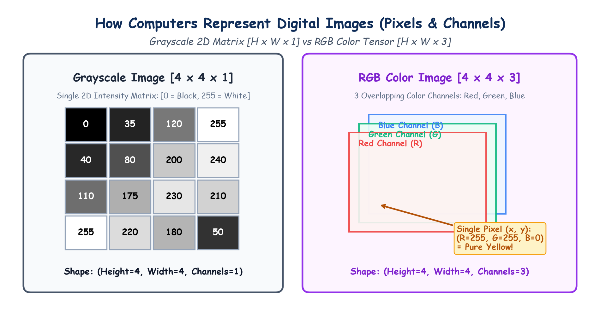

# Submodule 39.02: Computer Vision Foundations: Pixels, Grayscale aur RGB Tensors (Hinglish Guide)

## 1. Computer Vision Kya Hai?

**Computer Vision (CV)** Artificial Intelligence aur Deep Learning ki woh branch hai jisme hum computers ko visual data (photos aur videos) dekhne, samajhne aur interpret karne ki ability dete hain—bilkul jaise human eyes aur brain kaam karte hain.

Hum insaan jab kisi tasveer ko dekhte hain, toh hume ped, suraj, car, chehre aur rang dikhai dete hain. Lekin **computer ke liye koi tasveer sirf numbers ka ek 2D matrix ya 3D tensor hoti hai**.

---

## 2. Digital Image Ka Structure: Pixels Ka Grid

Har digital image chote-chote square blocks mein banti hoti hai jinhe **pixels** (picture elements) kaha jata hai:
- Agar kisi photo ka resolution $H \times W$ hai, toh usme $H$ rows aur $W$ columns hote hain.
- Total pixels $= H \times W$.
- Har pixel ke andar ek numeric value (intensity) store hoti hai.

---

## 3. Grayscale vs RGB Color Images Mein Farq

### 1. Grayscale Image (Black & White with Shading)
- Shape: **$(H, W, 1)$** (Single 2D Matrix).
- Har pixel ki value ek 8-bit integer hoti hai jo **$0$ se $255$** ke beech hoti hai:
  - $\mathbf{0}$: Pure Black (Kala)
  - $\mathbf{128}$: Medium Gray (Dhusar)
  - $\mathbf{255}$: Pure White (Safed)

### 2. RGB Color Image (Rangin Tasveer)
- Shape: **$(H, W, 3)$** ya PyTorch mein **$(3, H, W)$**.
- Color photo mein 3 alag-alag 2D layers hoti hain jinhe **Channels** bolte hain:
  1. **Red (R) Channel**: Range $[0, 255]$
  2. **Green (G) Channel**: Range $[0, 255]$
  3. **Blue (B) Channel**: Range $[0, 255]$
- In teen rangon ke combination se duniya ka har rang banta hai:
  - Pure Red: $(255, 0, 0)$
  - Pure Green: $(0, 255, 0)$
  - Pure Blue: $(0, 0, 255)$
  - Pila Rang (Yellow): $(255, 255, 0)$ (Red + Green)
  - Pure Safed (White): $(255, 255, 255)$
  - Pure Kala (Black): $(0, 0, 0)$

---

## 4. Hand-Drawn Educational Diagram: Image Matrix Representation

Neeche diya gaya student-style handwritten diagram grayscale matrix aur 3-channel RGB tensor ke internal structure ko visualize karta hai:

---

## 5. Pixel Normalization (0 se 1 Mein Scaling)

Raw photos mein pixels $0$ se $255$ tak hote hain. Agar in bade numbers ko seedhe neural network mein bhejenge, toh gradients explode ho jayenge aur training unstable ho jayegi.
Isiliye sabhi pixels ko $255.0$ se divide karke $[0.0, 1.0]$ floating range mein convert kiya jata hai:

$$x_{\text{norm}} = \frac{x}{255.0}$$

PyTorch mein `torchvision.transforms.ToTensor()` yeh normalization automatically perform karta hai.
