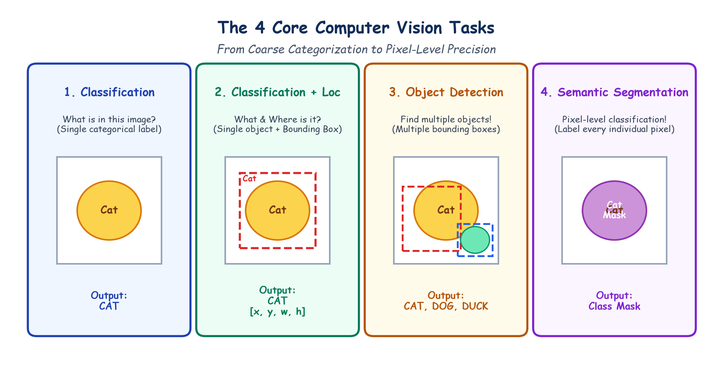

# Submodule 39.03: Core Computer Vision Tasks & Real-World Industrial Applications

## 1. The Spectrum of Computer Vision Tasks

Computer Vision problems range from coarse, whole-image semantic classification to ultra-fine pixel-level boundary segmentation. Understanding these tasks is essential to selecting proper neural network architectures.

```
Coarse (Image-Level) ----------------------------------> Fine (Pixel-Level)
[ Image Classification ] -> [ Classification + Loc ] -> [ Object Detection ] -> [ Semantic Segmentation ]
```

---

## 2. The 4 Fundamental Tasks Defined

### 1. Image Classification
- **Question**: *"What object is present in this image?"*
- **Output**: A single categorical label $y \in \{1, \dots, C\}$ (e.g. `'Cat'`).
- **Scope**: Assumes one dominant object occupies the scene. No spatial coordinates are predicted.

### 2. Classification + Localization
- **Question**: *"What is the object, and where is it located?"*
- **Output**: A class label + **1 Bounding Box** parameterized by 4 coordinates $(x, y, w, h)$:
  - $(x, y)$: Top-left corner coordinates.
  - $w, h$: Width and height of the bounding box.

### 3. Object Detection
- **Question**: *"Find all objects in the image, locate them, and classify each."*
- **Output**: Multiple bounding boxes and class labels for an arbitrary number of objects (e.g., `Cat at [x1, y1, w1, h1]`, `Dog at [x2, y2, w2, h2]`, `Duck at [x3, y3, w3, h3]`).
- **Standard Models**: YOLO, Faster R-CNN, SSD.

### 4. Semantic Segmentation
- **Question**: *"Which class does each individual pixel belong to?"*
- **Output**: A dense 2D class mask of shape $(H, W)$ where every single pixel $(i, j)$ is assigned a category label (e.g. Road pixel, Car pixel, Pedestrian pixel, Sky pixel).
- **Standard Models**: U-Net, DeepLabV3, Mask R-CNN.

---

## 3. Hand-Drawn Educational Diagram: Computer Vision Core Tasks

The following student-style diagram compares the 4 core tasks side-by-side using a clean, reproducible visual metaphor.



---

## 4. Real-World Industrial Applications of Computer Vision

1. **Facial Recognition & Biometric Unlock**:
   - Modern smartphones scan facial geometry, map landmarks against enrolled templates, and verify identity.
2. **Automated Traffic Enforcement & ALPR**:
   - Automated License Plate Recognition (ALPR) cameras detect moving vehicles, locate license plates, isolate alphanumeric characters, and issue automated e-challans.
3. **Autonomous Vehicles (Self-Driving Cars)**:
   - Systems in Tesla, Waymo, and Cruise process 360-degree video streams in real-time ($>30\text{ FPS}$) to detect lane boundaries, road hazards, pedestrians, cyclists, and traffic signals.
4. **Automated Retail & Checkout-Free Stores**:
   - Systems like Amazon Go track customers via overhead multi-camera fusion, detect which items are removed from shelves, and automatically bill customers.
5. **Medical Imaging & Diagnosis**:
   - Automated detection of lung nodules in chest X-rays, tumors in brain MRI scans, and diabetic retinopathy in retinal fundus photography.
6. **Augmented Reality & Social Filters**:
   - Real-time facial mesh tracking in Snapchat and Instagram applying dynamic 3D cosmetic filters.
